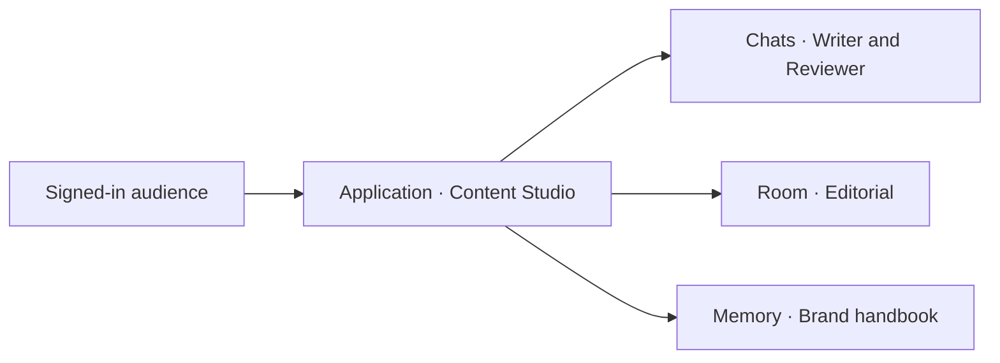

An **Application** is a workspace you publish for an audience. It brings together
multiple [Work Chats](/features/channels/#work-chat), Rooms and shared Memory under
one stable address and sign-in. Each Chat keeps its own Agent and conversations.

## Create and publish

Organization owners and administrators can author Applications. Open **Build → Applications**. Choose a display name and a permanent stable name,
such as `content-studio`. Add resources in the order people should see them:

- **Chats:** create a Work Chat from an Agent, or attach an existing Work Chat.
- **Rooms:** create or attach a Room for conversations between people and agents.
- **Memory:** create or attach organization Memory and choose read-only or write access.

Give each resource a navigation label and path. Save the configuration, choose the
audience, then publish. With the publication domain `work.example.com`, this example
opens at `https://content-studio.work.example.com`. The stable name stays reserved
even after archival.

Attaching an existing Room shares its history with the audience. Attaching Memory
shares its files. Chats and Rooms belong to one Application at a time; organization
Memory can be shared deliberately with several Applications.

## Choose the audience

**Anyone who signs in** admits identities accepted by the configured identity
provider. **Invited people** admits the verified email addresses you list.
**Organization users** admits current members of the owning Everruns organization.

External audiences have a separate runtime identity for each Application. That
identity is shared across its Chats and Rooms. Organization users reuse their
existing runtime account and connected services. None of these modes gives an
Application participant access to the Everruns management API.

The host uses the installation's OIDC provider, including `id.everruns.com` when
configured for Everruns ID. Credentials stay in the server-side browser broker.
See [Kubernetes publication setup](/sre/runbooks/applications/) for DNS, TLS, OIDC
registration, restricted database access and `everruns k8s up` flags.

## Work in an Application

The overview links to every published resource. Chats retain the Work Chat
conversation, file, thread and connection interfaces. Conversations remain private
to their participant. Rooms support shared messages, replies and mentions of
configured agent members. Add agent members and choose when they wake in the Application editor's Room members panel.

The Memory section browses shared files and edits text when writing is enabled.
Application agents see the same live files under
`/application/memory/<resource-name>`. Existing private user memory stays private.

Enable **Show in the Everruns sidebar** to add a launcher for organization members.
The launcher opens the published host and uses the same audience admission rules.

## Change access

Saving audience or resource changes applies to subsequent requests. Unpublishing
stops access without deleting conversations, Room history or Memory. Archiving also
retains the stable name. Enable **Show archived** in the list and choose **Restore**
to reopen an archived Application as an unpublished draft. Already admitted work and information a participant has
read cannot be undone by revoking access.

Configuration revisions can be restored through the platform's revision history.
Restoring selected fields keeps the other current settings, including audience and
resource access. Restore refuses stale edits and unavailable resources; it keeps
the permanent name and current publication state.

Automations have a reserved configuration boundary for the future runtime. Themes
and automation execution are not enabled in this release.

Removing a Chat from an Application restores that Chat's own audience policy. Chats
created inside Applications start with an organization-only standalone audience;
change it in the Agent's Work Chat settings if you want to publish it separately.
