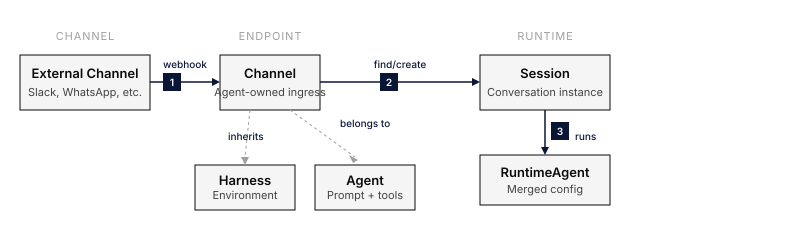

A **channel** is an Agent-owned way for an external caller to reach that Agent and get a reply. Each channel belongs to exactly one Agent and has its own transport configuration, authentication, session routing, and publish state. One Agent can have several channels, and publishing or unpublishing one does not change the others.

Use a channel when an external peer sends a request and waits for a reply. Use an [Agent trigger](/features/agent-triggers/) when a schedule or event starts Agent work without a reply channel.




## Channel types

| Type | `channel_type` | Who calls it | Canonical route | Guide |
|---|---|---|---|---|
| Slack | `slack` | Slack users, through a Slack app | `/v1/channels/{channel_id}/slack/events` | [Slack](/integrations/slack/) |
| AG-UI | `ag_ui` | Browser and app clients that speak the AG-UI protocol | `/v1/channels/{channel_id}/ag-ui` | [AG-UI](#ag-ui) |
| A2A | `a2a` | Other agents, over the A2A protocol | `/v1/channels/{channel_id}/a2a` | [A2A](/features/a2a/) |
| FCP | `fcp` | Any HTTP client, text in and text out | `/v1/channels/{channel_id}/fcp` | [FCP](#fcp) |
| Work Chat | `work_chat` | Signed-in consumers using a dedicated work interface | `/v1/channels/{channel_id}` | [Work Chat](#work-chat) |
| Public Chat | `public_chat` | Visitors to a hosted chat website for one Agent | `/v1/channels/{channel_id}/public-chat` | [Public Chat](#public-chat) |
| Voice | `voice` | People talking from a browser or app, over WebRTC | `/v1/agents/{agent_id}/channels/{channel_id}/voice/calls` | [Voice](/features/voice/) |
| Agent API | `api` | Your own code, with an agent key | `/v1/channels/{channel_id}` | [Agent API](/features/agent-api/) |
| Poppy | `poppy` | People's own agents, over the Personal Agent Protocol | `/v1/channels/{channel_id}/poppy` | [Poppy](/features/poppy/) |

Routes are relative to the API base, for example `https://your-everruns-host/api`. The channel ID in each route is the channel's own ID, not the Agent's.

## Download received files

Files received through Slack, AG-UI and A2A remain available to the Agent in
its session. Opening a stored file's `/v1/files/{file_id}` URL downloads its
bytes instead of rendering it on the application's origin. This endpoint uses
`Content-Disposition: attachment`, `Content-Type: application/octet-stream`
and `X-Content-Type-Options: nosniff` for every stored file, including PDFs and
zip archives. File listings retain the original media type. Downloads require
authentication and membership in the file's organization.

## Create a channel

1. Open the Agent and select the **Integrations** tab.
2. Select **Add channel** and choose the channel type.
3. Configure the type-specific fields and select **Save channel**.
4. Select **Publish** to make the channel live.

The same operations are available over the API under `/v1/agents/{agent_id}/channels`, with `publish` and `unpublish` actions per channel. Every channel runs the Agent's current configuration.

## Channel lifecycle

Each channel has its own lifecycle:

```text
Draft ⇄ Live
Draft → Disabled
Live → Disabled
Disabled → Draft
```

- **Draft**: Configured but does not accept ingress traffic.
- **Live**: Published and able to accept traffic while its Agent is active and exposures are not suspended.
- **Disabled**: Kept for configuration but rejects ingress traffic and does not invoke the Agent.

Publishing and unpublishing require the dangerous Agent permission (Owner by default). The same permission is required to change a live channel's configuration, including its authentication and secrets, or to disable it. Members who can manage Agents can still edit Draft and Disabled channels.

A channel serves traffic only when all three hold: the channel is live, the Agent is active, and the Agent's exposures are not suspended. Suspending exposures from the Agent's **Integrations** tab takes every channel of that Agent offline at once without changing each channel's state.

Errors from public channels are sanitized so they do not expose internal state, such as whether a channel exists or why it is offline.

## Files people send

Files sent to a channel reach the Agent the same way on every channel. Each one is stored with the message and copied into the session's `/attachments` folder, where the Agent can open it again later in the conversation, including after compaction.

| Channel | What is taken |
|---|---|
| Slack | Files shared in the message, downloaded with the app's bot token. Files linked from external services are described by name. |
| AG-UI | Image, audio, video and document parts of the user message, inline or by URL. |
| Public Chat | The same parts, inline only: at most 3 files of up to 10 MB, since visitors are not signed in. |
| A2A | File parts, as bytes or a URI. PACT endpoints take text only, as the PACT protocol requires. |
| Agent API | The `files` list of a message, as base64 `data` or a `url` ([Call your agent from code](/how-to/call-your-agent-from-code/#send-files)). A [serve](/framework/serve/) app takes the same list. |

Files sent by URL are downloaded only from public `https` addresses. A message keeps at most 10 files of up to 25 MB each, and the file's contents decide its type, whatever the sender declared. A file that cannot be taken, for example because it is too large or its download failed, becomes a note in the message, such as `[Attachment report.pdf not received: 31 MB is over the 25 MB limit]`, so the Agent knows it was sent.

## AG-UI

An AG-UI channel lets a client that speaks the [AG-UI protocol](https://docs.ag-ui.com/) run the Agent and stream its events. The channel accepts AG-UI `RunAgentInput` and streams AG-UI 1.0 events over SSE. Public Chat uses the same protocol.

### Upgrade a pre-1.0 client

Use a 1.0-compatible AG-UI client for existing channels as well as new ones. The reasoning event names changed:

| Pre-1.0 event | AG-UI 1.0 event |
|---|---|
| `THINKING_START` | `REASONING_START` |
| `THINKING_TEXT_MESSAGE_START` | `REASONING_MESSAGE_START` |
| `THINKING_TEXT_MESSAGE_CONTENT` | `REASONING_MESSAGE_CONTENT` |
| `THINKING_TEXT_MESSAGE_END` | `REASONING_MESSAGE_END` |
| `THINKING_END` | `REASONING_END` |

Custom handlers must recognize the new names to render reasoning. This is a breaking wire change for clients that require `THINKING_*`; the channel does not translate events back to that vocabulary. Text messages still use `TEXT_MESSAGE_*`.

With npm `@ag-ui/core` 1.0, import validation schemas from `@ag-ui/core/schemas`:

```ts
import { EventSchemas, RunAgentInputSchema } from "@ag-ui/core/schemas";
```

Send `protocolVersion: "1.0"` in the run request to receive the version in `RUN_STARTED`. Omitting it suppresses that response field; it does not select the old protocol. Open text and reasoning messages and reasoning spans close before a terminal event. Cancelled runs finish with `outcome: { type: "cancelled" }`.

Subagent events and their activity snapshots are available when the channel enables `subagents_visible`. This setting defaults to off and stays off for Public Chat.

The agent's todo list is available as AG-UI shared state when the channel enables `state_visible`, which defaults to off and stays off for Public Chat. The state is `{ "todos": [{ "content", "activeForm", "status" }] }`: a run sends `STATE_SNAPSHOT` the first time it knows the list (at run start when the conversation already has one) and `STATE_DELTA` JSON Patches for later changes. State the client sends in the run request is not read.

### Visibility and access

AG-UI channels are public client surfaces, so they expose less than the Agent's own event stream:

- `tool_visibility` controls tool activity: `none`, `generic` (a fixed text you configure in `generic_tool_text`), or `narrated`. Raw tool names, arguments, and results are never sent.
- Reasoning summaries, token usage, subagent activity, the todo list as shared state, and client answers to tool-approval interrupts are off by default, each behind its own setting.
- Access is anonymous by default. Set a shared `token` or an `auth` block to require authentication, and `rate_limit_per_minute` to cap requests per IP.
- A thread stays resumable for `session_expiration_seconds` (6 hours by default); after that, the same thread ID starts a new session.

To serve AG-UI from a Rust application without the Platform, see [AG-UI in the Framework](/framework/ag-ui/).

## FCP

An FCP channel implements the [Free Communication Protocol](https://github.com/everruns/fcp/blob/main/SPEC.md), a minimal text-in, text-out HTTP interface:

- `GET` returns a Markdown handshake that describes what the channel can do and how to authenticate.
- `POST` takes plain text, or `{"message": "..."}`, runs one turn, and returns the Agent's final reply as Markdown. There is no streaming.

Every response, including errors, is `text/markdown` with instructions that point back to the handshake. Access is anonymous by default; set `anonymous` to `false` and a `token` to require a shared bearer token. FCP has its own rate limit and does not accept the `auth` block that AG-UI and A2A use. `response_timeout_seconds` (120 by default) bounds how long a `POST` waits for the reply.

## Public Chat

A Public Chat channel serves an isolated, hosted chat website for one Agent. Visitors see only that Agent: there is no console navigation, organization switcher, or access to other agents, channels, or sessions.

- Visitors can be anonymous, or sign in through the channel's auth configuration, such as Google sign-in. Anonymous visitors can be required to pass a Cloudflare Turnstile challenge before a session starts.
- The chat streams AG-UI events, and raw tool names, arguments, results, and internal IDs never reach the browser.
- The deployment-level `public_chat` feature flag (`FEATURE_PUBLIC_CHAT`) controls whether Public Chat routes are mounted and whether the type appears under **Add channel**.

The website reads its public configuration from `/v1/channels/{channel_id}/public-chat/config`. That response never includes channel secrets.

### Sign in with AgentID

[AgentID](https://www.agentid.com) is a sign-in for AI agents. To let agents sign in to a Public Chat channel:

1. Register an AgentID client with the redirect URI `{API base URL}/v1/agentid/callback`, then set `AGENTID_CLIENT_ID` and `AGENTID_CLIENT_SECRET` on the server. One client serves every channel in the deployment.
2. Set the channel's sign-in to **AgentID** and enter the client ID. The chat page then shows **Continue with AgentID**.

Each agent becomes its own end user in the organization, keyed by its AgentID subject; it never becomes a console user. By default one agent owner can sign in 5 agents per organization; change that with `agentid_agents_per_owner` on the organization. A sign-in lasts 15 minutes, after which the agent signs in again.

To list the agent in the AgentID directory, use `{API base URL}/v1/agentid/initiate-login` as the sign-in URL and set `AGENTID_DEFAULT_CHANNEL` to the channel it should open. Without a default channel that URL creates nothing, because it does not say which chat the agent wants. `AGENTID_OWNER_SCOPES=true` also requests the owner's name and email; leave it off unless you need to contact owners.

## Agent API

An Agent API channel gives one Agent a base URL, `/v1/channels/{channel_id}`, that your own code calls with an **agent key** (`evr_ak_…`). A key reaches only this Agent's session routes, never the management API. Callers start sessions, send messages, follow events over SSE, answer questions, approve tool calls and cancel turns, and each caller sees only its own sessions. Channel settings add end users, your own identity provider, browser origins, safe retries and a daily spending limit per caller.

Add an **Agent API** channel on the Agent's **Integrations** tab, publish it, and create a key in its **Agent keys** card. See [Agent API](/features/agent-api/) for keys, every route, authentication, settings, streaming and errors, and [Call your agent from code](/how-to/call-your-agent-from-code/) for a walkthrough. A [serve](/framework/serve/) app serves the same routes at `/v1/channels/{agent}`.

## Other transports

The same channel model also carries transports that do not need a reply channel:

- `webhook` runs the Agent when an authenticated HTTP call reaches `/v1/channels/{channel_id}/webhook`, and is available under **Add channel**. A sender that retries can set an `Idempotency-Key` header: a repeat of a key the channel accepted in the last day answers `"delivery": "duplicate"` and starts nothing.
- `schedule` runs the Agent on a cron schedule. Create schedules as [Agent triggers](/features/agent-triggers/), which also cover webhook, GitHub, and MCP event starts.

## Existing integrations

Channels replace the former **Agent Endpoint** name. Existing channel IDs and configuration stay the same. CLI commands now use `everruns agents channels`; the management API uses `/v1/agents/{agent_id}/channels`. The former `/v1/agents/{agent_id}/endpoints` routes remain aliases, and console bookmarks under `/agents/{agent_id}/endpoints` redirect to the channel pages.

## Retired Apps

Apps are retired from Everruns management. Everruns keeps existing App records for historical attribution and compatibility, and existing installs continue to serve traffic, but the App list, detail page, create flow, and management API are retired.

The old `/v1/e/{channel_id}/…` and `/v1/apps/{app_id}/…` ingress paths remain permanent aliases. They resolve to the migrated channel and continue to work. Do not rewrite a working existing installation only to change its URL. New integrations use the channel-scoped canonical routes above.

## See also

- [Publish an Agent to Slack](/how-to/publish-to-slack/): a step-by-step Slack setup.
- [A2A](/features/a2a/): inbound A2A channels and outbound delegation.
- [Voice](/features/voice/): talk to an Agent and hear its answers.
- [Agent API](/features/agent-api/): call one Agent from your own code with an agent key.
- [Poppy](/features/poppy/): answer people's personal agents as a company.
- [Agent Triggers](/features/agent-triggers/): proactive scheduled and event-driven work.
- [Change History](/features/change-history/): see and restore earlier Agent configurations.

## Work Chat

Publish **Work Chat** to give an Agent a dedicated browser experience with its
own consumer sign-in. Each channel has a stable, unique hostname on the hosted
content domain configured by your deployment. Several Work Chat channels can
point to the same Agent.

Choose **Multiple conversations** for a conversation list, or **Single chat
with threads** for one permanent main conversation per consumer and related
work threads. Single mode requires coordinator thread tools on the effective
Agent, including inherited harness capabilities. Publication and later
configuration updates reject an incompatible combination. A worker-only
coordination capability does not qualify.

```json
{
  "channel_type": "work_chat",
  "channel_config": {
    "interface_mode": "multi_chat",
    "execution": {
      "visibility": "full",
      "errors": "public"
    }
  }
}
```

Consumers are separate from console members. Configure channel identity methods
and optional organization-member access through the existing
[Agent API authentication](/features/agent-api/) settings. The browser host uses
its deployment's OIDC provider and host-only sessions. It shows streamed replies,
work activity, threads, questions and permitted approvals. Workspace tools enable
file browsing and editing; read-only files remain protected. Provider reasoning,
debug records and private runtime mounts are excluded.

Existing budgets, approval policies and session ownership continue to apply.
Changing a channel's configuration changes the same URL. The channel introduces
no separate history or retention policy.

Self-hosters deploy the optional standalone browser app separately from the
console. Follow its [deployment instructions](https://github.com/everruns/everruns/tree/main/apps/chat-ui)
for the content domain, TLS, OIDC broker and least-privilege credential storage.
Publishing a channel alone does not provision hosting or DNS.
