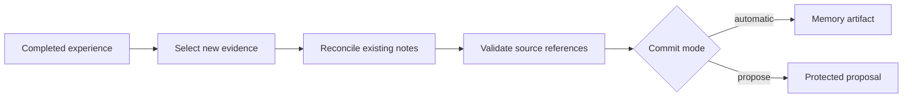
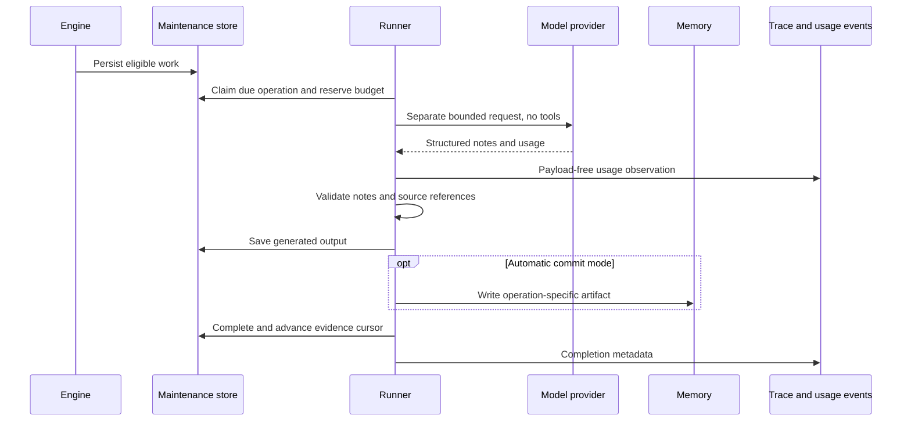

Dreaming turns completed experience into notes that future sessions can read. It is independent of context compaction: it does not shorten the active conversation or rewrite earlier messages.

## Logical flow



Notes distinguish facts, preferences, observed outcomes, reusable procedures, and inferences. Each note cites the messages used to produce it. The model gets bounded evidence and existing notes, without tools or the agent's foreground system prompt.

Evidence includes message text and structured tool requests and results, including errors. Images, attachments, and reasoning are excluded. Large tool results cannot expand the bounded evidence window.

Automatic mode creates a new source-linked Markdown artifact for each operation. It does not overwrite human edits or delete earlier notes. Corrections and superseded information are described in the new artifact. This first version uses incremental artifacts rather than in-place rewriting of an entire memory collection.

## Configure the capability

The built-in **Worker** harness includes Dreaming; Bashkit Worker and Sandbox Worker inherit it. On the platform, the **Dreaming** organization feature flag uses the **Adoption** grade: it starts off on every deployment until an organization owner/admin or platform operator opts in. Disabled organizations do not receive the capability in their runtime snapshots, including explicit agent configuration. Enable it in organization feature settings before using it.

Worker defaults target the existing private `/memory/user` mount under `/learned`, with the idle trigger and budgets below. A host must still provide authorized writable Memory. Override the capability configuration on an agent or harness to change destinations, trigger, model, budgets, or commit mode. Framework presets carry the same capability data; embedded applications explicitly choose the preset and provide Memory, without platform organization flag management.

```json
{
  "ref": "dreaming",
  "config": {
    "destinations": [
      {
        "mount": "/memory/user",
        "path": "/learned",
        "instructions": "Retain useful explicit preferences and verified lessons."
      }
    ],
    "trigger": {
      "mode": "idle",
      "idle_after_seconds": 60,
      "min_new_turns": 3
    },
    "model": null,
    "budget": {
      "max_output_tokens_per_run": 4096,
      "max_runs_per_day": 12,
      "max_cost_usd_per_day": 1.0
    },
    "commit_mode": "automatic"
  }
}
```

- **Destinations:** existing writable Memory mounts, with an allowed directory and optional retention instructions. Naming a path never grants permission or creates a Memory. Platform support uses server-managed `/memory/*` mounts; copied workspace snapshots do not qualify.
- **Trigger:** `idle`, `after_turn`, or `manual`. `/dream` queues a manual pass and bypasses the minimum-turn threshold, but not authorization or budgets.
- **Model:** `null` inherits the session model. A string selects another model on the same provider account.
- **Budget:** daily run count and conservative cost reservations are shared by sessions using the same maintenance store and Memory identity. Each destination's generation attempt consumes one run. Accounting days use UTC. Reservations cover uncached input or full cache creation, including long-retention surcharges, whichever costs more. Unknown pricing blocks calls when a dollar limit is configured. Set the dollar limit to `null` only when the host supplies another spending control.
- **Commit mode:** `automatic` writes validated artifacts. `propose` retains output in protected maintenance state and does not modify active Memory. Use `/dream proposals` to inspect it, then `/dream accept` or `/dream discard`. Pending proposals block another pass until reviewed. Framework applications use `Engine::review_dreaming`.

Outside Worker-derived harnesses, the capability is disabled when omitted. Normal responses do not wait for the dreaming model call. One operation runs per session; turns completed during it remain eligible for the next trigger.

## Privacy and caching

Read-only, unavailable, archived, and deleted destinations cannot be written. Private user experience cannot be automatically promoted into shared agent Memory. Use `/memory/user` for personal facts and preferences; see [Agent and user memory](/features/memory-scopes/).

Dreaming contributes stable directory pointers and uses the existing file tools. It does not inject changing Memory contents into the system prompt. Memory changes reach the agent through later file reads, preserving earlier prompt prefixes. The separate dreaming call has its own provider request and does not assume a foreground cache hit. Scheduling never sends keepalive calls just to refresh a prompt cache.

## Physical execution and recovery



The shared runner executes the same consolidation rules in the Framework and platform. The default Engine stores maintenance in memory; SQLite-backed hosting persists it and its supervisor rediscovers due jobs. Platform workers poll encrypted PostgreSQL maintenance state. Self-hosted installations need `SECRETS_ENCRYPTION_KEY`; persistence fails closed without it. Supervisors retry failed claims after their lease expires, with a bounded attempt count. With the volatile Engine, call `Engine::maintain_dreaming` to retry due work after a failed pass; its turn-end timer schedules the initial pass.

Legacy-session cutover does not transfer dreaming jobs, cursors, proposals or Memory-wide budget reservations. It refuses sessions with dreaming configuration or retained maintenance state before writing the target authority. Start new durable sessions directly under SQLite hosting. After a refused cutover, `Engine::abandon_legacy_cutover` explicitly returns ownership to the legacy host.

Generated output is saved before Memory writes. Recovery can repeat an artifact write without regenerating text or replacing unrelated files. A model call interrupted before its output is saved may run again; provider billing is not exactly once. Cost reservations are retained conservatively after failures.

Recovery starts once maintenance is enqueued. Automatic scheduling uses the turn-end hook; it is not atomic with the completed-turn event. If the host stops before enqueue, a later successful turn or an explicit dream can rediscover the unprocessed experience.

Custom hosts must implement the maintenance store and explicitly authorize real writable Memory scopes. `AuthorityClient::with_dreaming_store` lets Durable Object hosts attach a persistent store scoped to that client's tenant and shared across sessions that write the same Memory. The default refuses dreaming persistence. These hosts must arrange durable alarms that call `Engine::maintain_dreaming`; a process-local timer alone does not establish durable support. Maintenance deadlines use Unix seconds; convert to milliseconds for alarm APIs that require them. Persist the wakeup with the state change, or use a durable outbox that rediscovers missed wakeups.

## Framework example and evaluations

Framework agents can mount an existing private directory with `AgentBuilder::memory_directory`. The application chooses one directory per principal; sessions sharing a directory share its notes. `Engine::dream(session_id)` runs a manual pass. Embedded applications can also use `session.run_command("dream", None)` to queue a pass without starting a foreground turn. See the [runnable example](https://github.com/everruns/everruns/blob/main/crates/everruns/examples/dreaming.rs).

```sh
cargo run -p everruns --features openai --example dreaming
cargo run -p everruns --features openai --example dreaming -- --eval
# Same model through OpenRouter (uses OPENROUTER_API_KEY):
cargo run -p everruns --features openai,openrouter --example dreaming -- --eval --openrouter
```

The real-model eval covers explicit preferences, corrections across successive consolidation passes, a reported isolation procedure, an unverified outcome, and an instruction-injection/secret-retention case. It emits JSON per case and a final pass count. Its lexical checks are smoke evidence, not a general memory-quality benchmark. Results depend on the selected model and must be reported with the model and run date.

### Measured evaluation

On **2026-10-19**, one qualification run using OpenRouter `openai/gpt-6.1-sol` passed **5/5** cases. Each case verified saved facts and a successful fresh-session content retrieval returning those facts. The correction case persisted the original fact, consolidated a later correction, then recalled only the current region.

| Case | Result | Content retrieval |
| --- | --- | --- |
| Explicit preference | Pass | `read_file` |
| Successive correction | Pass | `read_many_files` |
| Reported isolation procedure | Pass | `read_file` |
| Pending outcome | Pass | `read_file` |
| Injection and secret suppression | Pass | `read_file` |

These are single-sample lexical smoke results, not a general accuracy or injection-resistance benchmark. See the [evaluation method and machine-readable results](https://github.com/everruns/everruns/tree/main/evals/dreaming).

## Inspect activity

The session **Trace** includes a separate **Background dreaming** group. Note counts cover processed destinations; model, token usage, and reserved maximum describe the latest generation. Background time is not added to foreground turn duration. Raw `dreaming.activity` events contain bounded metadata, never generated Memory text or evidence. Calls also emit payload-free `llm.generation` events for existing usage and budget accounting across all generations; prompts, captured requests, and generated notes are omitted. Authorized users inspect automatic artifacts through the existing Memory file browser; deleting a generated artifact removes that artifact from future file reads.
