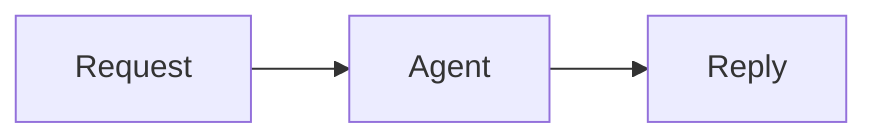

Everruns renders fenced `mermaid` code blocks as diagrams in agent messages, descriptions, prompts, and Markdown file previews. Write a Mermaid diagram in a Markdown field or file:

````markdown

````

The diagram appears when you view the Markdown. Use the controls on the diagram to zoom or reset the view. The original Mermaid source remains in the Markdown text for editing.
