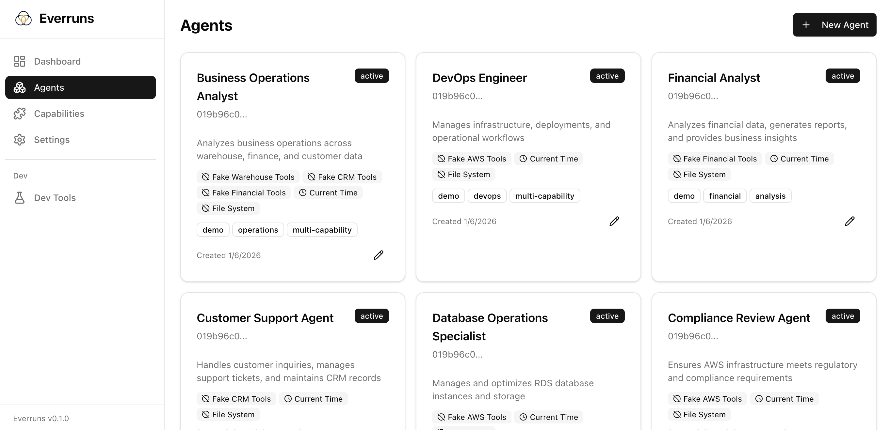

While Everruns is a headless agent platform designed for API-first integration, it provides an optional management UI for administrative tasks and session monitoring.

## Overview

The management UI is a Next.js application that provides:

- Agent management (create, edit, delete)
- Session monitoring and chat interface
- Capabilities browser
- Settings management (LLM providers, personal access tokens, team members)
- Dashboard with system statistics

Access the UI at `http://localhost:9300` when running locally.

## Navigation

The sidebar provides access to main sections:

| Section | Description |
|---------|-------------|
| Dashboard | Overview statistics and quick actions |
| Agents | List, create, and manage agents |
| Virtual users | Manage end-user and service runtime accounts |
| Capabilities | Browse available capabilities |
| Settings | Configure providers, personal access tokens, and team members |

## Chat and Threads

**Chat** opens your permanent conversation with the Platform Chat for managing
Everruns. Agent testing lives in Playground.

Organization owners and admins can opt into **Chat threads** in **Settings → Features**.
It is an adoption feature, disabled by default. With it enabled, the sidebar contains
only Chat, and a **Threads** button opens conversations and ongoing work beside the
permanent conversation. Create a **New thread**, search existing conversations, or open
work from a **View thread** card. The panel can expand and becomes a full-screen drawer
on mobile.

Idle conversations remain **Open**. **Resolve thread** puts one away without losing its
history; **Reopen thread** lets you continue. Background work shows its actual progress,
input requests, and failures. When a thread reports back, the conversation shows one
folded line, such as "Releases is done". Open the line to read the report. The
coordinator still receives the full text and answers in the conversation. Disabling the
feature restores the existing Chat interface and preserves conversations and their URLs.

## Dashboard

The dashboard provides an at-a-glance view of your system:

- **Stats Cards**: Total agents, active sessions, and other metrics
- **Recent Agents**: Quick access to recently created or updated agents
- **Quick Actions**: Shortcuts to create agents or browse the agent list

## Agents

### Agent List

The agents page displays all agents in a card grid layout.



Each card shows:

- Agent name and status badge (active/inactive)
- Truncated ID
- Description preview
- Enabled capabilities with icons
- Tags
- Creation date
- Edit button

Click a card to view the agent details, or click the edit icon to modify the agent.

### Agent Page

The agent page reads and edits an agent in one layout. The system prompt fills the wide left pane;
a narrow column on the right holds the settings:

- **Harness**, **Capabilities** (compact chips, in precedence order), **Default model**, and **Tags**
- **Updated**, read-only
- **More**: one row each for Branding, MCP servers, Credentials, Service account, Network
  access, Sandbox, Token usage, and Health check. **Files** is included when the agent
  has a filesystem (from its capabilities, a dependency, or the harness) or already has starter
  files. Each row shows its current value and opens a side sheet. Service account saves
  immediately.

Tabs: **Agent**, **Preview**, **Integrations** (channels and triggers), **Stats**, and
**Sessions**. Preview's Files card follows the same filesystem rule.

#### Estimate agent cost

Open **Agents**, select an agent, then click **Estimate cost** in the page header.
The button is available from every tab, including while editing.

**Smart estimate** suggests three typical tasks from the agent’s instructions and tools.
Optionally describe a workload, then choose **Update estimate** to regenerate the suggestions.
Adjust each task’s relative frequency, or set it to zero to exclude it.

Plan **By tasks** with tasks per day, or **By users** with active users and tasks per user per day.
Sliders and exact number inputs update average task, daily and monthly costs immediately, without
another AI call. The chart shows monthly spend as usage grows, with lighter and heavier task
scenarios. A month means 30 days of use.

Suggestions are editable assumptions, not measured behavior. **Advanced assumptions** lets you
adjust each task’s model calls and token counts. Current catalog prices determine the money;
the utility model does not invent prices. Missing prices and oversized tasks are shown explicitly.

Smart estimates require the deployment’s utility LLM service. The **Manual calculator** remains
available if smart estimates are unavailable. Neither mode executes tasks or saves the agent.
The **Manual calculator** covers AI tokens only. Smart estimates can include additional costs below.
These are planning estimates, not quotes or spending limits. Compare representative Playground
runs before budgeting.

In **Smart estimate**, use **Other operating costs** to include sandbox runtime, paid tools,
media generation, subagent work, and monthly hosting or platform fees. Enter resource usage
per average task and the provider's unit price. For a sandbox, use the complete instance price,
including memory, and include idle time. For subagents, enter the estimated cost of one child
task. These resource inputs are your assumptions; the AI task suggestions do not infer them.
An unknown price is shown as **price needed**, not as free usage. Monthly fees are added once,
including at zero task volume; the daily projection allocates one thirtieth of those fees.

Where a host supplies prepaid service rates, the dashboard separates credit spend from external
provider bills. Model prices come from the selected model catalog, and managed service rates
come from the host. Adding a resource to a plan does not change its billing arrangement.

**Advanced assumptions** also accepts an extra model-spend allowance for retries, cached-input
reads, and cache writes. Cache shares cannot exceed 100% combined. The retry allowance covers
model spend only: add repeated tool work and sandbox time to resource quantities. Cache prices
follow the model catalog, including context tiers. The chart varies model workload while keeping
resource assumptions fixed. Only resources you include contribute to the estimate.

#### Avatar

**Branding** starts with the agent's avatar. Drop a PNG, JPEG, GIF, or WebP image (at most 10 MB)
on the avatar, or choose one, then position and zoom the square crop. **Save avatar** uploads it
right away, without **Save changes**. The server renders the square once as square and circular
PNG presets of 32, 64, 128, 256, and 512 px.
Use **Choose preset** to browse 25 image-only avatar tiles across Watchers, Familiars, Totems,
Glyphs, and Bloom.
Search by name, role, animal, color, or style, and optionally filter by family. Select a card to
preview its circular shape, then **Use avatar** to save immediately. Names and roles describe the
artwork; they do not configure the agent. You can replace any preset with an uploaded image or
remove it.

The avatar shows on agent cards and the agent page, in the A2A Agent Card (`iconUrl`), on the MCP
agent card, and as the icon of Slack apps created with one-click setup.

Through the API, `PUT /v1/agents/{agent_id}/avatar` takes the image as the multipart field
`file`, and `DELETE` removes it. The agent's `avatar` field lists the URLs. Preset URLs look like
`/v1/avatars/{avatar_id}/circle-64.png`; they are public and cached as immutable, and a new upload
gets a new `avatar_id`. `GET /v1/avatar-presets` lists the curated catalog;
`PUT /v1/agents/{agent_id}/avatar/preset` selects one with `{"preset_id": "familiars-patch"}`.
`GET` on that selection endpoint reports the current preset ID, or `null` for a custom image
or no avatar. Preset selection uses the same agent-management permission as upload.

Header actions:
- **Edit**: switch the page into edit mode. The prompt becomes an editor and the settings take
  input; **Save changes** sends everything at once and **Discard** drops the draft. Changes apply
  to new sessions only.
- **More actions**: Sync from GitHub, Copy, Export, History, Manager notes, and Archive (or Delete, for an archived agent)
- **Test in Playground**: open Playground setup with this Agent selected and normal execution
  selected. It does not start a session until you confirm setup. Use the existing **Dry run**
  checkbox there to simulate actions; tools that only read still run for real.

In Playground setup, search **Talk as** for an end user by name, including users beyond the first
page of results. Owners and admins can choose another active end user; other members use their
own identity. Search the Agent/harness picker by name or identifier. These choices remain fixed
for the chat after it starts.

Use **More > Sandbox** to add named Bashkit or Daytona Sandbox Template bindings. Then select the
Agent and Sandbox when starting a **New Playground chat**. Personal Chats always use the
managed Platform Chat and do not expose a sandbox selector. See [Sandbox Templates]
(/features/sandbox-templates/) for recovery and lifecycle behavior.

## Sessions

### Session View

Each session has three tabs:

#### Chat Tab

The primary interface for viewing and participating in conversations:

- Message history with user messages (dark bubbles) and agent responses
- Tool call visualization with expandable details
- Tool results displayed inline
- Message input with keyboard shortcuts (Enter to send, Shift+Enter for newline)
- Reasoning effort selector (for models that support extended thinking: Anthropic Claude, OpenAI GPT-5.x, o-series)

#### File System Tab

Browse and manage files associated with the session's sandboxed environment.

#### Events Tab

View raw session events for debugging:

- Sequence number
- Event type (input.message, output.message.completed, tool.completed, etc.)
- Timestamp
- JSON data payload

### Session Status

Sessions display their current status:

| Status | Badge | Description |
|--------|-------|-------------|
| started | Outline | Newly created, no messages yet |
| idle | Secondary | Ready for input |
| active | Primary | Currently processing |

## Capabilities

The capabilities page lists all available functionality modules:

- **Summary Panel**: Counts by status (available, coming soon, deprecated)
- **Category Tags**: Filter by capability type
- **Capability Cards**: Click to view details including tools and configuration

Each capability card shows:
- Icon and name
- Identifier (for API use)
- Status badge
- Description
- Category tag

## Models

**Registries → Models** has three tabs:

- **Models**: every model from every connected provider, filtered by service,
  provider and status. Enabled models are shown by default. Choose models for a
  provider in bulk, and review models a sync discovered.
- **Providers**: connected provider accounts. Connect a provider, paste or
  rotate its key, sync its models and open its settings. Several providers of
  one kind can be connected under different names; model pickers show
  "Model (Provider name)".
- **Defaults**: the organization's default model, Small model for lightweight work, default decision model,
  system decisions source, and default provider for realtime, embeddings,
  images and rerank.

Connecting, rotating and deleting providers and enabling models need the
organization models permission (`org:models:manage`, admins by default).
Other members see the page read-only.

## Settings

### Personal access tokens

Manage personal access tokens for programmatic access. Tokens are tied to your
user account (not an organization) and inherit access to every organization
available to your account:

- Create new personal access tokens, choosing their access and expiration. The name is optional and last in the dialog. It starts as "Personal token" plus today's date, for example `Personal token (Oct 30, 2026)`. Leave it blank to keep that name.
- View existing tokens (values hidden) and each token's access
- Revoke tokens

#### Token access

Every token has one access level, chosen when you create it. It cannot be
changed later; create a new token instead.

| Access | API value | What it can do |
|---|---|---|
| **Full access** (default) | `["*"]` | Everything your account can do, in every organization you belong to. |
| **Read-only** | `["read"]` | Read access to all your organizations, and nothing else. |

A read-only token can list and view agents, sessions, messages, files and
other resources in every organization you belong to, run read-only CLI
commands, and use the read-only tools on the MCP endpoint. Treat it like a
password: if it leaks, everything you can read is exposed.

A read-only token can never:

- create, change, run, or delete anything (including sending messages to
  agents or calling an agent through an Agent API channel);
- create, list, or revoke personal access tokens, or create agent keys or
  share links;
- change organizations, members, or invitations, or connect providers and
  other accounts;
- download the full export of your account data
  (`GET /v1/users/me/export`).

A request outside the token's access fails with `403 Forbidden`, a
`WWW-Authenticate: Bearer error="insufficient_scope"` header, and a problem
body with `"code": "insufficient_scope"`. Use a full-access token for that
operation. `GET /v1/auth/me` reports the scope of the token you called it
with as `token_scope` (`"*"` or `"read"`; `null` when you are signed in
another way).

Tokens are created from a signed-in session; a personal access token cannot
create another one. Through the API, pass `scopes`:

```bash
curl -X POST "$EVERRUNS_URL/api/v1/auth/personal-access-tokens" \
  -H "Authorization: Bearer $SESSION_TOKEN" \
  -H "Content-Type: application/json" \
  -d '{"name": "ci-reader", "scopes": ["read"], "expires_in_days": 90}'
```

Omitting `scopes` creates a full-access token. Any value other than `["*"]`
or `["read"]` is rejected with `400` and `"code": "unsupported_pat_scopes"`.

### Members

View and manage team members (when authentication is enabled).

## Virtual users and personal settings

Open **Virtual users** to create or manage organization-scoped accounts. Choose **End user** for a person using agents or **Service** for an agent account. The detail page has **Overview**, **Connections**, **Linked identities**, and **Sessions** tabs. Usage is fixed at creation. On an agent page, **More → Service account** selects the account.

**Settings → Account** edits your Everruns management profile. **Profile** edits the name, locale, and timezone of your current organization's default virtual user. **Connections** holds that user's provider sign-ins and credentials. **MCP servers** holds the servers you add for yourself. **AI clients** lists the apps you approved to use Everruns as you. Switching organizations selects that organization's runtime account. **Team members** remains management membership administration. `/settings/connections` opens Connections.

End-user connections are private to their owner. Organization management permissions do not grant access to another end user's credentials. Service account connections require management permissions. Saved credentials are encrypted and never returned by the API.

When upgrading an account that belonged to several organizations, old connections require an explicit destination. Select the destination from **Connections** and move each pending connection once. A destination that already has that provider is rejected rather than overwritten. Accounts with one organization migrate automatically.

Operators upgrading an existing installation should follow the [virtual-user cutover runbook](/sre/runbooks/virtual-user-cutover/).
