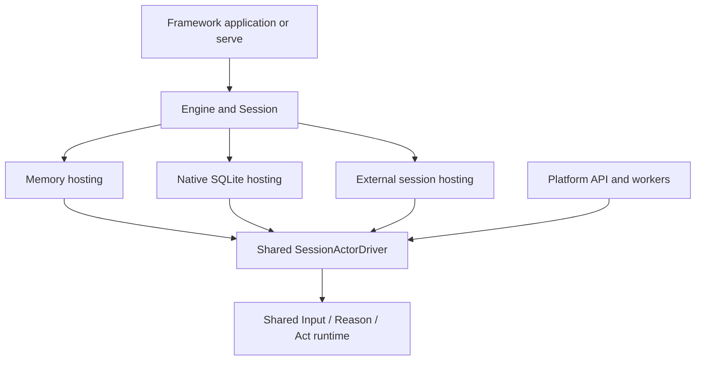

Everruns uses one agent runtime across native processes, platform workers and
Wasm isolates. Applications define ordinary `Agent` values and use
`everruns::Engine` and `Session`. A session hosting profile owns durable admission,
canonical state, ownership epochs and activation. It does not reimplement agent
planning, tool policy or recovery.



## Public Framework objects

| Object | Responsibility |
| --- | --- |
| `Agent` | Immutable behavior: instructions, model and provider, tools, capabilities, files, and lifecycle hooks |
| `Engine` | Retained behavior registry, session admission, lifecycle, queries and activation through the selected hosting profile |
| `Session` | First-class, engine-bound conversation used for turns, steering, events, cancellation, inspection, and history |
| `Environment` | Session resources, including one exact backend-owned workspace head and typed extensions |

New Framework code creates and resumes sessions through an Engine:

```rust
use everruns::{Agent, Engine, OpenAI};

# async fn example() -> Result<(), Box<dyn std::error::Error>> {
let agent = Agent::builder()
    .instructions("Answer concisely.")
    .provider(OpenAI::from_env()?)
    .model("gpt-6.1-sol")
    .build()?;

let engine = Engine::new();
let session = engine.create(agent);
let session_id = session.session_id();
let turn = session.send_and_wait("Begin.").await?;
assert!(turn.success);

drop(session);
let resumed = engine.resume(session_id).await?;
assert_eq!(resumed.session_id(), session_id);
# Ok(())
# }
```

## Shared execution, different authorities

Framework profiles use the same core `SessionActorDriver`, turn loop and event-log
recovery. Memory coordinates one process. SQLite commits creation, commands,
receipts and wakeups in one database and can run an independent native supervisor.
External hosts implement the [public hosting SPI](/framework/hosting/). The
source-only Durable Object reference demonstrates object-local Wasm and a
separately authenticated native Engine executor without a Framework vendor
dependency.

Admission commits before a send is acknowledged; a turn identity is assigned
later. Retain command identities across uncertain replies. Dropping a Session,
wait handle or SSE connection does not cancel durable accepted work. Reopen its
admission handle to observe assignment, pending client tools, suspension or a
finalized outcome. Awaited Framework completion hooks settle before that outcome
becomes final.

The Platform server uses its existing transactional PostgreSQL actor authority.
Workers lease runnable sessions and drive the same runtime. The Platform API's
internal `TurnBackend` remains a control-plane integration detail.

The generic `everruns-durable` task engine supplies Platform background jobs,
worker management and schedules. Agent turns use the shared actor driver.

## Choose a recovery boundary

- **Volatile Framework:** `Engine::new()` is offline and database-free. The
  creating Engine can resume a dropped Session, but process exit loses it.
- **Native durable Engine:** select `hosting::SqliteHosting`, register the exact
  `AgentBuild` and Environment factory, and start its supervisor for independent
  recovery. SQLite durability covers the configured disk's failure domain.
- **External durable Engine:** implement `SessionHosting`, retain exact builds,
  and configure independent activation plus explicit host services. The
  [Durable Object reference](/framework/durable-objects/) is one source-only
  implementation, outside the product publish set.
- **Legacy local storage:** explicit `LocalConfig` and custom host backends retain
  the older facade actor lane and its weaker recovery boundary. Persistent stores
  alone do not provide coherent session hosting or independent activation.
- **Distributed durable Platform:** server and workers keep each session's
  event log in PostgreSQL and lease sessions to workers, so a turn recovers
  across process or worker loss. Applications call it
  through the remote API or SDKs rather than configuring the facade Engine.

See [Persistence](/framework/sessions/#persistence) and [Session History and
Resume](/framework/sessions/#history-and-resume) for the exact application lifecycle.

## Extension boundaries

Normal applications depend on `everruns`. Engine is concrete. Hosting plugins
implement `SessionHosting` using `hosting::spi` and supply a coherent authority
plus epoch-scoped storage ports. The Framework owns lifecycle execution and outcome projection;
plugins never implement another agent loop. Providers implement `ChatDriver`.

Advanced core hosts can still compose the experimental `Execution` and internal
turn-backend contracts. Framework applications should use the session hosting
boundary, which also covers creation, admission, callbacks, reads and wakeups.
Workspaces, compute, secrets, channels and schedules require explicit services
with their own lifetime and isolation guarantees. A durable journal does not
preserve those resources automatically.
