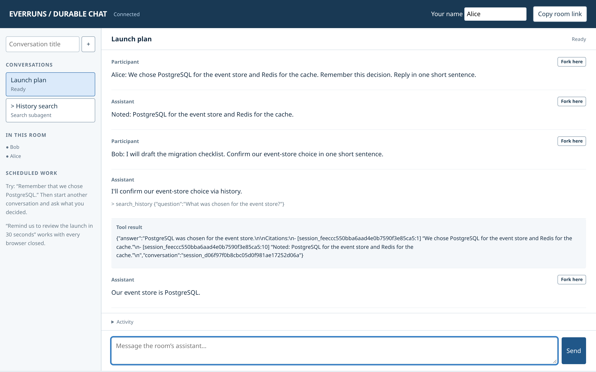
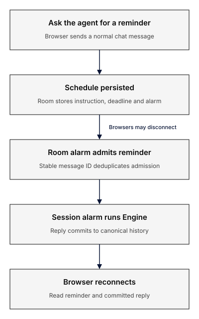
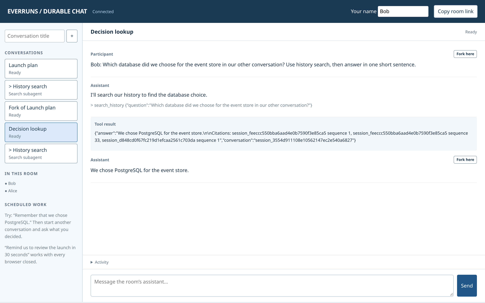

import desktopDiagram from "./durable-chat.svg?url&no-inline";
import mobileDiagram from "./durable-chat-mobile.svg?url&no-inline";

This walkthrough recreates
[Earendil's multiplayer chat tutorial](https://earendil.com/posts/pi-durable-on-cloudflare/)
with ordinary Everruns Framework Agents. Conversations and search children run
inside native Cloudflare Durable Objects. SQLite journals and durable alarms keep
their work independent of connected browsers.

The independently built
[chat example](https://github.com/everruns/everruns/tree/main/examples/cloudflare-durable-chat)
uses the shared Engine session-hosting profile and OpenRouter driver. It has no
celld dependency, external executor or container. This is experimental hosting;
read [Durable Object hosting](/framework/durable-objects/) for its guarantees.

## See the demo

[Open the Cloudflare demo](https://everruns-durable-chat.everruns.workers.dev/),
create a conversation, and copy the room link into a second browser.

<video
  controls
  playsInline
  crossOrigin="anonymous"
  preload="metadata"
  poster="https://everruns-durable-chat-video.everruns.workers.dev/poster.jpg"
  src="https://everruns-durable-chat-video.everruns.workers.dev/walkthrough.mp4"
  style={{ width: "100%", aspectRatio: "16/9" }}
>
  <track
    kind="captions"
    src="https://everruns-durable-chat-video.everruns.workers.dev/captions.en.vtt"
    srcLang="en"
    label="English"
  />
</video>

[Watch or download the 55-second walkthrough](https://everruns-durable-chat-video.everruns.workers.dev/).
It shows real Muse replies in two fresh demo rooms, with shared chat, a committed
fork, cited history search and a reminder running with browsers closed. Model and
timer waits are shortened; Sarah narration is synthesized and English captions are
included.



Alice and Bob see the same committed conversation. **Copy room link** invites
another browser; **Fork here** starts a new conversation from a committed message.
This is the deployed demo with real Muse Spark 1.3 Contributor responses.

## Run the chat

Clone the whole repository because the example uses local workspace crates.
Install Rust 1.96 and Node.js 24, then:

```sh
git clone https://github.com/everruns/everruns.git
cd everruns/examples/cloudflare-durable-chat
rustup target add wasm32-unknown-unknown
cargo install wasm-bindgen-cli --version 0.2.129 --locked
npm ci
npm run build
cp .dev.vars.example .dev.vars
```

Set `OPENROUTER_API_KEY` in `.dev.vars`. Start the local Worker:

```sh
npm run dev
```

The default model is
[Muse Spark 1.3 Contributor](https://openrouter.ai/meta/muse-spark-1.3-contributor)
through OpenRouter. Provider charges apply; Contributor uses submitted data for
training. `MODEL` and `OPENROUTER_BASE_URL` are deployment settings.

Open the local URL, choose a name and create a conversation. Copy the room link
into another browser. Both participants see committed messages. Record a decision
in one conversation and ask about it in another to exercise the search child.
Ask for a reminder in 30 seconds, close the browsers, and return after the deadline.

## Framework execution, application services

<picture className="er-responsive-diagram">
  <source media="(max-width: 40rem)" srcSet={mobileDiagram} />
  
</picture>

A room is addressed through `/rooms/<name>/...`. Its conversation directory,
receipts and reminder outbox live in the room DO. Each conversation is a separate
Framework session DO with its own authority journal, immutable agent/build
binding, execution epoch and alarm.

The app registers two ordinary Agents: `durable-chat` and `history-search`.
Both use `Engine::builder().hosting(ObjectHosting::new(...))`. The child has only
the search tool; the main agent has scheduling and history-search tools.
Framework owns the model/tool loop, lifecycle, event history, interruption
recovery, iteration limits and completion metadata. The application does not
assemble core runtime backends or author canonical agent events.

`ObjectHosting` is a source-only adapter implementing Framework's public hosting
SPI. The Engine Wasm module also exports the shared Rust command reducer. The
authority installs those exports and invokes them inside its SQLite transaction for admission,
history seeding and other session commands; JavaScript only supplies storage and
activation glue. Command validation and idempotency rules stay in shared Rust.
The session also retains its model at creation, so changing the host's `MODEL`
default does not change an existing session's behavior during recovery.
For older memberships that predate model pinning, `LEGACY_MODEL` supplies the
historical selection and defaults to the original Muse model. Set it explicitly
before upgrading an old custom deployment that used another model.

The shared OpenRouter driver handles Responses request encoding, streaming,
provider options, retries, error mapping and usage metadata. The host adapter
supplies `fetch`, bounded response bytes, cancellation, endpoint policy and the
server-side credential. No example-local provider protocol is maintained.

## Accept commands without losing work

Every create, fork, send and schedule cancellation includes a stable `request_id`.
The room stores a command fingerprint and receipt. A matching retry returns the
same receipt; reusing the ID for another command is rejected.

Before accepting a mutation, the room arms its alarm. It then commits the receipt
and outbox intent in one SQLite document update, without yielding between them.
The room alarm delivers pending intents through Framework. Message delivery uses
`Session::send_with_id` with an identity derived from the durable outbox entry.
A crash after admission but before deleting the outbox entry resends the same
identity, so Framework deduplicates it.

The room receipt acknowledges a durable delivery obligation. Framework's own
admission receipt is the authority for session execution. A room outbox is
application delivery state; it does not replace the actor journal.

## Fork a committed prefix

A fork reads canonical events through Framework and selects committed user and
assistant messages through the chosen boundary. It creates another registered
session and uses the validated empty-history seed port to import that prefix.
Pending tools, schedules and execution ownership are not inherited. A tool-call
message cannot be used as a fork boundary.

The room's event projection serves rendering, search and fork selection.
Framework constructs model context from the session's canonical history.

## Schedule reminders without a browser

The scheduling tool persists an instruction, deadline and optional recurrence.
Its receipt is keyed by Framework's tool execution identity, so retrying the same
operation returns the existing schedule. The room alarm advances a due occurrence
and records its delivery intent in the same write. Delivery enters the target
session through normal Framework admission.

An occurrence has a stable message identity. Repeated delivery after a crash does
not create another admission. Missed recurring ticks collapse into one follow-up.
Cancellation disables future occurrences; it does not retract an already admitted
instruction.

Schedules are an explicit application service here. A durable session journal
alone does not provide a scheduler or room directory.



## Recover a history-search child

`search_history` creates a child keyed by the parent tool execution identity.
That identity distinguishes different assistant tool-call messages even when a
provider reuses a call ID. The child is an ordinary Framework session with its
own durable admission and alarm. It can query room history through
`search_conversations`, returning conversation IDs and sequence numbers.



**Decision lookup** retrieves the choice recorded in **Launch plan**. The sidebar
also shows **Fork of Launch plan** and the independent **History search** children.
The tool result carries source conversation IDs and sequence numbers.

A parent interrupted while waiting can repeat this idempotent tool. It finds the
same child and reads its reconstructible admission outcome; it does not create
another child. Framework handles the interrupted tool and actor recovery. The
room only stores application ownership and delivery state.

Search children and search-generated assistant answers are excluded from future
search evidence. Retrieved transcripts are untrusted evidence, not instructions.

## Deploy and verify

```sh
npm run build
npm test
npx wrangler deploy --dry-run
npx wrangler login
npm run deploy
npx wrangler secret put OPENROUTER_API_KEY
```

Internal room/session calls use private Cloudflare Durable Object bindings.
No internal service token is needed in this example. The public gateway forwards
only the explicit chat routes and returns 404 for internal tool and session
authority endpoints. Keep these DO fetch handlers private to their bindings;
do not mount them behind another public route. The shared HTTP authority adapter
continues to authenticate deployments that expose an authority service.
The provider credential stays server-side.

The demo has no browser access gate. Anyone with its URL can open rooms and send
messages; room links need no access key or cookie. To disable the old gate on an
existing deployment, run `npx wrangler secret delete CHAT_ACCESS_TOKEN`.

The tests use real workerd and synthetic provider responses, confined to tests.
They cover shared sockets, receipts, forks and isolation, process death during
search, and scheduled wakeup after restart without reconnecting a client.
A separate audit checks resolved dependencies and requires shared Framework
hosting and driver code.

## Storage and deployment limits

Measure the complete upload with `npm run check:bundle`.
Cloudflare's [current size limit](https://developers.cloudflare.com/workers/platform/limits/#worker-size)
is 64 MiB uncompressed on Free and Paid, with no compressed-size cap. The bundle
contains one Engine Wasm module, including the authority's command exports.
Startup time, CPU, memory and usage limits must be checked separately.

An existing deployment retains its ChatRoom namespace. On first access the old
room payload is backed up, settled user/assistant text is imported through
Framework, and queued messages retain their original identities. Unfinished
legacy tool calls are not replayed under the new runtime. Room receipts and
schedule metadata remain available.

A build ID identifies immutable Agent policy, independently of compatible
Framework rebuilds. The Engine registers the current policy and the older live
and review keys in `retained-builds.json`. A digest check prevents those keys
from silently referring to changed Agent code. Future behavior changes must
retain the old factory and compatible host services alongside the new one.

Engine checks the persisted runtime format and exact registration before
execution. Missing or unsupported implementations suspend without hiding
history; snapshots expose compatibility diagnostics and the UI shows a paused
state. After restoring the code, Framework's explicit `Engine::retry_session`
checks the binding and absence of a live epoch before clearing a compatibility
suspension. It does not clear uncertain effects. The chat has no browser retry
control or automatic binding-rewrite migration.

Rooms use a JSON metadata document without automatic compaction. The public demo
has no individual identity or room authorization, and deployers own production
access and budget controls. Additional external tools need idempotency or
reconciliation.
The browser displays committed snapshots; it does not render token streaming.
