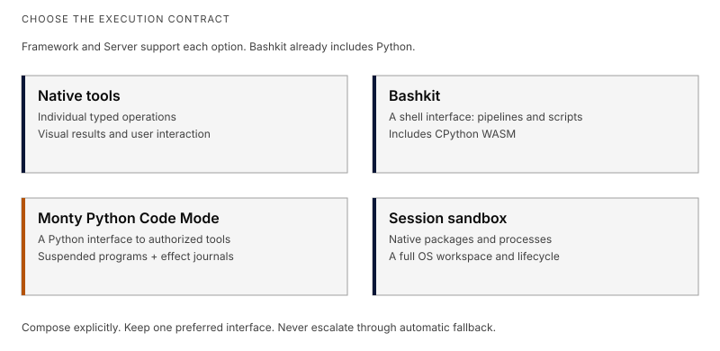

Everruns Framework and Server are platforms. Monty, Bashkit and session
sandboxes are execution options an agent can use on either platform; agentd
places those executions on its executor hosts.

Start with the interface and capabilities your agent needs. **Bashkit already
runs Python**, so “I need Python calculations” is not by itself a reason to add
Monty.

| Choose | When it fits | What to account for |
|---|---|---|
| Native tools | Individual typed operations, visual results, user interaction, or a small tool catalog | Each operation is a direct tool call; no interpreter to provision |
| [Bashkit](/capabilities/bashkit-shell/) and [Shell Code Mode](/capabilities/shell-code-mode/) | Shell is the preferred interface; pipelines, existing shell scripts, `jq`, or Python inside the shell | Python is CPython WASM in Everruns; shell approval stops the script and does not snapshot its stack |
| [Monty Python Code Mode](/framework/python-code-mode/) | Python is the preferred tool-orchestration interface and suspended-program approval continuations matter | A Python subset, separate pinned worker, private journal, Linux kernel isolation; no pip or native subprocesses |
| [Session sandbox](/features/isolated-sandboxes/) | Native packages, processes, development servers, or a complete OS workspace | Provision and secure the sandbox provider, its workspace, lifecycle, credentials and network boundary |

## Why Monty when Bashkit has Python?

The distinction is the execution contract. In Python Code Mode, Python is the
model's direct execution tool, calls to agent tools are structured host
suspensions, and a paused interpreter can be stored and resumed after a
person's approval. An effect journal protects previously completed operations
from repetition. You choose these properties, not merely Python syntax.

Bashkit provides a broader shell environment and keeps its existing Python
runtime. If your agent already works well in that environment and does not
need Monty's continuation model, keep using it. Neither choice is universally
faster or cheaper; measure the relevant workload instead of assuming that a
second interpreter improves it.

## Can one agent use multiple options?

Yes. Give the agent an explicit preferred interface and explain when another
is useful. Both tools stay available, each with its own execution semantics.
They share authorized workspace and network operations through the platform;
they do not share interpreter memory. Monty does not automatically retry a
failed program in Bashkit or a more privileged shell.

Python Code Mode does not hide native tool schemas. Shell Code Mode's optional
native/CLI routing still belongs to Shell Code Mode; adding Monty does not turn
its CLI route into a Python route. Execution and turn-control tools remain
direct, which also prevents nested execution loops. Do not advertise Python
code mode as a replacement for large-catalog schema compression.

## Where each option runs

Framework applications provision the execution facilities on their host.
Server deployments provision them on workers. agentd provisions them on
executors, including the executor embedded by standalone `serve`; shard-only
nodes store durable state. The same agent capability selects the same Python
bridge in each case.

Monty's subprocess pool is an interpreter service, not an implementation of
`SessionSandboxProvider`. It has no full workspace/container lifecycle, package
manager or arbitrary process execution. Keep that separate from the choice of
whether the enclosing session itself is durable.
