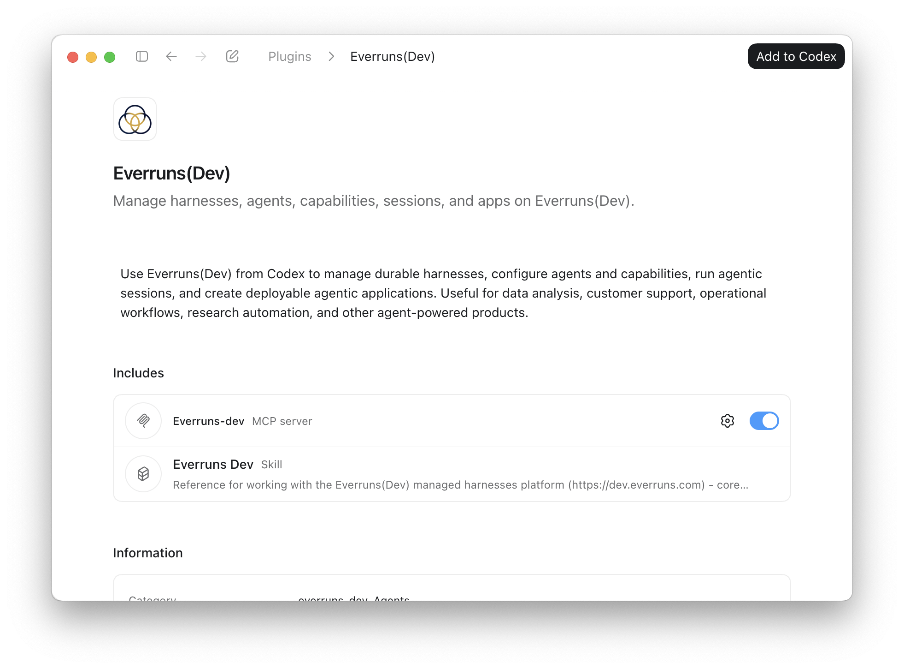

The `everruns` skill teaches a coding agent to work with Everruns: build agents
into a Rust application, install and run your own Everruns, and create, run,
debug, evaluate and ship agents on it. It is one skill: a short `SKILL.md` that
maps each task to a guide in `references/`, so the agent reads only what the
task needs.

| Task | Guide |
|---|---|
| Build agents into a Rust application | `framework.md` |
| Install, upgrade, or remove your own Everruns | `install.md` |
| Use the CLI, or connect over MCP | `cli.md`, `mcp.md` |
| Call a deployment over HTTP or from Python, TypeScript or Rust | `api.md`, `sdk.md` |
| Build an agent from a brief, or revise its definition | `build-agent.md`, `agent-authoring.md` |
| Hand a task to an agent | `run-agent.md` |
| Find out why a session failed | `debug-session.md` |
| Evaluate an agent, or compare models | `evaluate-agent.md` |
| Put an agent on Slack, the web, A2A, webhooks or a schedule | `ship-agent.md` |
| Check spending, health and change history | `operate.md` |
| Keep agent definitions in a repository | `agents-as-files.md` |

## Install the skill

Pick one. They install the same skill.

- **Any agent that reads skills** (Claude Code, Codex, Cursor, Gemini CLI and
  others):

  ```bash
  npx skills add everruns/everruns
  ```

- **The Everruns CLI** writes the copy that matches its version into the
  project, or into your user folders with `--global`:

  ```bash
  everruns agent-skill install
  ```

- **The Everruns plugin** adds the skill and an MCP connection. In Claude Code:

  ```text
  /plugin install everruns --marketplace everruns/plugins
  ```

  On Claude Code older than 2.1.275, run `/plugin marketplace add everruns/plugins`
  first, then `/plugin install everruns@everruns`. In Codex:

  ```bash
  codex plugin marketplace add everruns/plugins
  codex plugin add everruns@everruns
  ```

  Or open `/plugins` in Codex and pick **Everruns**, then start a new session.
  In Cursor, open **Settings > Plugins**, paste
  `https://github.com/everruns/plugins`, and install **Everruns**. In Gemini
  CLI: `gemini extensions install https://github.com/everruns/plugins`.

  

- **Without installing**: add
  `Instructions: https://everruns.com/.well-known/agent-skills/everruns/SKILL.md`
  to your prompt.

Every Everruns MCP server also serves the skill as `skill://everruns/SKILL.md`,
matching that server's version.

## Connect to your Everruns

The skill works with the Everruns you run. After `everruns docker up` or
`everruns k8s up` the CLI is already signed in, and the agent uses it. For MCP,
register your server's endpoint, for example with Claude Code:

```bash
claude mcp add --transport http everruns http://localhost:9300/mcp
```

The plugin's built-in MCP connection points at the
[demo instance](/getting-started/cloud/), because a plugin cannot know your
address; register your own endpoint as above to use your install. In the
Everruns UI, the user menu's **Connect your coding agent** gives a setup prompt
with your deployment's address already in it. **Settings → AI clients** shows
OAuth approvals and lets you revoke them.

## First run

1. Ask your agent "Who am I on Everruns?" and complete the sign-in if asked.
2. Ask for real work, for example "create a Hacker News summarizer agent and run
   it" or "why did this session fail?" with a session link.

Every change the agent makes is recorded in the entity's
[change history](/features/change-history/) with the reason it gave.

Your coding-agent subscription does not configure model access inside Everruns.
Running Everruns agents, including Platform Chat, requires a model provider in
**Models → Providers**, or one set during install
(`everruns docker up --provider ...`).

## Use the CLI too

The skill speaks the same commands as the
[`everruns` CLI](/features/cli/). When the CLI is installed and signed in, the
agent runs commands there directly, which is faster than going through MCP.

## Read the docs as text

The documentation site publishes itself as plain Markdown for agents and other
tools that would rather read text than HTML.

- [`/llms.txt`](https://everruns.com/docs/llms.txt): the index: the three ways
  to run Everruns, every documentation set, and the machine-readable surfaces.
  Start here.
- [`/llms-full.txt`](https://everruns.com/docs/llms-full.txt): every prose page
  in one file (roughly 250k tokens).
- [`/llms-small.txt`](https://everruns.com/docs/llms-small.txt): the same
  corpus without the vendor- and operator-specific long tails.
- `/_llms-txt/<set>.txt`: one topic at a time, mirroring the sidebar:
  [start-here](https://everruns.com/docs/_llms-txt/start-here.txt),
  [framework](https://everruns.com/docs/_llms-txt/framework.txt),
  [platform](https://everruns.com/docs/_llms-txt/platform.txt),
  [built-ins](https://everruns.com/docs/_llms-txt/built-ins.txt),
  [guides](https://everruns.com/docs/_llms-txt/guides.txt),
  [integrations](https://everruns.com/docs/_llms-txt/integrations.txt),
  [explanation](https://everruns.com/docs/_llms-txt/explanation.txt),
  [reference](https://everruns.com/docs/_llms-txt/reference.txt),
  [operations](https://everruns.com/docs/_llms-txt/operations.txt).
  Prefer a set over the complete text.
- [`/api/openapi.json`](https://everruns.com/docs/api/openapi.json): the REST
  API as OpenAPI 3.0. The text sets carry prose only, so take endpoint shapes
  from here.

Every page in those files begins with its title, its description, and a
`Source:` line holding the canonical URL. Cite that URL, not the text file.
