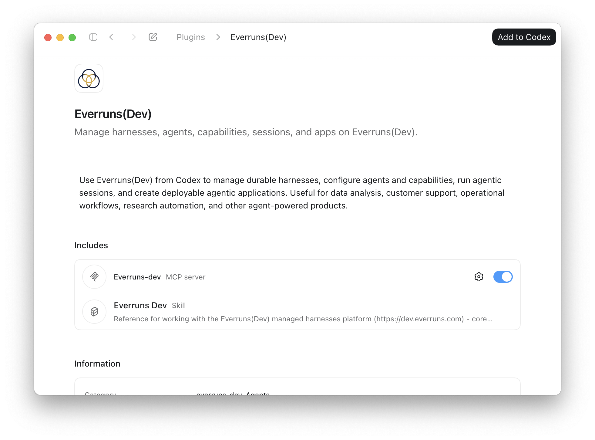

The [Everruns plugin](https://github.com/everruns/plugins) lets a coding agent
work with Everruns for you. It connects the Everruns MCP server at
`https://app.everruns.com/mcp` (you sign in with OAuth in the browser) and adds
skills that load only when a task needs them:

| Skill | Your agent can |
|---|---|
| `everruns` | Understand product concepts, find documentation and Cloud, and choose the right workflow skill |
| `everruns-cli` | Use the CLI and session shell, discover commands, script operations, and verify changes |
| `everruns-mcp` | Use an external MCP connection, run sessions, handle questions and connections, and read resources |
| `everruns-agent-authoring` | Design and revise agent behavior, harnesses, capabilities, identities, packages, and verification |
| `everruns-run-agent` | Hand a task to an existing agent, follow it, exchange files, and bring back the result |
| `everruns-build-agent` | Build or improve an agent from a plain-language brief, add knowledge and tools, and smoke-test it |
| `everruns-debug-session` | Diagnose failed, stalled, or poor-quality sessions and verify fixes |
| `everruns-evaluate-agent` | Build regression evals, compare models, and score live traffic |
| `everruns-ship-agent` | Expose agents through channels and triggers, with budgets and controls for stopping them |
| `everruns-operate` | Investigate organization spending, health, and change history |
| `everruns-agents-as-files` | Keep agent packages in a repository and validate, compare, import, or export them |
| `everruns-sdk` | Call hosted agents from Python, TypeScript, or Rust applications |
| `everruns-framework` | Develop Rust applications that run agents themselves and compose advanced execution hosts |

## Install

In the Everruns user menu, choose **Connect your coding agent**, copy the setup
prompt and paste it into your coding agent. It reads the maintained plugin
instructions and guides you through installation and browser sign-in. The same
dialog is available after organisation setup and on an empty Agents page.

In **Settings → My agent experience → Connected AI clients**, you can refresh
approvals or revoke access. It records OAuth
approval and last use, not local plugin installation.

For manual installation:

**Claude Code**:

```text
/plugin install everruns --marketplace everruns/plugins
```

On Claude Code older than 2.1.275, run `/plugin marketplace add everruns/plugins`
first, then `/plugin install everruns@everruns`.

**Codex**:

```bash
codex plugin marketplace add everruns/plugins
codex plugin add everruns@everruns
```

Or open `/plugins` in Codex and pick **Everruns**. Start a new session afterwards.



**Cursor**: open **Settings > Plugins**, paste `https://github.com/everruns/plugins`,
and install **Everruns**.

**Gemini CLI**:

```bash
gemini extensions install https://github.com/everruns/plugins
```

**Other agents**: hosts that read the [Agent Plugins](https://agent-plugins.org)
format can load `plugins/everruns/` from the repository directly. Any MCP client
can add `https://app.everruns.com/mcp` as a remote server named `everruns`.

## First run

1. Ask your agent "Who am I on Everruns?" and complete the sign-in in your browser.
2. Ask for real work, for example "create a Hacker News summarizer agent and run
   it" or "why did this session fail?" with a session link.

Every change the agent makes is recorded in the entity's
[change history](/features/change-history/) with the reason it gave.

Your coding-agent subscription does not configure model access inside Everruns.
Running Everruns agents, including Platform Chat, requires a model provider in
**Models → Providers**. An existing Cloud-managed provider can satisfy that need.
If you skip provider setup, you can still connect your coding agent for setup
and management; onboarding keeps an **Add a model provider** action visible.

## Use the CLI too

The plugin's skills speak the same commands as the
[`everruns` CLI](/features/cli/). When the CLI is installed and signed in, the
agent runs commands there directly, which is faster than going through MCP.

## Use a self-hosted deployment

The plugin points at Everruns Cloud. For your own deployment, keep the plugin's
skills and register your server's MCP endpoint under the same name, for
example with Claude Code:

```bash
claude mcp add --transport http everruns http://localhost:9300/mcp
```

For the CLI, use `everruns --api-url http://localhost:9300/api login` or set
`EVERRUNS_API_URL`. The [Docker Compose](/getting-started/docker-compose/) stack
serves both on port 9300.

## Read the docs as text

The documentation site publishes itself as plain Markdown for agents and other
tools that would rather read text than HTML.

- [`/llms.txt`](https://everruns.com/docs/llms.txt): the index: the three ways
  to run Everruns, every documentation set, and the machine-readable surfaces.
  Start here.
- [`/llms-full.txt`](https://everruns.com/docs/llms-full.txt): every prose page
  in one file (roughly 250k tokens).
- [`/llms-small.txt`](https://everruns.com/docs/llms-small.txt): the same
  corpus without the vendor- and operator-specific long tails.
- `/_llms-txt/<set>.txt`: one topic at a time, mirroring the sidebar:
  [start-here](https://everruns.com/docs/_llms-txt/start-here.txt),
  [framework](https://everruns.com/docs/_llms-txt/framework.txt),
  [platform](https://everruns.com/docs/_llms-txt/platform.txt),
  [built-ins](https://everruns.com/docs/_llms-txt/built-ins.txt),
  [guides](https://everruns.com/docs/_llms-txt/guides.txt),
  [integrations](https://everruns.com/docs/_llms-txt/integrations.txt),
  [explanation](https://everruns.com/docs/_llms-txt/explanation.txt),
  [reference](https://everruns.com/docs/_llms-txt/reference.txt),
  [operations](https://everruns.com/docs/_llms-txt/operations.txt).
  Prefer a set over the complete text.
- [`/api/openapi.json`](https://everruns.com/docs/api/openapi.json): the REST
  API as OpenAPI 3.0. The text sets carry prose only, so take endpoint shapes
  from here.

Every page in those files begins with its title, its description, and a
`Source:` line holding the canonical URL. Cite that URL, not the text file.
