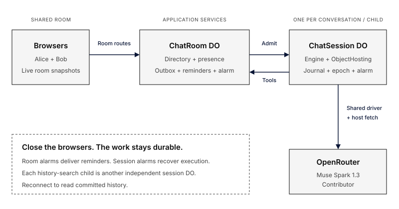

# Durable multiplayer chat on Cloudflare

A standalone Cloudflare Worker that runs ordinary Everruns `Agent` and `Engine`
sessions **inside native Durable Objects**. It recreates
[Earendil's multiplayer tutorial](https://earendil.com/posts/pi-durable-on-cloudflare/)
with shared conversations, forks, reminders and a recoverable history-search child.

[Open the Cloudflare demo](https://everruns-durable-chat.everruns.workers.dev/)
· [Read the walkthrough](../../docs/framework/examples/durable-chat.mdx)

[Watch the demo on YouTube](https://www.youtube.com/watch?v=eFmwod7GTrY)

## See it in action


Two browsers share one committed conversation. **Copy room link** invites another
participant; **Fork here** starts a separate conversation from a committed message.


A new conversation calls `search_history` and retrieves the earlier decision with
citations. Its search child runs as an independent Framework session.

## How it works

<picture>
  <source media="(max-width: 40rem)" srcset="../../docs/framework/examples/durable-chat-mobile.svg" />
  
</picture>

The room owns presence, the conversation directory and reminder delivery.
Each conversation or search child runs Engine inside its own Durable Object.
Room and session alarms keep scheduled and interrupted work moving while every
browser is closed; reconnecting reads committed history.

## Run

Requires Rust 1.96, Node.js 24, the wasm32 target and wasm-bindgen-cli 0.2.129.
From this directory in the full Everruns checkout:

```sh
rustup target add wasm32-unknown-unknown
cargo install wasm-bindgen-cli --version 0.2.129 --locked
npm ci
npm run build
cp .dev.vars.example .dev.vars
```

Set `OPENROUTER_API_KEY` in `.dev.vars`, then start the Worker:

```sh
npm run dev
```

The default model is
`meta/muse-spark-1.3-contributor` through OpenRouter. Provider charges apply, and
the Contributor model uses submitted data for training. `MODEL` and
`OPENROUTER_BASE_URL` are trusted deployment configuration.

Open the local URL, choose a name and create a conversation. Open its room link
in another browser. Record a decision in one conversation and ask about it in
another; the assistant can create a search child. Ask for a reminder, close all
browsers, and return after its deadline. Fork a committed message to explore an
alternative conversation.

## What belongs to Framework

`src/agent.rs` defines ordinary Framework Agents and idempotent tools.
`src/lib.rs` registers them on `Engine::builder().hosting(ObjectHosting::new(...))`.
Framework owns admission, canonical events, turn planning, iteration limits,
tool recovery, waits, cancellation, history and completion metadata.

The application uses the shared `OpenRouterChatDriver` with `with_transport`.
`src/fetch.rs` adapts host response bytes and cancellation; it contains no provider
JSON or SSE parser. `worker/provider.js` supplies endpoint and credential policy.

`ChatSession` uses the shared authority, activation and isolate bridge from
`crates/durable-object`. Each conversation and search child has its own SQLite
journal, Framework binding, execution epoch and durable alarm.

The DO adapter connects Framework to SQLite storage and Durable Object alarms.
Engine and session command handling run in the same WebAssembly module.
Each session retains its model at creation. Changing the host's `MODEL` default
affects new sessions; recovery of existing sessions uses their original model.

## What belongs to the application

`ChatRoom` owns room membership, command receipts, forks, search ownership,
WebSocket presence and reminder delivery. These are application services, separate
from session execution. Room metadata occupies one SQLite row.

Accepted commands commit a receipt and durable outbox intent after arming the
room alarm. Delivery uses Framework `Session::send_with_id` with a stable message
identity. A crash between admission and outbox acknowledgement retries the same
admission. Timers advance together with their outbox entry; missed recurring
ticks collapse into one delivery.

A search child is keyed by the Framework tool execution identity, including the
assistant tool-call message. It is created and messaged through Engine, and owns
an independent activation alarm. A parent replay finds the same child and admission.
Search children and search-generated answers are excluded from future evidence.

A fork imports only the committed user/assistant conversation prefix through
Framework's validated empty-history seed port. It does not copy pending tools,
execution state or timers. Rendering canonical events for the UI is application
code; Framework constructs model context.

## Verify

```sh
npm run build
npm test
npm run check:bundle
```

Tests run in workerd with SQLite, WebSockets, alarms and simulated model
responses. They cover shared rooms, forks, recovery of interrupted searches and
scheduled reminders after a restart.

## Deploy

Check the complete bundle with `npm run check:bundle`. Cloudflare's
[current size limits](https://developers.cloudflare.com/workers/platform/limits/#worker-size)
allow 64 MiB uncompressed on Free and Paid, with no compressed-size cap. Startup,
CPU, memory, request and storage limits remain separate constraints.

```sh
npx wrangler login
npm run deploy
npx wrangler secret put OPENROUTER_API_KEY
```

The public Worker handles browser requests. Room and session Durable Objects
communicate through private bindings, and the OpenRouter API key stays on the
server.

> [!WARNING]
> This example has no sign-in, room access controls or per-user quotas. Anyone
> with its URL can open rooms and send messages using the configured model
> budget. Add access and usage controls before sharing your own deployment.

See [Durable Object hosting](../../docs/framework/durable-objects.md) for hosting
guarantees and upgrade compatibility.
