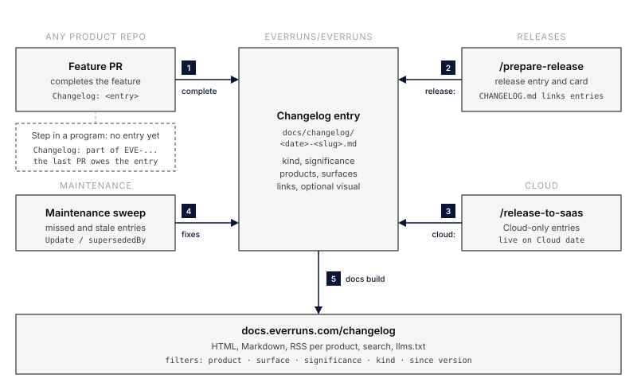

# Public Changelog

Status: proposed (2026-10-11). Nothing here is built yet.

## Abstract

`docs.everruns.com/changelog/` lists what changed for people who use Everruns,
one short entry per finished user-facing feature or significant incident. It
covers every product: Everruns Cloud, the self-hosted Platform, the Framework
crates, the SDKs, the `everruns` CLI, Yolop, Mira and Bashkit.

An entry is written when a feature is **complete**, not when a PR merges and not
when a release is cut. Releases get their own entries that link to the feature
entries they carry, and every versioned `CHANGELOG.md` links back to them. The
model is the [Cloudflare changelog](https://developers.cloudflare.com/changelog/):
a dated title, product tags, two or three short paragraphs, real links, and a
picture when one helps.



## Goals

1. A reader can answer "what changed in the product I use, since when, and where
   do I read more" in under a minute.
2. Writing an entry is part of finishing a feature, so the changelog is never a
   separate catch-up chore.
3. Every claim is checkable: each entry links to the docs page, the PR or
   release, and nothing it says outlives the behavior it describes.
4. People and coding agents read the same content: HTML, Markdown, RSS and
   search all come from one source file.

## Non-goals

- Marketing. No launch language, no adjectives doing the work of facts, no
  roadmap teasers. The monthly roundup on everruns.com stays the place for a
  narrative ([blog roundup posts](https://github.com/everruns/landing/blob/main/knowledge/content/blog-roundup-posts.md)).
- Replacing `CHANGELOG.md`. The versioned file stays the complete per-release
  record of every PR. The public changelog is the curated, user-facing layer.
- An entry per PR. Internal refactors, CI, dependency bumps and PRs that are a
  step inside a larger program get no entry of their own.

## What gets an entry

| Kind | When | Example |
|---|---|---|
| `feature` | A user can now do something new, and the work is complete | Call one agent from code with an agent key |
| `improvement` | Something existing works noticeably better or differently | Chat answers stream faster |
| `fix` | A bug users hit is fixed, and it was visible enough that people may have worked around it | Codex sessions no longer fail with HTTP 400 |
| `breaking` | Code or configuration has to change on upgrade | Flag removed, API field renamed |
| `deprecation` | Something will be removed; the entry says by when and what replaces it | |
| `incident` | A significant Cloud incident: what users saw, the window, the fix | |
| `release` | A versioned release of any product (see [Releases](#releases)) | Everruns 0.48.0 |

**Complete** means the feature is usable end to end on at least one product
without further PRs: the last PR of a program, or a single PR that is the whole
feature. A program spread over many PRs gets one entry, written by the PR that
finishes it. A design PR never gets an entry.

## Taxonomy and filters

Every entry carries three filterable fields. They answer different questions,
so they stay separate.

**Product: which thing I run.** `cloud` (app.everruns.com), `platform` (the
self-hosted open source server, worker and UI), `framework` (the Rust crates),
`sdk` (Python, TypeScript, Rust clients), `cli` (the `everruns` CLI), `yolop`,
`mira`, `bashkit`. An entry may list several: a server feature that reaches
Cloud through the next deploy is `[platform, cloud]`. The first three match the
existing `appliesTo` badges on docs pages, so the same badge component renders
both.

**Surface: how I touch it.** `ui`, `api`, `code` (library or SDK calls),
`cli`, `agent` (MCP, A2A, AG-UI and other agent-facing endpoints), `operations`
(deploy, configuration, security settings). This is how the changelog serves
both audiences: someone who only uses the Everruns UI filters to `ui`; someone
embedding the Framework filters to `code`. An entry that matters to both says
so in two short labelled paragraphs, **In the UI** and **In code**, rather than
one paragraph that serves neither.

**Significance: how much I should care.** `major` (changes how people use the
product; at most a few a month), `notable` (the default), `minor` (small, but
someone asked for it). Breaking changes are always at least `notable`.

The index page filters on all three plus kind. Filters are query parameters
(`/changelog/?product=yolop&significance=major`), so a filtered view is a link
someone can share, and each product also has a static page
(`/changelog/yolop/`) that search engines and feeds can use.

## Entry format

One Markdown file per entry, in the docs content tree next to the pages it
links to:

```text
docs/changelog/
  index.mdx                          # the filterable list
  2026-10-11-agent-keys.md           # an entry
  2026-10-11-agent-keys.png          # its optional visual, co-located
  2026-10-09-everruns-0-47-0.md      # a release entry
```

````markdown
---
title: Call one agent from code with an agent key
description: An Agent API channel gives an application a key to one agent, with an AgentClient in every SDK.
date: 2026-10-11
kind: feature
significance: major
products: [platform, cloud, sdk]
surfaces: [api, code]
links:
  docs: /how-to/call-your-agent-from-code/
  prs: [everruns/everruns#4527, everruns/everruns#4559]
release: 0.48.0          # filled in by /prepare-release, not by the author
cloud: 2026-10-12        # filled in by /release-to-saas, not by the author
---

Add an **Agent API** channel to an agent and create a key in its **Agent keys**
card. An application holding that key can call this one agent and nothing else.

```python
async with AgentClient() as agent:
    print(await agent.run("Where is order 42?"))
```

See [Call your agent from code](/how-to/call-your-agent-from-code/).
````

Rules for the body:

- 40 to 150 words. First sentence: what changed, in the reader's terms. Then
  how to use it (a UI path, a request, or a short code block). Then links.
- Code blocks are real: Rust snippets go through the same doc-snippet check as
  the rest of `docs/`, and Python through `check-python-snippets.py`.
- At least one internal docs link for `feature`, `improvement`, `breaking` and
  `deprecation`; internal links are checked by the existing
  `starlight-links-validator` build step, so a dead link fails the docs build.
- A visual is welcome when it shows something words cannot: a cropped
  screenshot for a `ui` change, a navy-and-grey diagram per
  [diagrams.md](diagrams.md) when a flow changed, a release card for a release.
  Alt text is required. No decorative images.
- No "we're excited", "powerful", "seamless", "game-changing", exclamation marks,
  or claims about the future. The build lints for a short banned-word list.

The `release` and `cloud` fields are what make the changelog honest without
waiting on releases: an entry goes up as soon as the feature is complete, and
its header shows where it is available. Before a release it reads **On main**;
after `/prepare-release` it reads **In 0.48.0** with a link to that release; on
Cloud it reads **Live on Cloud** with the deploy date. Readers never have to
guess whether a feature they read about is in the version they run.

## Rendering, search, Markdown and RSS

Entries live in the existing Starlight `docs` collection, with the schema in
`apps/docs/src/content.config.ts` extended by the fields above. That choice gives
the changelog everything the docs already have, with no parallel pipeline:

- **HTML** pages with the site chrome, Open Graph cards and the `appliesTo`
  badge row.
- **Search**: Pagefind indexes entries like any other page; results show the
  entry date and kind. Changelog pages are excluded from the sidebar, not from
  search.
- **Markdown**: the per-page Markdown route (`/changelog/<slug>.md`) already
  covers the docs collection. The index gets a Markdown rendering too, and
  `llms.txt` gains a Changelog section, so an agent can read "what changed
  since 0.45" directly.
- **RSS**: `/changelog/rss.xml` for everything, plus one feed per product
  (`/changelog/yolop/rss.xml`). Feed items carry the full entry body and the
  product and kind as categories.

New code is small: the index component with filters, the per-product pages,
the feed endpoints, the availability header, and a validation script.

## Definition of done

Writing the entry belongs to the PR that completes the feature, in whichever
repository that PR lives:

1. **The PR template** in every repository gets one line under "What changed":
   `Changelog: <entry link> | part of <program or Linear issue> | not user-facing`.
   An empty line is a review finding.
2. **The ship skills** treat the entry as a synced artifact (shipping outcome 4).
   When the PR completes a user-facing feature or closes a significant incident,
   the entry is part of the change; when the PR is a step in a program, the line
   names the program so the last PR knows it owes the entry.
3. **Entries always land in `everruns/everruns`**, because the docs site lives
   there. A PR in `everruns/everruns` adds the file itself. A PR in another
   repository (`saas`, `yolop`, `sdk`, `mira`, `bashkit`) opens a companion PR
   adding the entry in `everruns/everruns`, merged right after its own. The
   ship skills do this, so it costs the author nothing.
4. **Cloud-only features** from `saas` are an exception to "merged right after":
   Cloud runs the tip of main but production deploys happen on the owner's
   schedule, so the entry should not appear before the feature is live. The
   saas ship skill writes the entry draft into the PR body under
   "Changelog entry"; `/release-to-saas` collects the drafts from every PR in
   the deploy, publishes them with `cloud:` set, and stamps `cloud:` on the
   platform entries the deploy carried.
5. **A PR that changes or removes behavior an earlier entry describes** updates
   that entry in the same PR (see [Keeping entries current](#keeping-entries-current)).

A CI check is deliberately not a merge gate in the first version: whether a PR
completes a feature is a judgement, and a body-format check would mostly produce
"not user-facing" noise. The maintenance sweep below is the backstop.

## Releases

Each versioned release of any product gets a `release` entry, and each
versioned `CHANGELOG.md` links to the public entries it carries.

**Everruns platform** (`/prepare-release` and `release.yml`):

- The release PR adds `docs/changelog/<date>-everruns-<version>.md`. Its body
  is the release headline and summary, the rendered release card, a list of the
  feature entries since the previous release, upgrade notes when there are
  `breaking` entries, and links to the GitHub Release and the `CHANGELOG.md`
  section.
- The release card moves from the single root `release-card.yml` to
  `docs/changelog/releases/<version>.yml`. The docs build renders the PNG with
  the existing `generate-release-card.mjs`, so every past release keeps its card
  on the site; `release.yml` keeps attaching the same PNG to the GitHub Release.
- Every `Highlights` bullet in `CHANGELOG.md` links its changelog entry, and the
  version section gains a `Changelog` line linking the release entry. The GitHub
  Release body is extracted from that section, so it carries the links too.
- `/prepare-release` sets `release: <version>` on every entry dated since the
  previous release that names `platform`, `framework` or `cli`. The release
  card validator gains one rule: every such entry is linked from the version
  section, so a highlight cannot be missing its entry and an entry cannot be
  missing from its release.

**Yolop, Mira, SDKs, Bashkit**: their release skills do the same in their own
`CHANGELOG.md` (link entries, set `release:` on them) and open a companion PR
with the release entry. A release card is optional for these; when the product
has none, the entry has no image.

**Cloud**: Cloud has no versions. `/release-to-saas` adds no release entry; it
stamps `cloud:` on the entries the deploy made live, and adds an entry only for
Cloud-only features (step 4 above).

## Keeping entries current

An entry is a dated record, so it is never rewritten to describe newer
behavior. It changes in three ways:

- **Update section.** When the feature changed in a way that matters to someone
  reading the old entry, append `## Update 2026-11-02` with one or two sentences
  and a link to the newer entry.
- **Superseded.** When the feature was replaced or removed, set
  `supersededBy: <slug>` (or `removedIn: <version>`). The entry renders a banner
  at the top pointing to the replacement, keeps its text, and drops out of the
  default index view (a "show superseded" toggle brings it back).
- **Link repair.** A moved docs page or a renamed API is fixed in place, without
  an Update section: that is upkeep, not news.

Who does it:

- **The PR that changes the behavior**, as part of the definition of done:
  searching `docs/changelog/` for the feature's name, capability slug or API
  path is part of syncing artifacts.
- **The maintenance skill**, as a new surface in
  `.agents/skills/maintenance/references/surfaces.md`, with two checks:
  1. *Missed entries*: list merged `feat` and user-visible `fix` PRs across the
     product repositories since the last sweep whose bodies have no
     `Changelog:` line or name a program that has since finished without an
     entry. Write the missing entries.
  2. *Stale entries*: list entries whose linked docs pages, capability slugs or
     flags changed or disappeared after the entry date (a script over git
     history and the docs build output). Add an Update section, a
     `supersededBy`, or a link fix.

The docs build backs both: internal links are already validated, and the new
validation script fails on an unknown product, surface or kind, a missing
required link, a `supersededBy` that points nowhere, or a body over the word
limit.

## Additional ideas

These are not required by the asks above; each is cheap given the design.

- **"Since version" view.** `/changelog/?since=0.45.0&product=framework`
  lists everything between the reader's version and now, with `breaking`
  entries first. It is the upgrade checklist people otherwise rebuild from
  three `CHANGELOG.md` sections.
- **Breaking and deprecation entries carry the fix**: a before/after snippet or
  the setting to change, so the entry is the migration note.
- **The monthly blog roundup is written from the changelog.** The roundup
  sources its items from `major` and `notable` entries of the month, which
  removes the separate research pass and keeps both in agreement.
- **"What's new" in the product.** The Everruns UI and Yolop can show the
  newest `ui` or `yolop` entries from the product feed. Later, behind no flag,
  once the feed has a few weeks of entries.
- **Agents read it too.** The Markdown index and `llms.txt` section let a
  coding agent answer "is this available in my version" without scraping; the
  Everruns docs MCP surface can expose the same filter.
- **Backfill.** Seed the changelog with entries for the highlights since
  0.40.0, so it does not launch empty and the filters have something to show.

## Rollout

Each step is one PR and is useful on its own.

1. **Site**: schema fields, index with filters, per-product pages, feeds,
   availability header, Markdown index, `llms.txt` section, validation script.
   Two or three real entries as fixtures.
2. **Process in everruns**: PR template line, `shipping.md` and the ship skill,
   `/prepare-release` and the release card move, the validator rule, release
   entry for the next version.
3. **Maintenance**: the surface entry and the stale-entry script.
4. **Other repositories**: PR template line and ship skill companion-PR step in
   `saas`, `yolop`, `sdk`, `mira`, `bashkit`; `/release-to-saas` collection and
   `cloud:` stamping; release skills link entries.
5. **Backfill** the highlights since 0.40.0.

## Rejected options

- **Entries per release only.** Readers wait weeks for features already on
  Cloud, and a release entry with forty items is the `CHANGELOG.md` again.
- **Entries in each product repository, pulled in at docs build time.** Keeps
  authoring local, but the docs build would need tokens for private `saas`,
  internal links could not be validated at authoring time, and one entry
  spanning products would have no single home. A companion PR costs an agent
  one extra step.
- **A separate content collection or a separate site.** It would need its own
  search, Markdown route and link validation, all of which the docs collection
  already has.
- **Generating entries from PR titles.** PR titles describe the change to code
  reviewers, not to users, and one feature spans many PRs.
