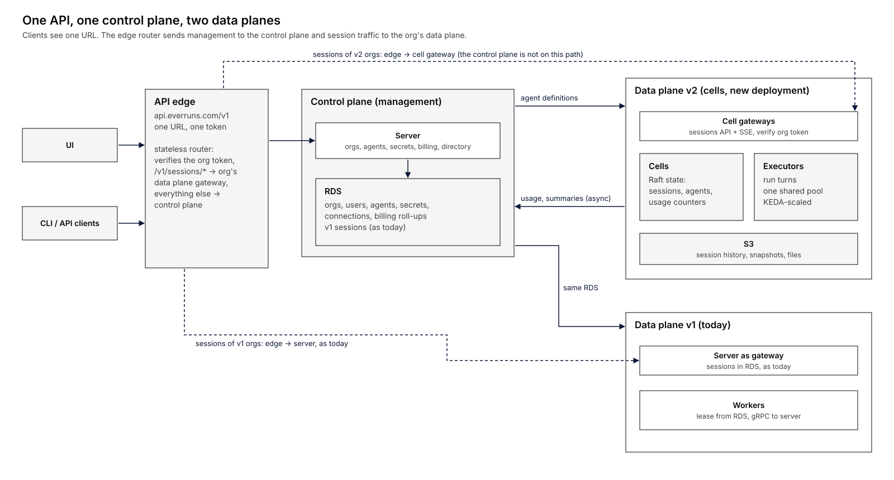
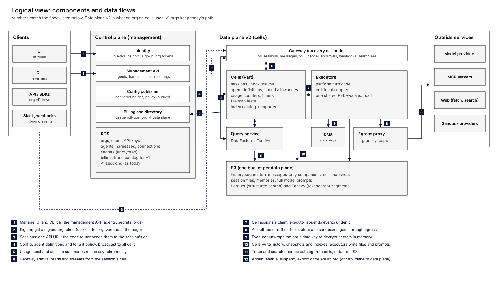
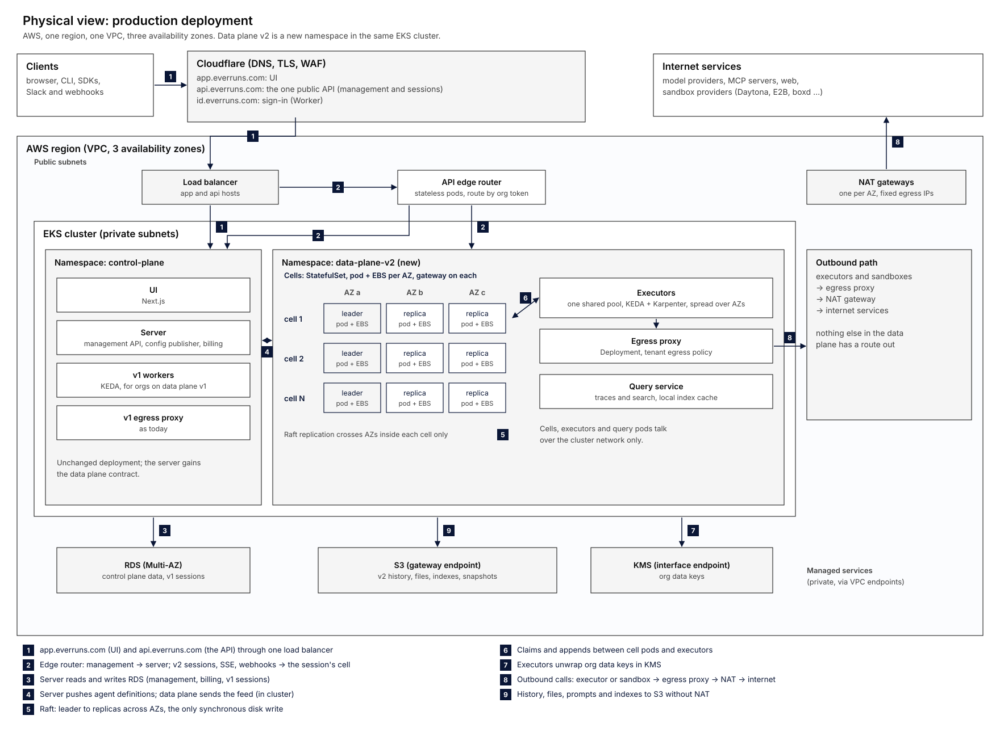
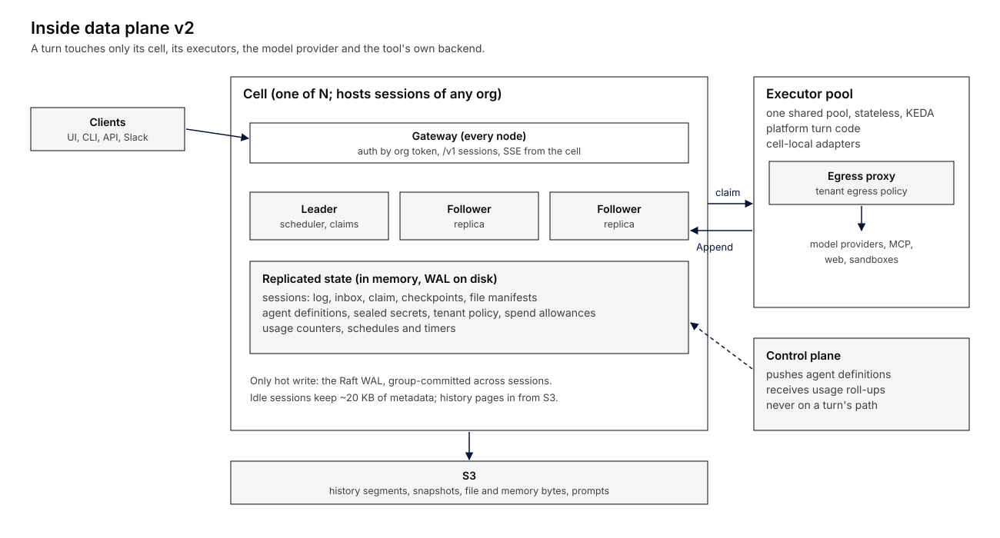
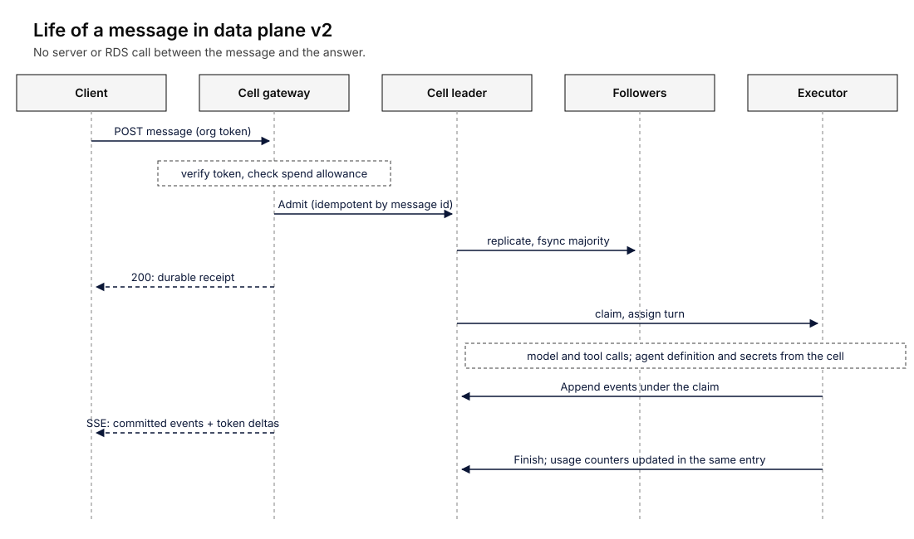
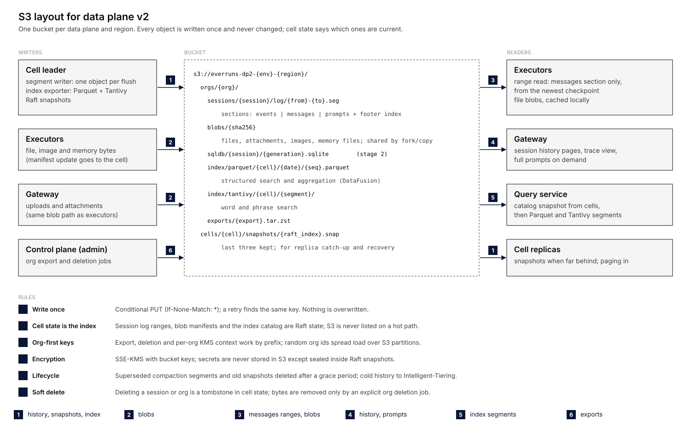

# Everruns data plane v2: cells

Status: approved 2026-11-09; implementation in progress, step by step (see "Implementation plan").

Goal: run 75 000 agents on Everruns. Backward compatibility is not a
constraint. The cell architecture comes from `everruns/funout` (`0a0c0ec`: cells as Everruns Engine hosting profiles).

## Summary

Everruns splits into one **control plane** for management and two **data
planes** for running agents. The control plane (server + RDS) owns orgs,
users, agents, secrets, connections and billing. Data plane v1 is today's
server-and-workers execution. Data plane v2 is new: cells that hold sessions
in Raft-replicated memory, run turns on their own executors and keep history
in S3. Each org runs on one data plane. Clients manage through the control
plane and send session traffic straight to their org's data plane, so a v2
turn never touches the server or RDS.







## Why this shape

An earlier version of this plan kept one shared data path and replaced only
RDS's session log with cells. It could not reach 75k: every turn still made
gRPC calls to the server for agents, secrets, usage, budgets, files and MCP
tokens, most of them RDS reads, and NATS and the server stayed on every
turn. Most of the work also went into making old and new paths coexist.

Splitting by data plane fixes both:

- **Nothing central on the turn path.** A v2 turn gets its agent
  definition and sealed secrets from caches the data plane keeps current,
  checks spend against its cell's local allowance, writes only the cell's
  Raft log, and streams to the client from the cell's gateway.
- **Little coexistence work.** v2 orgs never reach the server's session
  features (sessions, messages, events, trace, files), so those need no cell
  path. The server gains a small contract with data planes, nothing more.
- **Capacity grows by adding cells.** Each cell is independent; nothing on a
  turn's path crosses cells.

## Control plane

Owns everything about *what* runs, never the running of it:

- orgs, users, auth, agents, harnesses, capabilities settings, secrets,
  connections, providers, billing;
- the org setting `data_plane = v1 | v2` (cells inside a data plane are the data plane's business);
- the UI and CLI management API, unchanged.

### Contract with data planes

| Direction | What | How |
| --- | --- | --- |
| Control → data | Full agent definitions (revisions), tenant secrets and connections, tenant policy and limits; spend allowances on request | Pushed on every edit from an RDS outbox, retried until acknowledged; stored in the data plane registry, not in any particular cell |
| Control → client | A short-lived signed org token naming the org's data plane | Issued at sign-in or API key exchange; the edge router and gateways verify it with the control plane's public keys (JWKS), no call back |
| Data → control | Usage and cost, session summaries for lists and search, health | Batched feed, async; drives billing roll-ups and the org overview |
| Control → data | Admin: enable, suspend, export or delete an org's data (cells, drains and moves stay internal to the data plane) | Data plane admin API |

Full schema and rules: [cp-dp-protocol.md](cp-dp-protocol.md).

Data plane v1 implements the contract trivially: it shares the control
plane's RDS, so config pushes and the feed are no-ops and its gateway is today's
server.

## Data plane v2



### Cells

A cell is three nodes (one per zone) running one Raft group, ported from
funout:

- **State in memory, replicated.** Sessions (journal and Engine authority state: binding, admitted input,
  epoch, receipts, checkpoints) of any orgs, their usage counters and
  spend allowances, timers, and the other placeable units it hosts (shared
  volumes, schedules). Times and ids travel in commands, so every replica applies the
  same state.
- **The Raft WAL is the only hot write,** group-committed across sessions
  (append commit p50 1.4 ms in funout on one VM; on a three-zone cell with
  EBS it will be several times that, which is why waited round trips per
  turn are a budget).
- **History in S3**: immutable segments with messages-only companions,
  tiered compaction, snapshots. Idle sessions keep ~20 KB of metadata in
  memory and page history in when needed.
- **Moves, rebalancing, draining and live membership** as funout built and
  proved them under `kill -9`.

### Placement: sessions, not orgs

Nothing ties an org to a cell. The unit of placement is the **session**
(plus a few other small units: a shared volume such as org Memories, a
schedule), as in funout:

- **Any cell hosts sessions of any org.** Thousands of small orgs share a
  cell; a large org's sessions spread over many cells. A new session goes
  to the less loaded of two random cells (with a mild preference for cells
  already running the org's agents, for warm caches). An org policy can
  pin an org to a dedicated pool of cells, for isolation or noisy orgs.
- **Units move freely.** A move freezes the unit in its source cell, hands
  back the running epoch at the next step boundary, installs the unit's
  metadata in the target, repoints the directory and leaves a forward.
  History is already in S3 and does not move, so a move costs metadata
  only. The rebalancer uses this for hot cells; draining uses it to empty a
  cell.
- **Every placement has a generation.** Each unit carries a placement
  generation that only grows, and each move has a transfer id. Import,
  activation, directory updates, forwards and cleanup all name the
  generation they belong to, and a cell or the directory rejects anything
  older than what it has seen. Cells keep a tombstone with the last
  generation of every unit that left them, so a delayed import from an old
  move (A → B arriving after B → C) is refused rather than revived. The
  destination holds the imported unit **prepared** (not runnable) and
  becomes executable only when the directory commits the new generation;
  only a prepared copy can be activated, so a late duplicate activation
  can't wake a copy that has since started **leaving** (the model found
  that hole when both were one "frozen" state). A move whose import or
  place is lost is abandoned by the source taking the unit back through
  the directory at a higher generation, so the stale prepared copy can
  never be activated and is dropped by generation. Freeze waits for the
  session's pending event batch to commit or fail before it takes the
  image, so no half-written step travels. funout's moves at
  `8ce744b` lack these checks (`Import` accepts any unit the cell doesn't
  hold, `Place` overwrites without a version, `Forward` doesn't name its
  move), so the port adds them, and the move model in "Formal models" is
  written first.
- **The registry** is a small replicated group (sharded by id as it grows)
  that holds what is per data plane rather than per cell: the directory
  (unit → cell), each agent's current revision, tenants (data key, secrets, policy) and the change stream. It changes only
  when a unit is created or moved, an agent is edited or tenant policy
  changes, so its write rate stays low. Gateways and cells cache it; it is
  not on the per-step path.
- **The data plane knows agents, not org configuration.** It has no notion
  of harnesses, org defaults, members or capability settings. The control
  plane resolves those (with the platform's existing resolution code) into
  a **full agent definition** per agent, with a revision number, and sends
  that. An edit to a harness or the org default model makes the control
  plane re-resolve the affected agents and send their new revisions; that
  fan-out happens once, at edit time, off the turn path. Framework apps and
  the platform look the same to the data plane: a session runs an agent
  definition.
  - The org survives only as an opaque **tenant**: an id, its sealed data
    key, its secret and connection-token store, its spend allowances and
    its operational limits.
  - Every change goes onto one data-plane-wide **change stream** ("agent
    A is now at revision R", "tenant T policy changed"); every cell and
    executor subscribes to all of it and drops what it cached. Edits are
    rare, so broadcasting everything costs nothing and nobody tracks who
    hosts what. Sequence numbers detect gaps; a gap drops the whole cache.
  - The executor caches the hydrated agent under `(agent, revision)`, and
    the turn records the revision. A turn keeps that revision until it
    finishes, also across a crash, a hand-off or a move: an activation for
    an unfinished turn carries the turn's retained revision, and only a new
    turn gets the current one. A tool operation that is waiting (approval,
    detached call) also records the tool's implementation version and its
    effective arguments, and resumes only on an executor that has them.
- **Execution context: who a turn acts for.** Some access depends on the
  person, not the agent: a person's own MCP connections and OAuth tokens
  are exposed only when that person wrote the input or takes part in the
  session. An agent definition can't hold that, so each admitted input
  carries an **execution context**: the verified author (from the org
  token at the gateway), the session's participants, and the resource
  grants the agent definition allows for them. The executor resolves
  per-person connections from the tenant secret store using that context,
  as today's user-MCP layer does with the verified input author.
- **Credentials and suspension have a freshness bound.** A connection
  token is refreshed by one holder at a time: the refresher takes a short
  lease on the connection in the registry, writes the new token with a
  higher revision, and a token with a lower revision (a delayed feed, an
  old full snapshot) never overwrites it. Suspension and policy changes go
  out on the change stream, and every executor, stream node and egress
  proxy must have heard from it within 30 s; past that it finishes the
  current model or tool call and starts nothing new until it catches up.
  So suspension is immediate when the data plane is connected and takes at
  most 30 s through a partition. During a control plane outage longer than
  the 10-minute token lifetime, new clients can't sign in, while running
  sessions continue.
- **Budgets stay in the control plane, enforced with allowances.** The
  control plane's ledger and usage policies (notify, ask to continue,
  stop) remain the single source of truth. A cell that runs a tenant's
  turn holds a small **spend allowance** for that tenant, granted by the
  control plane; it spends from it locally (no call per turn) and asks for
  more when it runs low, reporting what it used. The control plane sizes
  each grant from the remaining balance (smaller as it nears zero). The
  product guarantee is a **strict cap on authorized spend**:
  - Every grant has an id and is reserved in the ledger when issued.
  - Before each chargeable operation (a model call, a sandbox lease, a
    paid tool) the cell reserves that operation's maximum cost from the
    allowance (for a model call: prompt plus `max_tokens` at the model's
    price) and settles the actual cost after it. A turn never starts a
    call its allowance can't cover.
  - The cell reports usage per grant. A grant is closed only by the cell's
    final settlement for it, never by time: an expired grant stops being
    spendable at once, but its reserved amount returns to the balance only
    when the settlement arrives. If a cell is lost, its open grants count
    as fully spent until disaster recovery reconciles them.
  - So the sum of grants can never exceed the balance. Actual cost can pass
    a reservation only when a provider bills more than the declared
    maximum, and that difference is reported as an overrun.
  If the control plane is down, cells keep running until their allowances
  are spent, then new turns wait rather than fail. Policy actions such as
  "ask to continue" come back as tenant policy changes on the change
  stream. Operational limits (concurrent sessions, rate limits) are only
  safety nets: plain per-cell caps from the tenant policy, no coordination.
- **Org-wide lists** (the Sessions page) are served by the control plane
  from the session summaries it receives on the feed, so they may lag a
  second or two; nothing fans out over cells and nothing is written to the
  registry per turn. Search over content uses the query service.

### Upgrading code

Moves are what make every upgrade safe:

- **Executors** are stateless: a rolling deploy hands epochs back at step
  boundaries and other executors resume (no moves at all).
- **Cell nodes, compatible change** (the common case; cell state follows
  the same additive rules as the session protocol): rolling restart one
  replica at a time; Raft keeps quorum, sessions keep running.
- **Cell nodes, breaking change or a risky release:** blue/green cells.
  Start cells on the new release, mark old cells draining, the rebalancer
  moves their units over at a controlled rate, and empty old cells are
  retired. Mixed releases coexist, so the directory and move protocol
  stay compatible across adjacent releases (checked in CI).
- The same drain handles cell replacement, zone evacuation and shrinking
  the fleet.

### Gateways

Every cell node serves the `/v1` session API (create session, send message,
read events, SSE, cancel, approvals, tool results) with the same shapes as
today. Clients never call a gateway directly: one public API
(`api.everruns.com/v1`, one token) sits behind a stateless **edge router**
that verifies the org token, sends `/v1/sessions/*` of v2 orgs to the
session's cell and everything else (and v1 sessions) to the control plane. The
UI, CLI and SDKs keep one URL, a session move between cells is invisible to
them, and the control plane stays off the message path. Streaming is
described under "Live streaming" below. No NATS. Org-wide session lists come from the control plane (feed summaries).

### Executors

Executors are **one shared pool per data plane** (stateless pods, KEDA on
running plus waiting turns across all cells), not a pool per cell: sessions
of any org are spread over every cell, so per-cell pools would fragment
capacity. Executors pull work with **credits**: an executor splits its free slots
among the cells it talks to and never offers the same slot twice (a cell
holding an unused credit returns it after a short timeout, and the
executor re-offers it elsewhere). A cell's leader hands out an activation
only against a credit, so an executor can't be oversubscribed, and each
cell has a **per-cell cap** on running turns so one hot cell can't take
the whole pool. Dispatch has **soft affinity**: a cell offers a
session's activation first to the executor that ran it last, if that
executor has a credit, and otherwise to any. Affinity alone doesn't keep a
session warm, because Engine rebuilds its stored view per epoch, so each
executor keeps a bounded cache of immutable context (history segments,
checkpoints) across activations, and Engine's per-session handles on an
executor sit behind an LRU so an executor doesn't slowly accumulate every
session it ever touched. The bench measures cache misses and S3 reads per
warm turn rather than assuming zero. **Each cell is an Everruns Engine hosting
profile**, as funout now does: the cell implements Engine's
`SessionHosting` SPI (admission, journal, receipts, execution epochs and the
wakeup obligation in one consistency domain, every operation a Raft
command, Engine's shared command reducer running inside apply), and an
executor runs `Engine::activate`. Turn logic, steering, durable waits,
cancel, approvals, tool results and recovery are Everruns' own code; the
cell owns only replication, placement, moves, unloading and S3. Everruns'
hosting conformance suite runs against a cell.

What the executor adds is the **platform host**: hydrating agents from
definitions, an `EnvironmentFactory` that reopens the session's workspace
from the cell (see [fs.md](fs.md)), secrets unwrapped with the org's KMS
data key, and usage written with the epoch's entries.

**Fewer waited writes, without weakening durability.** As first ported to
Engine hosting, a funout turn made 23 sequential authority writes, each
waiting for its own commit (87% of an activation). funout's adapter cut
that to about 11 by sending lifecycle events in the background with
predicted sequence numbers. That returns a not-yet-committed result
through Engine's crash-durable `EventLog`, so a listener can see a
completed output that a crash then erases, and an input admitted mid-step
takes the predicted sequence, fails the batch, and re-runs the model call
with its usage never recorded. v2 does it in Engine, with an explicit
boundary instead:
- Events of a step go into a **pending batch**. The authority assigns the
  final sequence numbers when it commits the batch; listeners, SSE and
  the feed see an event only after that commit. A batch commits whole or
  not at all, and its batch id has a receipt, so a retry after a lost
  acknowledgement gets the original result.
- **Admission doesn't take journal sequences while an epoch is live.** A
  message that arrives mid-step goes to the inbox and is journaled at the
  next step boundary (steering keeps working, at step granularity).
- Some writes stay waited: authorizing a tool that isn't safe to repeat,
  the canonical model decision, and accounting settlement.
- **Every provider call is an attempt.** Before dispatch the executor
  durably records the attempt with its reserved maximum cost; after it,
  exactly one settlement, or an explicit "unresolved" state if the process
  died before usage came back. Unresolved spend stays reserved until
  reconciled, never counted as zero. A retry that makes a second billable
  request is a new attempt.
- `session.started` lives in the authority state, so an activation
  doesn't read the oldest history segment to check it.

The bench counts **waited authority round trips per turn**, per phase and
per model or tool call, with a target of 5 or fewer for a chat turn. On a
three-zone cell each wait is an executor-to-leader hop plus a quorum
fsync, so this count times that latency is the turn-overhead floor. The
target is per workload, never a reason to drop a required barrier.

**Agents are data the data plane keeps.** The control plane resolves each
agent fully (instructions, model, capabilities, MCP servers, sealed secret
references) and pushes the definition into the data plane as a numbered
revision stored in S3; every revision a session or trace refers to is
kept. A session points at its agent. When a **new turn** starts, the cell
resolves the pointer to the current definition (cached); the turn record
keeps `(agent_revision, protocol_major)`, and every later activation of
that unfinished turn (after a crash, hand-off or move) hydrates that
retained revision instead. The definition goes to Engine with the
activation (`prepare_activation`). Every revision is kept in S3, so
serving an old one needs no pinned executor; what it does need is an
executor whose native tools and hydration declare that they still support
it, which is a compatibility identity separate from the JSON schema. The
executor hydrates the live agent from the definition (pure CPU,
milliseconds), caches it by agent and revision, and drops it when unused. No agent
registry and no resolver call: the control plane is off the turn path, so
sessions keep running while it is down, and an edit applies at the next
turn. Framework apps keep code-registered agents; for them the definition
is the code.

**Supported rolling upgrades never stop or suspend sessions.** Engine's session binding pins
the agent identity and the session protocol major, never a release (funout
made the same change in `8ce744b`). A
rolling deploy works like today's worker drain: an executor that is
stopping hands its epochs back at the next step boundary
(`SessionEpoch::hand_off`) and another executor resumes them from the
journal. The session protocol (journal event types and payloads, reducer commands)
is versioned. Additive changes need no bump, with one rule about what
"additive" means: new optional fields are ignored by older readers, and new
**informational** event types (diagnostics, metrics) are skipped, but a new
event type that changes execution (an approval, a cancel, an operation
state) is declared **execution-critical** and listed as a capability the
session requires. Dispatch only sends a session to an executor that has
every capability the session's journal uses; an executor that meets one it
doesn't know stops and hands the epoch back rather than guess. A breaking
change bumps the major. Each
session records its major, each executor declares the range it supports,
and dispatch only hands a session to an executor that covers it. Once the
whole fleet supports a new major, the authority upgrades sessions at a
turn boundary; the next release can drop the old one. CI checks that event
payloads accept unknown fields and replays stored journals of every
supported major.

### Live streaming

Two kinds of events reach a watching client: **committed events** (durable,
in the journal) and **token deltas** (live typing, never stored). Engine's
listeners carry committed events only, so funout lost deltas when it moved
to Engine hosting; v2 adds them back with a small Engine hook (plan step 1).

- **One stream node per session.** Within the session's cell, one of the
  three nodes serves all of that session's live streams, chosen by
  rendezvous hashing of the session id over the cell's **committed
  membership view** (the Raft configuration plus a view generation, not
  each component's own idea of who is alive). The edge router caches
  session → cell (from the directory) and computes the node itself, so an
  SSE request takes one hop; every watcher of a session lands on the same
  node. Edge and executor send the view generation they hashed with; a
  node that isn't the owner in the current view redirects with the new
  view instead of serving.
- **Committed events** come from that node's own replica as it applies
  them, so no extra copy is made.
- **Deltas go straight from the executor to the stream node** (same hash,
  no lookup), over the connection the executor already holds to the cell,
  and never touch Raft or disk. The node drops them when the session has
  no watchers, so an unwatched turn costs nothing.
- **Fencing:** deltas carry `(turn, step, attempt, seq)`, where the
  attempt is the durable model-call attempt above, and the stream node
  accepts them only from the executor holding the session's current epoch.
  The committed event that ends an attempt closes it; later deltas for
  that attempt, or deltas from a replaced attempt, are dropped.
- **Resume:** a reconnecting client resumes from its last committed event
  id (`since_id`); deltas missed while disconnected are not replayed, as
  today. If the node it lands on hasn't yet applied up to `since_id`, it
  waits until it has (or redirects); a cursor never moves backwards.
- **Engine hook (step 1):** `SessionEpoch::live_deltas` hands an epoch's
  deltas to the host as `LiveDelta { fence, attempt: (turn, stream), seq,
  event }`. Until durable model-call attempts land, the stream is the
  assistant message id (the tool call id for tool output, the atom
  execution for thinking); a committed `output.message.completed`,
  `tool.completed` or `reason.completed` closes it on the executor too.
- **Moves and failures:** a move ends the stream with a `moved` event;
  the client reconnects and the edge re-resolves. If the stream node dies,
  the hash picks another live node and clients reconnect with `since_id`.
- **Tests:** a stale publisher after its epoch is lost, edge and executor
  on different membership views, reconnect to a lagging follower, and a
  move during the replay-to-live handoff.
- **Load:** deltas are the heaviest live traffic (tens of thousands of
  small messages per second per cell at full load); they are batched per
  session every ~50 ms and the stress bench has a budget for them.

Executors are separate from the cell's three state nodes on purpose: in
funout, turns on the same nodes delayed Raft heartbeats until a node cap of
256 turns was needed. Separate pods keep consensus stable and let turn
capacity scale in seconds.

### Life of a message



### What a turn needs, and where it comes from

| Need | v1 (today) | v2 |
| --- | --- | --- |
| Agent, harness, capabilities | gRPC → server → RDS | Full agent definition handed over with the activation (cached by agent and revision) |
| Secrets, provider keys | gRPC, decrypted by server | Tenant secret store holds them sealed; executor decrypts with the org's KMS-wrapped data key |
| Budget check, usage | RDS ledger | Control plane ledger; cells enforce locally from spend allowances it grants |
| Session log | RDS `events` | Cell Raft log + S3 |
| Files | Session file storage via server | Workspace tree: root and recent changes in the cell, contents in S3 by hash ([fs.md](fs.md)) |
| Sandboxes, MCP, web tools | Executor calls provider; records via server | Executor calls provider; records in cell state |
| OAuth tokens (MCP, connections) | Server refreshes | Tenant secret store; the data plane refreshes and reports the new token on the feed |
| Schedules, triggers | Durable scheduler in RDS | Timers in cell state; inbound webhooks go through the edge router to the data plane |
| Streaming | NATS | Cell gateway |

### Where things live

| Thing | Source of truth | Copy or cache | On a turn's path |
| --- | --- | --- | --- |
| Agent, harness, capability config | Control plane RDS (edited via UI, CLI, API) | Full agent definitions by revision in S3; current revision in the registry; executor cache | Cached definition only |
| Org secrets, provider keys, OAuth tokens | Control plane RDS, encrypted | Tenant secret store in the registry, sealed with a per-org data key (envelope encryption, key wrapped by KMS) | Executor unwraps the data key via KMS (cached) and decrypts in memory; cell nodes never see plaintext |
| Session secrets (set during a session) | Cell state, sealed with the same org data key | | Yes, local |
| Session log | Cell Raft log, then S3 segments | | Yes, local |
| Session files (workspace) | Root and recent changes in cell state; tree nodes and contents in S3 by hash ([fs.md](fs.md)) | Executor cache, data plane chunk cache | A commit is a Raft entry; large contents go through the chunk cache to S3 |
| Session SQL database | SQLite file per session in S3, opened by the executor for the turn | | Stage 2 |
| Org Memories (shared, mountable) | A shared volume: a placeable unit on some cell (movable like a session), tree in S3 | Read-only mounts read S3 directly; writes go to the cell hosting the volume | Reads local to S3; writes one hop to the volume's cell |
| Traces (one session) | The session log itself; full model prompts stored as S3 objects referenced from `llm.generation` | | No; read by the gateway on demand |
| Traces (across sessions: costs, monitoring, reporting) | Analytical copy in S3 written by the cell's segment writer (the trace-store format: "an analytical copy, never a journal") | Catalog entries as Raft commands in the writing cell | No |
| Usage, budgets | Control plane ledger and usage policies | Spend allowance per tenant in the cell; usage feed back | Yes, local (allowance) |
| Egress | Policy (allowlists, caps, kill switch) in the tenant policy | | Every outbound call of executors and sandboxes goes through the data plane's egress proxy pool; the cell signs a per-turn proxy token the proxy verifies locally; egress usage joins the turn's usage counters |

#### Trace and session search in v2

This follows the separate trace and session search proposal (DataFusion +
Parquet for structured search and aggregation, Tantivy for word and phrase
search, S3 for immutable indexes and payloads, an async exporter publishing
through a catalog). In v2 its PostgreSQL part maps onto the cell:

| PostgreSQL role in that proposal | v2 |
| --- | --- |
| Live execution, session metadata | Cell state |
| Permissions | Org token from the control plane; queries are scoped to one org |
| Deletion visibility | Tombstones in cell state, applied before counts and pagination |
| Catalog (atomic publication) | Catalog entries as Raft commands in the cell that wrote them: an index is visible once its entry commits |

- **Exporter:** the cell's segment writer, which already writes immutable
  history segments, also builds Parquet files and Tantivy segments for the
  same events, off the turn path, and commits their catalog entry.
- **Query service:** stateless pods in the data plane (DataFusion + Tantivy
  readers with local caches), scoped by org token, reading a consistent
  catalog snapshot from each cell in the org's **catalog lineage** and
  fanning out.
- **Catalog lineage is not placement.** Indexes stay where they were
  written even after every session of the org has moved away. The
  registry records, once per org and cell, that the cell holds index
  entries for the org (a rare write), and queries use that list, not
  current session placement. Draining a cell hands its catalog entries to
  another cell before retirement, and deletion tombstones apply to every
  historical segment and to cached query plans. Test: index on A, move all
  the org's sessions to B, retire A, then query and delete through B.
  This must hold before search or analytics are enabled for v2 orgs.
- **Freshness:** results report how far the index lags; the unindexed tail
  can be merged from cell memory when a query needs it.

Today, by comparison: config, secrets, session files metadata, Memories and
traces all live in RDS (file bytes already in S3), and the egress proxy is
one shared service with its own limits store.

### Storage in S3



One bucket per data plane and region, `s3://everruns-dp2-{env}-{region}/`.
S3 holds bytes; the cell holds the truth about which bytes matter.

**Keys** (org first, so export, deletion and per-org encryption context
work by prefix, and random org ids spread load across S3 partitions):

| Key | What | Written by | Read by |
| --- | --- | --- | --- |
| `orgs/{org}/sessions/{session}/log/{from}-{to}.seg` | Session history: one object per flush, with events, messages and prompts sections and a footer index. Compaction writes larger replacement segments (funout's tiered compaction, messages-only companions) | Cell leader (segment writer) | Executors (range read of the messages section from the newest checkpoint), gateway (history pages, trace view, full prompts) |
| `orgs/{org}/blobs/{sha256}` | File, attachment, image and memory bytes, content-addressed, so fork and copy share them | Executors, gateway uploads | Executors (local cache), gateway downloads |
| `orgs/{org}/sqldb/{session}/{generation}.sqlite` | Session SQL database (stage 2), a new generation per committed turn | Executors | Executors |
| `orgs/{org}/index/parquet/{cell}/{date}/{seq}.parquet`, `orgs/{org}/index/tantivy/{cell}/{segment}/` | Trace and session search indexes | Cell leader (exporter) | Query service |
| `orgs/{org}/exports/{export}.tar.zst` | Org export, used to move an org between data planes or for a download | Control plane admin job | Control plane, importing cell |
| `cells/{cell}/snapshots/{raft_index}.snap` | Raft snapshots, last three kept | Cell leader | Replicas that fall far behind, recovery |

**Rules**

- **Write once.** Every PUT is conditional (`If-None-Match: *`); a retry
  finds the same key. Nothing is overwritten, so readers never see a torn or
  changed object and caches never go stale.
- **Cell state is the index.** Which segments cover a session, which blobs a
  manifest points to, which index files are published: all Raft state. S3 is
  never listed on a hot path. An object without a committed reference is
  invisible and is cleaned up by the sweeper.
- **Encryption.** SSE-KMS with bucket keys (one KMS call per bucket key, not
  per object). Secrets never go to S3 except sealed inside Raft snapshots.
- **Lifecycle.** Segments replaced by compaction and old snapshots are
  deleted only after no supported restore point refers to them (see
  "Disaster recovery"), since they are copies. History older than
  30 days moves to Intelligent-Tiering.
- **Soft delete.** Deleting a session or org writes a tombstone in cell
  state; reads and counts respect it at once. Original bytes are removed only
  by an explicit org deletion job, never by retention, matching the rule that
  records are never purged.
- **No blob garbage collection.** Blobs are shared across the org's
  sessions while reference counts would live in separate cells, so local
  absence of references proves nothing. Blobs are removed only by the
  explicit org deletion job, which matches the data rule that records are
  never purged. If storage cost ever needs it, a global mark-and-sweep over
  every cell and restore point is a separate design.

**Cost and load, estimated.** At 1 250 turns/s with one flush per turn, about
1 250 segment PUTs/s plus blob PUTs from file writes. S3 handles 3 500 PUTs/s
per prefix, and org-first random prefixes spread it further. Group flushing
(several sessions' events in one segment) is the fallback if PUT cost
dominates; funout's per-session segments are the starting point. Reads are
mostly range GETs that executors cache; with session affinity most warm
turns read nothing from S3, and the bench reports the miss rate.

## Features, in stages

v2 starts small and grows; a feature missing in v2 is hidden for v2 orgs.

1. **Core**: agents, harnesses, sessions, messages, SSE, built-in
   capabilities and tools, model providers, usage and budgets, cancel,
   approvals, client-side tools, compaction.
2. **Platform**: session files, MCP servers, sandboxes, schedules and
   triggers, detached tool calls, agents using agents.
3. **Integrations**: Slack and other channels, observers and evals, trace
   exports, analytics export to a warehouse.

## Scale estimate for 75 000 agents

From funout `0a0c0ec` on one 4-vCPU VM (three replicas of one cell),
under Engine hosting, with simulated chat agents: about **115 turns/s per
cell, flat** over 40 sessions × 5 000 turns (p50 100 to 130 ms, 390 to
470 MB RSS per node). The pre-Engine driver did 131/s (and 75 000
sessions on 2 cells at 251 turns/s), so Engine hosting is about 12% and
40 ms p50 behind. Not yet measured under Engine: the 75k-session run, CPU
per turn, and memory for Engine's per-session handle.

If each of 75 000 agents takes a turn a minute, that is ~1 250 turns/s.
At 115 turns/s that is 11 cells **at saturation** (98% utilization, no
room for a lost node, platform work or backlog), so it is a lower bound,
not the estimate: with headroom for one cell's worth of failure and 70%
target utilization, plan on about 16 cells (48 state pods) until step 0
measures cells on separate machines per replica. Executors are sized by
concurrent turns (at ~2 MiB per running turn, 7 500 running turns need
~15 GB across the pool). Platform turns cost more CPU than funout's sim
agent; the stress bench (plan steps 0 and 6) measures the real numbers.

These are hypotheses, not capacity results, and they move a lot with a few
assumptions:

| Assumption | What it changes |
| --- | --- |
| One turn per agent per minute | 1 250 turns/s; agent count alone says nothing about load |
| Average turn takes ~6 s | ~7 500 running turns, ~15 GB of executor memory |
| Average turn takes 30 s | ~37 500 running turns, ~73 GB of executor memory |
| One history PUT per turn | ~108 million PUTs a day before blobs, indexes, replication and compaction |
| Workspace deltas near the 64 KiB cap | ~4.9 GB of cell state, ~14.7 GB across three replicas |
| Commit latency from one VM | Says nothing about three-zone network and EBS latency |

The 115 turns/s result relies on funout's background-append pipeline,
which has the durability problem described under "Executors"; it becomes
the qualified baseline only after the bench reruns it with the committed
batch boundary. None of these is a v2 capacity number until the bench
reruns them on the real path. Shared services (egress proxies, chunk cache, KMS, cold
definition reads) get their own saturation and failure budgets, and
analytical export, compaction, snapshots and SSE fan-out run with resources
isolated from consensus.

## Layout

```text
crates/cell/            everruns-cell: Raft state machine, WAL, S3 store, directory,
                        moves, rebalancer, gateway (/v1), node binary
  benches/  tests/  scripts/   (fleet, chaos, soak, scale, many_sessions,
                                big_context, prove_*, ported from funout)
crates/cell-executor/   executor binary: Engine + platform host (agent hydration,
                        environment factory, usage), no turn logic of its own
crates/cell-testkit/    unpublished: sim executor, load and check tool
crates/server           data_plane module: org setting, agent resolution + config outbox,
                        tokens, allowances, feed ingest
```

`cell-executor` is separate because it links the platform runtime (heavy),
while the cell nodes stay small. Deleting v2 later means removing three
crates and one server module; deleting v1 means removing workers and the
server's session domains.

## Testing

Testing is a deliverable of every phase, not a later phase. funout's habit stays: a whole data plane runs on one machine with no database, control plane, cloud account or real model. Every run ends with an invariant check over every session, and a red check fails the run.

### Simulators (`crates/cell-testkit`, unpublished)

| Real thing | Simulator |
| --- | --- |
| Model providers | llmsim with the prod mix (Luna, Sol, Muse, long tool calls), controllable latency, errors and stream cuts |
| Executor (cells-alone level) | Sim executor: Engine-shaped activations without platform code |
| S3 | In-process object store, or local SeaweedFS for conditional PUTs and range reads; fault mode (slow, 5xx, throttling) |
| KMS | Local key service with the same wrap/unwrap API |
| Control plane | Fake that serves `/dp/v1` (config changes, allowances, feed sink, JWKS) from files, with a "down" switch |
| Disk | fsync delay shim (`LD_PRELOAD`, as in the stress bench) to model EBS latency |
| Network | Fault layer in the cell transport: drop, delay, partition one node or a whole zone |
| Sandboxes, MCP, web | Test tools with known side effects, so "ran exactly once" is checkable |

### Invariants checked after every run

- Every accepted input has exactly one durable disposition (a new turn, steering into a running turn, or a recorded rejection).
- Journals are dense, ids are unique, and replicas agree byte for byte.
- Each logical tool operation (by its operation id and idempotency key) had at most one external effect, also across moves, restores and lost acknowledgements.
- Every provider call attempt was recorded before dispatch and has exactly one settlement or an explicit unresolved state; no usage is lost when input arrives mid-step.
- No listener, stream or feed saw an event that was not committed.
- No placement generation ever went backwards in a cell or in the directory.
- Feed records and grant settlements reached the control plane exactly once by id, and authorized spend never passed the balance.
- No committed file write was lost, and forks are independent.
- Every session is in exactly one cell, and the directory agrees.
- After an upgrade, no session was suspended for build or protocol reasons.

### Levels

1. **Cells alone, sim executor.** Fleet, chaos (`kill -9` of leaders and followers), partitions, soak, scale (75 000 sessions on one machine, as funout proved), large messages, long sessions (200 000 turns), moves, rebalance, scale in and out, blue/green drain.
2. **Cells + real executor** (Engine plus platform host), with llmsim, the fake control plane and file-based agent definitions. The same chaos and invariants, plus Everruns' hosting conformance suite against a 3-node cell.
3. **Full v2 locally.** Real control plane, edge router, cells, executors and UI via `start-all` with a v2 data plane. Covers e2e tests through the UI and API, CP-down (sessions keep running, turns wait once allowances run out), config changes during turns, and token expiry.
4. **Upgrade tests.** A mixed-release fleet built from the previous release tag: rolling executor deploy mid-turn, rolling cell restart, blue/green cell drain, and replay of stored journals from every supported protocol major. Pass means zero suspended sessions and all invariants green.

### Stress bench with budgets

`just stress-v2` extends today's `scripts/stress`:
- It runs levels 1 and 2 at fixed loads (100, 1 000, 10 000 and 75 000 agents) and a sweep runner for tuning knobs (batch size, writes in flight, executor slots, segment size).
- It reports cost per turn against a written budget, like the 8k budgets: CPU per turn (cell, executor), fsyncs and WAL bytes per turn, S3 PUTs and GETs per turn, memory per idle and per active session, Raft commit latency, and platform overhead per model call (p50 and p99).
- Each budget has a "fits 75k" line. A change that regresses a budget fails the bench, the same gate the 8k program used.
- The **long-session gate** is part of it: 200 000 turns, with throughput and per-turn latency flat as sessions grow. This closes the Engine hosting regression first.

### CI tiers

| When | What |
| --- | --- |
| Every PR touching `crates/cell*`, hosting or the executor | Unit and state-machine property tests, hosting conformance on a cell, a 2-minute chaos run with invariants, protocol contract tests (`/dp/v1` schemas, unknown-field tolerance) |
| Nightly | Soak (1 h chaos), 75k scale, long-session gate, upgrade tests against the last release, stress bench with budgets; results posted with a trend |
| Weekly | Large-org and many-small-org placement runs, zone loss |
| Before each prod ramp step | The same stress profile against EKS with llmsim; prod is only the final check, never the discovery tool |

There are no `#[ignore]` tests: what can't run on every PR runs nightly or weekly, and examples use real models.

### Formal models and deterministic simulation

Running many cells finds the bugs that are common. The dangerous ones sit at a few known interleavings: a leader change in the middle of a group commit, an epoch expiring while its holder's write is in flight, a move racing a hand-off, a snapshot installed during segment compaction. Three tools target those directly. funout has none of them today.

1. **Formal models of our protocols (TLA+, checked with TLC or Apalache).** Raft itself is openraft's, so the models cover what we build on top of it:
   - epochs and fencing;
   - session moves (freeze, hand-off, install, forward) and the directory, including a move while an event batch is pending;
   - turn admission and exactly-once completion;
   - file commits against the workspace root;
   - spend allowances;
   - the config change stream.

   The safety properties are the same invariants as above: one writer per session, never two owners during a move, no lost commit, a bounded overspend. Small models (3 nodes, 2 cells, 3 sessions) explore every interleaving and find the protocol bugs before code exists. Each model is written in the same phase as the protocol it covers.
2. **Deterministic simulation of the real cell code** (FoundationDB style; madsim or turmoil):
   - The cell runs under a seeded scheduler with simulated network, disk (fsync latency, torn tail writes, full disk) and clock.
   - Load is logical rather than wall-clock, so a seed runs millions of commands (heavy multi-session load, long sessions, oversized entries split into pieces) in seconds of CPU.
   - Code marks **points of interest** with `buggify!` hooks: before and after fsync, between Raft apply and segment flush, mid-move, at epoch expiry, around the snapshot install. The simulator fires faults and reorderings preferentially at those points.
   - A failing seed replays exactly, and becomes a regression test.
   - The point list is derived from the models: every model action that interleaves with another becomes a hook.
3. **Trace checking.** Simulation runs emit protocol events that are checked against the TLA+ model's transitions, so the code can't quietly drift from the spec.

**Finding where load hurts:** a simple queueing model of the leader (group-commit batch size, writes in flight, apply cost, flush cost) predicts saturation points: batch-size cliffs, the 64 KiB entry cap, queue growth on long sessions. The simulator and the stress bench then aim straight at those points, instead of searching blindly with more cells.

**CI:**
- Every PR: model checks and about 10 000 simulation seeds.
- Nightly: millions of seeds, with new failing seeds filed automatically.

The simulation harness lands in plan step 5, with the first models (epochs, moves) before the move code is ported. The first models (moves, spend grants, feed) are in [models.md](models.md).

## Disaster recovery

The bar is what RDS gives us today: no loss from a node or zone failure, a
small stated loss window from anything worse, and a point-in-time restore.

| Failure | What happens | Data lost |
| --- | --- | --- |
| One node or one zone | Raft elects a new leader on the surviving quorum; the replaced node catches up from a snapshot and the log | None |
| A cell loses quorum (two zones, correlated disks) | The cell is rebuilt from its last snapshot plus the shipped log in S3, on new nodes, as a new incarnation | Entries not yet shipped: target under 2 s, enforced by backpressure; never a started side effect |
| Registry shard loses quorum | Same rebuild; directory entries for sessions created in the window are re-derived from the cells' own state | Same window, then repaired |
| S3 bucket damage or a bad delete | Object versioning; deletes are tombstones first (data rule: nothing is purged by accident) | None |
| Region loss | Restore in a second region from the replicated bucket and multi-region KMS keys | Replication lag: S3 Replication Time Control commits to 99.99% of objects within 15 minutes, so the regional target is 15 minutes, not seconds |
| Bad release corrupts state | Point-in-time restore of the affected cell, or of one org's sessions, to before the release | Turns after the chosen point |

How:

- **Log shipping.** Each cell leader writes its committed Raft batches to
  S3 continuously (an object per second or per few MB, whichever comes
  first). This is the same data the segments already hold, just shipped
  sooner, so the loss window on quorum loss is the shipping interval, not
  the segment interval. If shipping falls more than 5 s behind, the cell
  stops admitting new turns until it catches up, so the 2 s target is a
  bound and not a hope.
- **Ship before an external effect.** A lost log tail must not turn into a
  repeated side effect. A tool call that isn't safe to repeat (today's
  AtMostOnce class) already writes `tool.started` before it runs; in v2 it
  also waits until that record is shipped to S3 (a forced flush, one PUT,
  tens of milliseconds). After a restore, every started operation is
  known, and its idempotency key (derived from session, message and call)
  is the same as before. Operations whose outcome was lost are reported
  to the agent as "outcome unknown", as on a crash today; they are not
  rerun automatically.
- **Incarnations.** A rebuilt cell gets a new incarnation number. Feed
  record ids, executor epochs and moves carry it, so nothing from the lost
  incarnation (a late feed batch, a stale executor, an old move message)
  is accepted after the rebuild.
- **Snapshots.** Cells and registry shards snapshot to S3 on a schedule
  (and before every blue/green drain). Restore = latest snapshot before the
  target time + shipped log up to it.
- **Point-in-time restore**, for a whole cell or scoped to one org (replay
  only that org's units into a fresh cell, then repoint the directory).
- **Retention follows restore points.** A restore point (snapshot plus
  shipped log) is only useful if everything it refers to still exists:
  segments, workspace roots, tree nodes, blobs, agent revisions. Nothing
  referenced by a supported restore point is deleted; compaction marks
  replaced objects and they are removed only after the oldest restore
  point that uses them expires. Blobs are never collected at all (see
  "Storage in S3").
- **Bucket:** versioning, cross-region replication, object lock on
  snapshots and shipped log for the retention window. KMS multi-region keys
  so data keys can be unwrapped in the second region.
- **Control plane rollback.** RDS PITR as today, but restoring the control
  plane can leave the data plane ahead of it (data plane applied config
  version 120, RDS restored to 100). Config versions therefore carry a
  control plane epoch; a restored control plane starts a new epoch and the
  data plane accepts only a full snapshot in that epoch. Before that
  snapshot applies, the data plane reports every agent revision and
  secret it holds that the restored control plane doesn't know, and an
  operator decides per org whether to re-import them or drop them; running
  turns finish on their retained revision either way. The feed is kept in
  the shipped log for 30 days, so a restored control plane can replay from
  its own older cursor.
- **Restoring one org** also restores its shared volumes, schedules and
  connection tokens to the same point, and closes its grants: allowances
  are reissued from the control plane ledger, never from the restored
  cell.
- **Drills.** The weekly tier kills a cell's quorum in the bench and
  restores it, checking the stated loss window and the invariants. A
  quarterly drill restores a copy of production into a second region.
- **Bench budget:** log-shipping lag p99 under 2 s at 75k agents, and
  rebuild of a full cell under 10 minutes.

## Deployment and rollout

- Data plane v2 is a new deployment: its own namespace (or cluster) with
  cell StatefulSets (PVCs, zone spread), one shared executor Deployment with KEDA, and
  an S3 bucket. The control plane stays the existing one.
- Cells are static at first (`cells: N` in Helm); a new cell registers
  itself and takes new sessions. No operator until manual scaling hurts.
- Orgs opt in with the org setting: the Load Testing org first, then
  Alice's. New orgs can default to v2 once stage 1 is solid.
- Moving an org between data planes is export and import, done when the
  features it uses exist in v2.

## Implementation plan

One ordered plan that includes the platform-on-Engine work
([platform-on-engine.md](platform-on-engine.md)), because the cells need it
before they can run platform features. The rule for every step: **build
enough to run it, run it under the bench, and only move on when the step's
gate holds.** A gate is a number in `just stress-v2` (or the v1 `just
stress` bench) checked in CI, so a later step can't silently undo it.

| # | Step | Gate (bench) | Depends on |
| --- | --- | --- | --- |
| 0 | **Bench first, and the core protocols on paper.** `just stress-v2` with budgets and the long-session gate; v1 `just stress` gains the same per-turn report, including waited authority round trips per turn. Rerun funout `0a0c0ec` as the starting point and measure Engine hosting today: long-session throughput and latency against length, memory per idle session, per-model-call overhead at 100 and 1 000 agents. In parallel, write concrete failure traces and small TLA+ models for move generations, feed record ids, grant settlement, turn revision retention and recovery incarnations. | Baseline recorded; budgets written down; models check clean | none |
| 1 | **Engine hooks.** Definition with activation (`(agent_revision, protocol_major)` retained per turn, plus a compatibility identity for native tools), `SessionEpoch::hand_off`, the log-end fix, token delta hook with attempt fencing, session protocol versioning with execution-critical capabilities, execution context on admitted input. Move funout's adapter fixes into Engine the safe way: committed event batches with authority-assigned sequences, admission through the inbox during a live epoch, provider call attempts, `started` kept in authority state, an LRU for per-session handles. Then rerun the long-session bench, with steering. | Engine long-session: after compaction, throughput and p99 per turn at 200 000 turns within 10% of the first 1 000 turns, and within 10% of funout's own driver; waited round trips per chat turn ≤ 5; a killed executor before commit leaves no listener holding an uncommitted event; with steering, every provider attempt settled once; memory per idle session within budget | 0 |
| 2 | **Trusted host extensions** (composition, authorities, stores, resolvers). | Per-model-call overhead at 100 agents unchanged versus step 0 | 1 |
| 3 | **Agent definitions as data.** One definition format, built by the control plane, hydrated and cached by the Engine. | Hydration cost per activation (cold and warm) within budget | 1 |
| 4 | **Workers on the Engine** (PostgreSQL `SessionHosting`, still actors). Platform e2e and hosting conformance against PostgreSQL. `WorkerRuntimeHost` removed. It inherits step 1's batched commits, which on PostgreSQL is the difference between passing and failing the 8k budgets. | The 8k budgets of today's bench not regressed | 1, 2, 3 |
| 5 | **`crates/cell` + `crates/cell-testkit`.** Port funout `0a0c0ec` with Engine hosting, adding placement generations; registry, session placement, moves, spend allowances, log shipping. TLA+ models and the deterministic simulation harness. | Cells alone: 75k simulated agents, long session flat, chaos invariants, DST seeds clean | 1 (can start in parallel with 2 to 4) |
| 6 | **One thin, complete cell deployment.** Three state nodes, separate executors on credits, real Engine, a minimal agent definition, admission, cancel, recovery, streaming, a minimal durable workspace, and the CP protocol exercised early. Then the failure qualification: repeated moves with delayed old messages, lost acknowledgements, CP rollback, delayed feed, expired grants, stale executors, restore after an external effect. Stage-1 features come after this passes. | Level 2 and the failure suite green; overhead per turn and per-cell leader CPU within budget | 2, 3, 5 |
| 7 | **Control-plane contract** ([cp-dp-protocol.md](cp-dp-protocol.md)): outbox, org tokens, allowances, feed, v1 as the trivial implementation. | Config propagation p99 under 1 s; feed lag within budget; allowances never overspend in chaos | 5 |
| 8 | **Gateway, edge router, live streaming, local full v2** (`start-all` with a v2 data plane, real UI end to end). | Level 3: the whole stack locally, SSE first-delta latency and edge hop within budget | 6, 7 |
| 9 | **Disaster recovery:** log shipping, snapshots, point-in-time restore, restore drill in the weekly tier. | Loss window under 2 s; cell rebuild under 10 min | 5 |
| 10 | **Prove on EKS + operations.** Load Testing org, ramp to 75k agents with the llmsim mix and production-shaped conditions: cross-zone latency, realistic turn durations (including 30 s averages), cold caches, long histories, heavy streaming, S3 throttling, loss of a node and of a fraction of executors. Cell inspector CLI ("where is session X and what is it doing"), per-cell SLO dashboards, runbooks for leader loss, a stuck move and a drain. | 75k agents at the stated cost per agent and turn overhead, with spare capacity and recovery backlog measured, not just peak | 8, 9 |
| 11 | **Stages 2 and 3 features, then the v1 → v2 org move** (session import format, cutover of in-flight turns). | Each feature lands with its own bench line | 10 |

### Step 0 measurements (2026-11-09)

- **funout `0a0c0ec`**, one 3-node cell on a 4-core container, 40 chat
  sessions x 5 000 turns, 0.2 s think: 120 turns/s, p50 per turn flat
  across the run (91 to 113 ms per tenth; one tenth at 171 ms overlapped a
  local compile), about 400 MB resident per node.
- **Engine hosting today** (`cargo bench -p everruns --bench long_session`,
  `MemoryHosting`, llmsim with 150-token answers in an 8k window and
  compaction on): 22 authority writes per turn, and the time per turn grows
  with session length, about 100x by turn 500. Proactive compaction for a
  provider without native compaction trims the prompt in memory and saves no
  checkpoint, so every turn reloads the whole history, and every
  `llm.generation` event carries the untrimmed prompt. Step 1 must give
  that path a durable history floor before the long-session gate can hold.
  Fixed in step 1 (Trimmed checkpoints, checkpoint-aware loading, tail
  reads from the latest `turn.started`): p50 per turn now stays near 60 ms
  from turn 100 to 1 000.
- **Where a plain chat turn's 22 writes go** (Engine on `MemoryHosting`):
  9 journal appends, 4 lease renewals, 3 record commits, 2 wake schedules,
  2 claims, 1 release and 1 session record rewritten by every activation.
  Reads: 14 record reads, 11 session reads, 9 log pages, 4 storage key
  listings, 4 log-end lookups, 3 journal tails. Committed batches (appends
  to about 2), renewals that ride on batches, and one claim per activation
  are what brings writes to 5 or fewer.

### Step 1 measurements (2026-11-09)

Same bench, 4 sessions x 1 000 turns: **9 authority writes per chat turn, 5
waited** (claim, renew, the turn's opening batch, its closing batch,
release), flat from the second tenth to the last. Where the other 13 went:

- Gone. The separate turn-identity receipt (a fresh input's assignment is
  its turn identity); the wake time stored again unchanged (the claim
  returns it); and the session record rewritten by every activation (the
  synthetic harness and agent definition take session-derived ids, which
  also stops each turn from adding one more definition to the store).
- Folded. Lifecycle records ride on the next barrier, and a turn's final
  answer without tool calls rides with `turn.completed`. A terminal event
  is never held: an epoch that ends without a release must not lose it.
  A receipt the next holder can recompute rides on the next lease write:
  the outcome on the release and, after a clean release, the fresh input's
  assignment on the renew that reports its cancel.
- Behind the work. `reason.started`, `output.message.started`,
  `context.compacted` and `session.idled` commit in a background task,
  chained per session, while the work goes on. Each is counted as a write
  but not as a waited one.

What keeps this safe: a listener sees an event only after its commit, in
emission order; every later commit, tail read, steered input and lease
release commits held and background events first; an answer that calls
tools commits before any tool runs; a failed background commit fails the
next commit that waits for it. A crash loses only events and receipts the
next holder re-emits or recomputes from the log.

**Long sessions (gate run, 40 sessions x 5 000 turns, 200 000 turns, 4
cores):** p99 per turn stays within 10% (70 ms in the first tenth, 49 to
78 ms after); throughput after the first compactions holds within 11%
(1 043 turns/s in the second tenth, 929 to 1 032 after). One 20 000-turn
session: 261 turns/s in the second tenth, 215 to 238 after, p99 6 to 7.5
ms. Before the fixes below, the same run fell from 947 to 611 turns/s and
the in-memory authority ran out of memory. What it took:

- History reads name the event types they want, and the in-memory log
  skips the rest and starts at the cursor. Each turn re-read the events
  since the last compaction several times, copying every earlier turn's
  `llm.generation` with its whole prompt (about 77 KB in an 8k window):
  74 turns/s became 666 on 4 x 1 000.
- No per-turn read scans the session: receipts are scanned by key range,
  and a typed read examines a bounded run of other events per page.
- The bench authority keeps `llm.generation` without its prompt, as a cell
  keeps prompts in S3 (`--keep-prompts` keeps them): 230 KB retained per
  turn became 33 KB. No turn reads a prompt back.

**Per-turn revision:** the turn's first assignment receipt keeps
`TurnRevision { behavior, framework }` (agent build and runtime format).
An activation's binding is the authority's choice, so a session moves to
a newer build at its next turn and Engine's session cache follows it; an
activation that brings another revision to an unfinished turn suspends
the session (`turn_revision_mismatch`) instead of finishing it under
different code.

**Execution context:** a trusted host admits input with
`Session::send_as(id, input, InputContext { author, participants, grants })`
(`SessionHosting::admit_as`); the authority keeps the context in the
`input.message` event's host-written metadata, a retry under another
context is a different command, and turn host code reads it with
`Engine::input_context(session, input)`.

**Protocol capabilities:** `SessionEpoch::requires` lists the
execution-critical protocol capabilities a session's journal uses, and
`hosting::PROTOCOL_CAPABILITIES` the ones an Engine knows (none yet). An
Engine missing one releases the epoch without consuming input or
suspending, so a capable executor takes the session.

**Provider call attempts:** with steering (12 inputs over 3 turns, 15 ms
apart against a model with latency), every `reason.started` has exactly one
`llm.generation` (`hosted_sessions::with_steering_every_model_call_is_settled_exactly_once`).
Every call is also recorded before it is dispatched: `reason.started` still
commits behind the context assembly, and the reason phase waits for that
commit (`EventEmitter::wait_stored`) only when the call goes out, so it
adds no waited write and costs latency only when the commit is slower than
the assembly. An executor killed during a call leaves `reason.started`
without `reason.completed`: an explicit unresolved attempt, a call whose
outcome and usage are unknown; the resumed turn calls again under a new
execution id (`hosted_sessions::a_model_call_is_in_the_log_before_it_is_dispatched`,
against an authority whose behind writes take 300 ms). The worker keeps
its own write-behind queue and is unchanged.

**Memory per idle session** (`cargo bench -p everruns --bench
idle_sessions`, 20 000 sessions with one turn each, handles dropped,
counted by a counting allocator): Engine kept 6.2 KB per idle session for
good, a cache entry with a full Agent copy and the session's live
controls. Hosted sessions now sit in a bounded cache (default 1 024,
`EngineBuilder::session_cache_capacity`), least recently used dropped
first and rebuilt from the authority on the next activation, query or
resume: 1.3 KB per idle session, gated at 2 KB. Never dropped: a session
with an open handle, a volatile session, and live controls held by a turn
or carrying live MCP edits. Most of what is left is the default in-memory
workspace's per-session Environment. The in-memory authority holds 37 KB
per session; a cell keeps that on disk and in S3, not in the executor.

### Step 2 measurements (2026-11-09)

**Trusted host extensions** (`everruns_core::host::HostExtensions` on
`HostBackends`, set in a profile's activation hook; no Framework builder
method). `InProcessRuntime` forwards each slot to the adapter method a
worker turn already uses: egress, utility model and decisions (over the
composition's), budget and payment per agent, session creation, outbound
rate limiting, provider credentials, leased resources, durable tool
results, session resources, subagent spawns, image and file resolvers,
image artifacts and hosted MCP per input. Knowledge
auto-context runs through the worker's own code, now shared
(`host::add_automatic_knowledge`); a host's tool detacher wraps the
activation as it wraps a worker lease; a host's wait predicate adds to the
agent's, and the Engine's resume now uses it. A host may replace a
built-in capability by listing it in `replaced_capabilities`; one whose id
the runtime lacks fails the build. An empty bundle changes nothing.

Gate (`long_session`, 100 sessions x 20 turns, two runs each): 432 and
444 turns/s before, 444 and 495 after, 5.1 waited writes per turn in both.
Per-model-call overhead is unchanged. A host budget authority stops a
hosted turn before any model call
(`hosted_sessions::a_trusted_hosts_budget_authority_stops_a_turn_before_the_model_call`).

### Step 3 measurements (2026-11-09)

**Agent definitions as data** (`everruns::hosting::AgentDefinition`): an
agent key, a revision, and the portable agent package as JSON, the format
`AgentPackage` already reads and writes. The authority keeps every
revision (`AgentDefinitions::publish_definition`, memory and SQLite
authorities; a cell keeps them in S3 and its registry). Publishing makes a
revision the agent's current one; a revision is immutable, and different
content under a published revision fails. A session bound to a defined
agent moves to the current revision in the claim that starts its next
turn, never while a turn is open or parked, so the turn's retained
`TurnRevision` and the claim agree. The Engine hydrates a revision it
lacks from its own authority (`AgentHydrator`, by default the package
mapping through `AgentBuilder::package`; a platform host supplies one that
binds its own capabilities and credentials) and keeps hydrated revisions
in a bounded cache (`EngineBuilder::hydrated_capacity`, default 256). No
resolver call and no registry: step 1's `AgentResolver` is gone. A
definition the Engine cannot hydrate is refused at publication.
Code-registered builds are unchanged and always win.

Gate (`cargo bench -p everruns --bench definitions`, 3 000 sessions per
path, one llmsim turn each, a support agent with 7 KB of instructions,
three capabilities and five starter files):

| Measure | Value |
|---|---|
| Hydrate one definition (parse and build) | 114 us |
| Turn, registered agent | 4.83 ms |
| Turn, defined agent, revision cached (warm) | 4.67 ms (no measurable overhead) |
| Turn, defined agent, revision not cached (cold) | 4.97 ms (+138 us) |

Budgets in the bench: hydration under 1 ms, warm overhead under 3% of a
registered turn, cold under 25%. The control plane producing definitions
from stored agents (with harness and org defaults resolved) and the
platform hydrator land with step 4, which needs them on the PostgreSQL
authority.

Steps 4 and 5 to 9 run in parallel once 2 and 3 land. Step 4 is gated on
its own and v2's first proof does not wait for it: both paths already share
the turn driver, so cells need the host bundle (step 2), not a finished
worker replacement. Step 4 is still worth doing: it puts today's production
on the same execution path as cells and as Framework apps, and the 8k bench
guards it.

Sandbox file sync (`everruns-fs`) and anything beyond conservative
retention stay out of the first proof; the workspace starts with the
executor path only.

If step 1's gate can't be met, the plan stops there and we decide between
fixing the Engine further or keeping funout's own turn driver inside cells
(losing the shared-code benefit). That decision is made on measured
numbers, not before.

### Step 4 measurements (2026-11-10)

The gate runs locally, not in production. `just stress --servers 1
--workers 2 --sessions 300 --sweep flag:engine_hosting=off,on` drives the
hosted mix (llmsim) on one machine: 900 turns per point, none failed, and
301 of 301 sessions ran on the Engine in the `on` point.

| Per turn | Worker host | Engine lane | Change |
|---|---|---|---|
| Overhead per model call, p50 / p99 | 325 / 3 614 ms | 1 286 / 3 695 ms | 4x at p50 |
| Pickup, p50 | 858 ms | 1 820 ms | 2.1x |
| Database commits | 169 | 236 | +40% |
| Statements | 217 | 286 | +32% |
| WAL | 343 KB | 344 KB | same |
| PostgreSQL CPU | 113 ms | 154 ms | +37% |
| Server + worker CPU | 153 ms | 234 ms | +52% |

**The step 4 gate does not hold yet** ("the 8k budgets of today's bench
not regressed"). The statement profile names the causes:

- **Events are written one at a time.** The worker host writes about 27
  events in 13 batches per turn; the Engine lane makes 29 single-event
  writes, which doubles `event_sequences` updates (30 to 58 per turn). The
  Engine's committed batches stop at `PlatformEventLog`, which has no
  `append_batch` because the worker's fenced write returns only the last
  stored event.
- **The journal is re-read from the start.** 23 journal reads per turn
  return 960 rows, plus a `MAX(sequence)` per read: the Engine reads the
  session's history through the lease store's journal page instead of from
  its tail.
- **Repeated lookups.** Session rows are read 12 times per turn (6 on the
  worker host) and Engine session records 11 times.

Correctness holds under kills: the chaos harness's Engine leg (30
sessions, a worker SIGKILL) passes with every session on the Engine. Its
first runs found two gaps, now fixed: the session state never reached the
control plane (sessions stayed "running", tool approvals never paused),
and live deltas never left the worker (chat showed no typing).

### Step 5 progress (2026-11-10)

funout `0a0c0ec` is ported into `crates/cell` and `crates/cell-testkit`
against today's Engine: the cell is an `AgentDefinitions` and
`SessionHosting` profile, definitions travel with their sessions, and the
fleet scripts (`scripts/cell/`) and a real-model example
(`examples/cell-assistant`) came along. The storage proof came first, as
the storage decision below requires. What it checks and what it found:

- **Kill run** (`scripts/cell/chaos.py --cells 2 --sessions 300 --moves
  100`): `kill -9` of nodes, leaders included, while sessions run 3 to 5
  tool turns and move live between cells; then every session's log is
  checked. The first run failed 6 of 300 sessions: three node kills inside
  one turn tripped the Engine's poison guard, which counted holder deaths
  even when every lease moved the turn on. The guard now counts deaths
  without progress
  ([durable execution engine](../../operations/durable-execution-engine.md),
  "Poison guard"). Since then 4 of 4 runs pass: 900 to 1 500 turns, up to
  17 kills (6 of a leader), up to 51 live moves, no tool ran twice.
- **Log crash tests** (`crates/cell/src/wal_tests.rs`): seeded crashes with
  torn tails and garbage, and named crash points inside truncation, roll
  and purge. They found a data-loss bug: truncation deleted the segments
  before renaming the rewritten log in, so a crash between the two left
  the node with an empty log. A rewrite now commits by a rename and open
  finishes it. A tear before the active segment now refuses to open rather
  than hand Raft a log with a hole. The log and the state machine also pass
  openraft's own storage suite.
- **Cell simulation** (`crates/cell/tests/raft_simulation.rs`): three real
  nodes (log, state machine, openraft) over an in-memory network that
  drops, delays and partitions messages, with nodes killed and restarted
  from disk and snapshots every 40 entries. 12 seeds per run, about 400
  writes each, 5 to 13 kills and 4 to 10 terms per seed: every
  acknowledged write is on every node, the nodes agree, nothing unwritten
  appears, and no node ever follows an older leader than it followed
  before. (Not "one leader per term": openraft 0.9 without
  `single-term-leader` lets two candidates win one term, the higher node
  id taking over, and a loaded machine makes that happen.)
- **Placement generations** (`crates/cell/src/state.rs`,
  `state_moves_tests.rs`): moves now follow the `Moves` model. A session's
  copy carries a generation that only grows; an imported copy is prepared
  and runs nothing until the directory commits its generation over the
  previous one (a compare-and-swap that is the ownership transfer); a cell
  keeps a tombstone of the last generation that left it, so a late import
  can't revive a stale copy; a forward drops only the copy it took the
  image from; an abandoned move takes the session back two generations up,
  and a prepared copy the directory never committed is dropped. The kill
  run with 300 sessions, 12 kills (7 of a leader) and 48 live moves passes.
- **Log shipping** (`crates/cell/src/ship.rs`): the leader ships committed
  entries to the object store every second, a new leader resumes after
  the highest shipped index, and new sessions and input wait (callers see
  a frozen session and retry) while shipping is more than 5 s behind.
  Restore rebuilds a cell from the newest archived snapshot plus the
  shipped log after it, and refuses a log with a hole. The cell simulation
  now ships while the faults run, then loses every node at once and
  restores from the store: on all 12 seeds every acknowledged write the
  shipper had reached is in the rebuilt state. Still to come with plan
  step 9: incarnations for a rebuilt cell, shipping before an at-most-once
  tool runs, and retention tied to restore points.
- **Epochs and fencing model** (`Epochs` in [models.md](models.md)): the
  cell authority's claim, append, progress and release rules, with
  executors restarting under the same name, late and duplicated messages,
  and a proposer clock that can move back. It holds the journal to one
  writer and the poison guard to "seal after exactly K deaths without
  progress". Three bug configurations keep failing: fencing by holder name,
  the guard before the fix, and progress reports accepted from any epoch.
- **Spend allowances** (`crates/cell/src/allowance.rs`, the `Grants`
  model): grants per tenant live in replicated cell state, so every
  replica and a new leader agree on what was spent. The cell plugs into
  the budget gate Engine already has (the host's budget authority), with
  no platform ids in the agent model: before each provider call it
  reserves the grant's per-call maximum, a call that doesn't fit never
  starts and the turn ends as budget exhausted, and each `llm.generation`
  event settles the reservation at its real cost (anything above counts
  as an overrun). A reservation left open by an executor that died counts
  as spent at its maximum when the next epoch claims the session. Grants
  come in through the cell API for now (`/cell/tenants/{tenant}/grants`);
  the control plane endpoint and a per-model maximum (price times prompt
  and `max_tokens`) are plan step 7. An end-to-end test runs a real cell
  node: a tenant that can't cover one call gets no model call, one that
  can runs the whole turn, and the ledger closes every reservation. Three
  holes are closed: a session that moves out closes its leaving copy's
  open reservation at its maximum; a metered session in a cell with no
  grant for its tenant is exhausted, not unmetered; and a budget check the
  cell can't answer (after retrying through a leader change for about
  5 s) stops the call, because Engine's gate lets a call run when the
  check errors.
- **Protocol simulation** (`crates/cell/tests/protocol_simulation.rs`):
  three cells and a directory as real `CellState`s, with executors,
  clients, a rebalancer and move drivers that run the node's own move
  rules (now pure functions in `crates/cell/src/moves.rs`). One network
  delays, reorders, duplicates and drops every command and reply;
  executors and drivers die mid-step; proposers' clocks lag by up to a
  lease. Nothing reads the wall clock, so a seed replays exactly, and each
  of 40 seeds runs twice and must end the same. It checks the models'
  invariants at every step (one live copy, the one the directory names;
  writes only from growing epochs; reservations only for sessions the
  cell holds, never over the grant) and, after the faults stop, that every
  acknowledged write survived. About 3 300 moves per run. It found three
  move bugs the kill runs had missed, each fixed with a rule in
  `state.rs` and a failing check when the rule is taken out: a late freeze
  could retarget a move the directory had already committed, and the next
  driver thawed the leaving copy while the target ran the session; a late
  thaw of an earlier freeze did the same; and a write from an epoch the
  driver's clock called expired could land after the copy was taken and
  be lost. A move now ends the epoch through the log (`Revoke`) before it
  copies the session, never retargets, and thaws only the freeze it names.

- **Follower catch-up** (`scripts/cell/prove_follower_catchup.py`): the
  first 75 000-session run (2 cells, 3 nodes each, one 15 GB machine)
  created every session in about 20 s and ran about 210 turns/s, until
  the machine ran out of memory and killed one cell's leader. That cell
  never committed again: its other follower was behind the purged log,
  so it could only catch up by snapshot (about 150 MB), each chunk sent
  as JSON took longer than the 0.4 to 0.8 s election timeout, and the
  follower kept calling elections that cancelled its own catch-up (about
  2 900 terms in 1.5 hours). Snapshot chunks now travel as raw bytes in
  16 MiB pieces and elections wait 1 to 2 s. The script makes the case on
  purpose: it pauses one follower until the leader's log has moved past
  it, resumes it, and kills the other follower; the cell must catch up
  and complete a turn. With 42 000 sessions in the cell (what each cell
  held in the 75 000 run) the old transport never elected a leader in
  180 s; the new one caught up in 9.9 s and completed a turn at 10 s.
  With 20 000 sessions both pass (9.5 s old, 7.4 s new), so the test runs
  at the larger size.
  Writing it found one more: a gateway try could outlast the whole call,
  so a member that accepts connections but never answers blocked every
  request. Each try now gets at most 10 s of a 45 s call.
- **75 000 sessions** (`scripts/cell/many_sessions.py --concurrency
  1000`; 2 cells of 3 nodes, all six on one machine with 14 GB for
  everything, a simulated model with 50 ms per step): 75 000 sessions of
  the tool-calling `worker` agent, 2 turns each, 150 000 turns in 16
  minutes at 240 turns/s, 0 errors. Turn p50 4.0 s and p99 11.2 s with
  1 000 turns in flight; admission p50 179 ms. The check reads every
  session back: every message completed exactly once, sequences dense,
  and no tool ran without its durable `tool.started` (150 135 of each:
  135 steps ran again, each under its own durable start). Node memory:
  median 1.1 GB, p90 1.5 GB, one sample at 3.1 GB during a snapshot;
  1.2 to 1.6 GB at the end. The run before this one put two nodes out of
  memory, and measuring one cell at 37 000 sessions showed two causes,
  both fixed: the snapshot trigger counted the log tail kept for lagging
  followers, which alone passed it, so a node copied the whole cell
  (about 110 MB) every few seconds even when idle; and that tail (2 048
  entries, kept parsed in memory at about four times their encoded size)
  held about 500 MB per node. The trigger now counts only the log since
  the last snapshot and the tail defaults to 256 entries (`node.rs`
  says why): idle memory went from about 1.8 to 1.2 GB per node and peaks
  from 2.6 to 1.6 GB, at the same throughput. A stored snapshot is now a
  metadata line and the state as it is, not the state escaped inside a
  JSON document, which also dropped three more copies of it from every
  build. Serving the kept tail from the segment files instead of memory
  is a follow-up.
- **Long sessions** (`scripts/cell/scale.py --cells 1 --sessions 40
  --turns 5000 --agent chat --concurrency 40`, one cell of 3 nodes on the
  same machine): 200 000 turns at 204 turns/s, 0 errors. Median turn by
  tenth of each session's turns: 151 ms in the first tenth (empty
  history), then 180, 196, 179, 176, 176, 176, 171, 176 and 173 ms, so
  after the first tenth it holds within 9% of the second. Admission p50
  14 ms, p99 36 ms. At the end the leader held 2.1 GB and the followers
  1.1 GB; what the leader's extra gigabyte is with only 40 sessions is
  not broken down yet.

Still open in step 5: running the whole node (openraft, the log, the
object store) under a simulated runtime with crash points, so the Raft
simulation replays bit for bit too; the protocol simulation covers the
layer above it.

### Step 6 progress (2026-11-11)

One cell now runs as the plan's thin deployment: three state nodes, and
executors as their own processes that pull turns on credits
(`cell-testnode executor`, `crates/cell/src/remote.rs`). An executor keeps
a mirror of the sessions it runs, catches it up with deltas from the cell,
and sends every write as a fenced proposal; the nodes run no Engine when
executors serve them (`CELL_EXECUTOR_CAP`). What it covers and what it
found:

- **Hosting conformance through an executor's link**
  (`crates/cell/tests/hosting_conformance.rs`, `remote_*`): authority,
  lease expiry, waits and retained builds pass over HTTP as they do in
  process. A view that carried no definition looked like a partial view and
  was ignored, so the mirror never caught up; a delta now says when it is
  whole.
- **Durable workspace.** Each session is its own workspace in the cell's
  file store (`hosting_files.rs`), because Engine keys files by workspace
  id: one shared workspace made every session's files look foreign. The
  host grants the workspace read and write; the default policy is read only.
- **Fleet and chaos with executors** (`scripts/cell/fleet.py up
  --executors N`, `chaos.py --executors 2 --executor-kills 10`): 2 cells,
  200 sessions of 3 tool turns, 8 node kills (one of a leader), 10
  executor kills and 17 live moves; every session's log checks out, and
  each of 2 080 tool runs has its durable `tool.started` (2 093: a killed
  executor started 13 it never ran).
- **The control plane protocol, early** (`dp.rs`, `control.rs`,
  `node_control.rs`, `gateway_dp.rs`; a fake control plane in
  `crates/cell-testkit/src/fake_cp.rs` with a ledger, feed dedup and
  fault knobs). Agents arrive as config in the directory cell's Raft, by
  the protocol's ordering rules; a session copies its revision when it is
  created, so a new revision or a removal never changes a running one.
  Each cell's leader asks for allowances with request ids that a new
  leader repeats, commits the answer, and settles expired grants; a turn
  with no answer yet waits, a refused one ends exhausted. Feed records are
  made at apply from committed events, numbered by Raft index and position,
  and leave state only when acknowledged.
- **Failure qualification** (`crates/cell-testkit/tests/control_plane.rs`
  and `qualification.rs`, against a live fleet): lost acknowledgements
  grant and bill once; with the control plane down turns wait for money
  and then run; a control plane restored to an older epoch starts only
  from a full snapshot and its old updates are refused; an exhausted
  budget ends the turn before a model call; expired grants are reported
  closed and replaced; a feed backed up across a leader change arrives
  once; a stale executor's writes and live deltas are fenced out after
  another took the turn; the messages of earlier moves, delivered late,
  change nothing; and a whole cell killed after a tool's external effect
  finishes the turn with no tool run twice. The moves case found a bug: an
  executor kept a session's applied index from the cell it moved away
  from, so after moving back its views looked late and the turn stalled.
  A session that changes cells now drops its mirror.

- **Bench** (`scripts/cell/bench.py`, one cell of 3 nodes and 2
  executors, all on one 4-core machine, simulated model with no think
  time, 200 sessions x 10 turns): the chat agent runs 380 turns/s, p50
  433 ms and p99 986 ms with 200 turns in flight. The leader spends
  **2.75 ms of CPU per turn** against a budget of 8.7 (one core at the
  115 turns/s a cell must hold), so about 0.2 of a core at the "fits 75k"
  line of 78 turns/s per cell over 16 cells; each follower 0.8 ms and the
  executors 5.4 ms. The same turns on Engine alone (`cell-baseline`, its
  in-memory authority in one process) cost 1.5 ms, so the cell's overhead
  is about 8 ms of CPU per turn across five processes. Raft takes 0.35
  entries and fsyncs per turn: group commit carries about three turns per
  entry. A turn waits for **5.0 round trips** to the cell (claim, renew,
  the turn's opening batch, its closing batch, release), the budget, and
  Engine's own count on its in-memory authority; a new session adds 2 once.
  The tool-calling `worker` agent (four model steps a turn) runs 210
  turns/s at 4.6 ms of leader CPU and 9.0 waited round trips per turn.

  The first run waited 11.3 round trips per chat turn at 290 turns/s with
  p99 4 s: the cell had none of Engine's step 1 shortcuts, which are
  optional in the hosting interface. Now, as the in-memory authority does,
  input and cancels are pushed to the running epoch (it no longer renews
  to read its inbox; a poke fires only when the inbox, a cancel or a
  resume moved, not on the epoch's own writes), the claim's wake time is
  not stored again, and receipts the next holder can recompute ride on the
  next renew or release (`receipts` on those commands). An unmetered
  session answers its budget check from the replica or mirror instead of a
  reservation round trip. A metered session still reserves before each
  provider call, one more round trip per model step; reserving for several
  calls at once belongs with the per-model maximum in step 7.

  Still open: an executor's long-poll for changes also returns on its own
  writes, about 9 reads per chat turn; waiting for other writers' changes
  only would cut most of them, and with them part of the leader's CPU.

The step 6 gate holds: Level 2 (cells with real executors, llmsim, the
fake control plane and test definitions, hosting conformance through an
executor's link) and the failure suite are green, and per-turn overhead
and leader CPU are within budget. Stage-1 features can start.

### Step 7 progress (2026-11-11)

The server is now the control plane for orgs on a v2 data plane, and the
cells serve the rest of [cp-dp-protocol.md](cp-dp-protocol.md). v1 is the
trivial implementation: an org with no data plane row gets no config,
grants or feed, and nothing changes for it. What it covers:

- **Config outbox** (server `domains/data_plane/outbox.rs`, tables in the
  `data_plane_control` migration). The outbox stores state, not a log of
  events: each agent, secret, connection or policy item carries the org
  version that last changed it. An update sends the items changed since
  the version the data plane acknowledged. A full snapshot sends every live
  item, so edits made while a data plane was away coalesce into one
  update. Every write sends a `NOTIFY`, a dispatcher listens, and a 1 s
  poll backs it up. A published agent revision goes out as its definition
  (step 3's format), so the data plane never reads the platform's tables.
- **Sealed secrets and connections** (`everruns_contracts::dataplane_seal`).
  Each org has a data key, kept under the server's secrets key and sent
  wrapped with the data plane's key when the org is enabled. The token
  signing key is kept the same way, so secrets key rotation covers both,
  and a server without a secrets key can't put an org on a data plane. Secrets and
  connection tokens are sealed under the data key with AES-256-GCM. The
  associated data names org, item and revision, so a value can't be moved
  to another org or replayed as another revision. Only executors unseal;
  the cell stores and moves ciphertext.
- **Control plane epoch and restore.** `everruns-dataplane diff <org>` asks
  the data plane what it holds that the restored database doesn't know.
  `bump-epoch` then makes every data plane take a full snapshot; updates
  from the old epoch are refused.
- **Feed** (`feed.rs`). Usage is journaled once per `attempt_id` through
  the budget service (`source_type` `data_plane`), which posts the cost
  and debits the org's usage policies. Session summaries are kept by
  version, and org events are stored. Each source's stored position makes
  a retried batch cost nothing. Cells archive the feed to the object store
  before they drop acknowledged records, so `POST /dp/v1/feed/replay` can
  resend it.
- **Grant ledger** (`allowances.rs`). A grant is reserved when issued.
  Money comes back only through a closed settlement, and settlements are
  cumulative, so a repeated one changes nothing. The cap is what the org's
  usage policies still allow before their first stop (or ask) step, and
  usage already charged through the feed counts once, not twice. Answers
  are idempotent by request id, and a suspended org is granted nothing.
- **Org tokens** (`tokens.rs`, cell `org_token.rs`). EdDSA JWTs that live
  10 minutes, issued at `POST /v1/auth/token` to members of an org on a data
  plane; the signing key is generated on first use and published at
  `/.well-known/jwks.json`. With `CELL_JWKS_URL` set, a gateway requires
  them: `sessions:write` creates and drives the org's own sessions, another
  org's session answers as missing, and everything else needs `admin`.
- **Org admin and the link.** Enable, suspend and resume, export, delete
  and command status are served behind the link's bearer token. A
  suspended org starts no new turns. The operator CLI `everruns-dataplane`
  registers a data plane and moves an org to it (the admin-only switch).

Gate:

- **Config propagation:** p50 4.7 ms, p99 9.4 ms from an edit in the
  control plane's database to the data plane, against the 1 s budget
  (`config_reaches_the_data_plane_in_under_a_second`, 40 edits through
  `NOTIFY`).
- **Feed lag:** p50 117 ms, p99 199 ms from a record's commit in a cell
  to the control plane, against the 2 s budget. This is a small sample:
  one fleet of 2 cells and a few turns, with the leader shipping the feed
  every 200 ms (`agents_come_from_config_and_turns_bill_the_org`).
- **Allowances never overspend:** 8 cells ask at once, 12 requests each,
  against a $1 policy. Every request is sent twice, as if its reply were
  lost, and each one settles the cell's earlier grants, closing half of
  them. What could be spent (closed grants' use plus open grants whole)
  stays under the cap, and still does after the feed charges the spend
  (`allowances_never_overspend_under_concurrency_and_retries`).
- **Conformance and the failure suite:** green on the cell side against
  the fake control plane, which now also checks link and org tokens,
  secrets, suspension, export and replay (`crates/cell-testkit/tests/org_admin.rs`).
  The server side is tested on a real database against a stub data plane
  (`domains/data_plane/tests.rs`). Both sides use the same wire types. A
  cell fleet driven by the real server, not the fake, comes with step 8's
  local full v2 stack.

Decisions for now: the link uses a bearer token per data plane, and the
wrapping key is a local key; mTLS and KMS replace both in step 10.
v2 sessions show in the console from step 8.

### Corrections after the architecture review (2026-11-09)

A review of the merged steps 1 to 3 against the code, not the plan, found
the following. All are fixed and tested; what an authority must honor is
in the conformance scenario `hosting::conformance::agent_definitions`,
which runs against the memory and SQLite authorities.

- **A session's binding does not depend on its revision.** A session moves
  between revisions while its Environment, metadata and bound Harness are
  fixed at creation. The Environment used to be derived from the revision's
  content (does the agent have files?) and the Harness from the package
  mapping inside the authority, so an edit that added an agent's first file,
  or a hydrator whose Harness differed from the package's, suspended the
  agent's sessions as unavailable configuration. Now every defined agent's
  sessions run in one Engine-owned Environment
  (`EngineBuilder::definition_environment`; a cell installs its filesystem
  there) and bind no Harness: the revision names it. The workspace also used
  to belong to the hydrated Agent value, so a session got a new, empty one
  on every revision and every cache eviction.
- **One rule for moving a session** (`hosting::definitions::advance`): only
  between turns, only the revision. The authority no longer parses a
  package in the claim transaction.
- **An executor that cannot build a revision hands the session back**
  unsuspended, like a missing protocol capability, instead of suspending
  it for every executor.
- **A resolved revision is held for the whole operation.** The Engine used
  to check the cache and look the build up again; with more agents than
  cache slots a concurrent activation could drop the revision in between,
  and the miss suspended the session.
- **Definitions are their own interface** (`AgentDefinitions`), reached
  through a required `SessionHosting::definitions`. As defaulted methods, a
  profile that wraps another silently answered "no definitions".

- **A team member follows its lead.** `AgentBuild` owns the member key;
  the Engine and the authorities resolve a member through its lead, so a
  member session moves to the lead's current revision. Before, the
  authorities looked a member up under its own key, which no definition
  has, and members stayed on their first revision.
- **One typed table says when an event must be stored**
  (`CommitClass` in the host emitter: live, barrier, held, behind), keyed by
  the protocol's event type constants, with a test over every event type.
  An event type nobody classified is a barrier. The emitter contract now
  says that a returned event without a sequence is a receipt, not a log
  entry, and that an emitter which returns before storing must implement
  `wait_stored`. Checked while doing this: no caller keeps the id or
  sequence of a deferred event, and both worker emitters store before
  `emit` returns.

Left for step 4, where they are needed anyway: merging the four host
service bundles into the one the platform host fills. Checked and dropped:
moving the Engine out of the facade crate. The worker and the server
already depend on the facade, so step 4 needs no crate move.

### Cell storage: alternatives (2026-11-09)

The design takes funout's storage as given: an in-memory state machine
replicated by Raft (`openraft` pinned to 0.9, the maintenance line; 0.10
has been in alpha for a long time), a hand-written write-ahead log, Raft
messages as JSON over HTTP, and S3 for history. That means owning a storage
engine. Its speed is measured; its correctness is not: funout has no
formal model, no deterministic simulation and no fault-injection history
yet, and torn writes, fsync semantics, snapshot installs, membership
changes and on-disk format upgrades are where such engines lose data. The
alternatives were never written down. They are below, against what the
session authority actually needs:

1. one atomic write per step across a session's control record, inbox,
   journal tail and wake (the claim, fence and append in one domain);
2. group commit across sessions, because waited commits are the budget
   (5 per turn after step 1; at 1 250 turns/s that is about 6 000 waited
   commits a second for the whole data plane);
3. failover without minutes of stalled sessions;
4. a whole data plane on one machine for tests, with no cloud account;
5. something a self-hosting reader can run.

| Option | Atomic step | Commit, three zones | Failover | What we own | Self-hosted |
| --- | --- | --- | --- | --- | --- |
| A. Own Raft and log (funout, the plan) | Yes, by construction | 1.4 ms on one VM; a few ms expected across zones | About a second | The storage engine: log, snapshots, membership, upgrades, and proving them | Three stateful pods per cell |
| B. PostgreSQL per cell | Yes, a transaction | A few ms with a synchronous standby, group commit built in | Typically 20 to 35 s on a managed Multi-AZ cluster | A schema and a `SessionHosting` profile; SQLite already is one | Everyone already runs it |
| C. One writer on object storage (conditional writes, batched) | Yes, one object per group commit | Single-digit ms only on S3 Express One Zone, which is one zone; standard S3 is tens of ms | Seconds: any node takes over by winning a conditional write | A log format and a fencing rule, no replicas and no disks | Depends on the object store's conditional writes and latency |
| D. An existing replicated store (FoundationDB, TiKV) | Yes | A few ms | Seconds | Nothing in storage; a second database to operate, with limits to design around (FoundationDB: 10 MB and 5 s per transaction, 100 KB per value) | Heavy |

Ruled out: etcd (sized for configuration, not this write rate), a log
broker (appends only, no fenced multi-key step), and JetStream (one Raft
group per stream does not fit one stream per session, and its KV has no
multi-key transaction).

What this says:

- **The choice sits behind one interface.** A cell is an Engine
  `SessionHosting` profile. Steps 4 (workers on the Engine) and the
  control plane protocol do not depend on which option stores a cell.
- **A is the fastest and the one with the most unproven correctness.** C
  and D do not beat it on anything this workload needs: C trades zones for
  latency, D trades our storage engine for someone else's operations.
- **B looks simpler and is not.** PostgreSQL does not replicate itself, so
  every cell would need a managed cluster or an operator. Capacity then
  moves in whole database clusters that take many minutes to create and
  are billed idle, and failover takes tens of seconds. It also keeps a
  database at the center of each cell, which cells exist to remove.

**Decision (2026-11-09): A, own Raft storage, stays.** The point of cells
is to be fast and to scale by adding cells, with no central database, and
none of the alternatives keeps that. What the comparison changes is the
order of the cell port (step 5): the proof of the storage engine comes
first. The formal models, the deterministic simulation and the kill and
partition tests listed under Testing are its first deliverables, before
any feature work on cells.

## Limits and risks

- **We own consensus.** openraft is a library; snapshots, membership, moves
  and the directory are ours. The chaos suite runs in CI.
- **Config is eventually consistent.** An agent edit reaches the data plane
  in the push delay (target under a second); a turn uses the revision it
  started with.
- **No SQL across a v2 org's sessions.** Lists and search come from session
  summaries; analytics need the warehouse export.
- **Secrets leave the control plane** (encrypted) and live in the registry's tenant store;
  key handling needs a security review before real orgs move.
- **Feature lag.** v2 orgs see fewer features until stages 2 and 3 land.
- **Stateful pods** (PVCs, zone spread) are new operational weight.
- **Mixed releases during a deploy.** Protocol ranges and range-aware
  dispatch keep every session runnable; the discipline is additive-first
  changes, enforced by CI.
- **Engine hosting is a little slower, and its fast path isn't safe yet.**
  funout `0a0c0ec` under Engine hosting runs long sessions at 115.5
  turns/s flat, against 131 with its own driver (it was 46.7 falling to 25
  before three fixes: paged reads, compaction, and the `session.started`
  read). The speed depends on background appends that return uncommitted
  results; plan step 1 replaces them with committed batches and must hold
  the gate afterwards. Also open in funout: Engine keeps a handle per session in
  process (memory at large session counts unmeasured), and member
  sessions go over HTTP rather than as Engine child sessions.
- **Platform features on Engine.** The turn driver is already shared, but
  about half the platform services have no way into Engine today. Closed by
  a trusted host extension bundle, agents hydrated from definitions, and moving v1
  workers onto Engine too: see [platform-on-engine.md](platform-on-engine.md).
- **The registry is a new shared component.** It is off the per-step
  path, but it is on the session-creation and org-config path, so it is
  replicated, sharded by id and cached everywhere.
- **Cross-cell features** (agents using agents, shared volumes) are the
  norm, not the exception, so every hand-off between units is idempotent,
  as funout's already are.

## Architecture review

Self-review, 2026-11-09, after a day of design changes. Other reviewers (people or agents) add their findings under "Review log" at the end; please read "How to review" first.

### How to review

**Read in this order:**
1. this file;
2. [cp-dp-protocol.md](cp-dp-protocol.md) (control plane ↔ data plane);
3. [fs.md](fs.md) (workspaces);
4. [platform-on-engine.md](platform-on-engine.md) (platform services on the Engine).

**Code to check claims against:**
- funout `0a0c0ec` (`crates/funout/src/hosting.rs`, `authority.rs`, `state.rs`, `docs/architecture.md`, README results);
- everruns `crates/everruns/src/hosting/` and `engine/hosting.rs` (Engine hosting);
- `crates/core/src/host/session_actor/` (the shared driver);
- `crates/worker/src/runtime_host.rs` (today's platform host);
- `scripts/stress/` (bench and 8k budgets).

**Decisions the user has already made.** Challenge one only with new evidence:
- Build cell-native from the ground. Target 75 000 agents. No backward compatibility; a new deployment is fine.
- One control plane (server + RDS), data plane v1 (today's workers) and data plane v2 (cells + S3).
- One public API. The edge router routes by org token, and the control plane is off the message path.
- Crates live under `crates/` named `cell*`. funout's isolated testability is kept.
- Cells are Engine hosting profiles. Workers move onto the Engine too, staying actors.
- The data plane knows full agent definitions, not org configuration. Changes reach it as a broadcast stream. There is no agent registry or resolver.
- Placement is per session. Any cell hosts any org, and sessions move freely, also for upgrades.
- Supported rolling upgrades never suspend sessions. The session protocol is versioned with major/minor rules.
- Budgets live in the control plane, enforced with spend allowances. Concurrency and rate limits are only safety nets.
- Control plane ↔ data plane traffic is HTTPS + JSON.
- Testing: heavy local simulation, a stress bench with budgets, formal models and deterministic simulation.
- RDS is not a raw event store for v2. The user rejected JetStream as the record because of disaster recovery.

**What to look for:** a turn-path dependency on something central; a protocol step without an idempotency key or fence; a claim that rests on funout numbers measured before Engine hosting; state with two sources of truth; failure modes with no recovery story.

### Strengths

- **Nothing central on the turn path:** a turn touches its cell, the executor's caches and S3.
- **Stateless executors and per-session placement** make deploys, drains and rebalancing one mechanism.
- **One turn implementation for everything:** Engine hosting is shared by Framework apps, v1 workers and v2 cells.
- **The data plane is mostly business-agnostic:** agent definitions in, usage out.
- **A strong testing story inherited from funout,** extended with budgets, models and simulation.

### Findings

Ordered by severity. Each has a proposed resolution; the ones marked *open* need a decision.

1. **Engine hosting performance is unproven at our scale.** *Accepted: build and measure.*
   - funout's long-session run fell from 131 turns/s flat to 46.7/s, dropping to 25/s, under Engine hosting.
   - The Engine also keeps a handle per session in memory, which hasn't been measured at 75k.
   - The scale estimate above uses pre-Engine numbers (251 turns/s on 2 cells), so it's optimistic until re-measured.
   - Resolution (user, 2026-11-09): build enough to run, then measure, with a bench gate on every step. Step 0 of the plan measures Engine hosting today; step 1 must make it flat before cells depend on it.
   - Update (funout `0a0c0ec`, review round 3): now 115.5 turns/s flat; see items 23 to 25.
2. **Disaster recovery is not designed.** *Accepted; see "Disaster recovery".*
   - Quorum loss in a cell (two zones, or correlated disk loss) loses whatever was not yet in S3. There's no backup story for the registry, and no answer to "restore the data plane to a point in time", which RDS gives us today. The user rejected JetStream for exactly this reason.
   - Proposed:
     - S3 versioning plus cross-region replication.
     - Registry and cell snapshots to S3 on a schedule.
     - A recovery procedure that rebuilds a cell from its last snapshot plus segments, with the window of loss stated (unflushed tail, target under a few seconds).
     - A tested restore drill in the weekly tier.
3. **The registry risks becoming the new RDS.** *Accepted (user, 2026-11-09): summary index dropped; lists come from the control plane's feed copy.*
   - It holds the directory, agent revisions, tenants and secrets, the change stream and the session summary index.
   - The summary index is written on every session status change (about 1 250/s at 75k), and the control plane already receives the same summaries on the feed.
   - Applied: dropped the summary index from the registry. Org-wide lists and search come from the query service (Parquet index) or the control plane's copy from the feed. The registry keeps only the directory, revisions, tenants and the change stream: low write rate, sharded by id, cached.
4. **Platform-on-Engine is a prerequisite of stage 1, not a later program.** *Accepted; plans merged into "Implementation plan".*
   - The Engine hard-codes egress, utility LLM and decisions, and stage 1 needs platform egress.
   - So the trusted host extension bundle (platform-on-engine step 2) must land before phase 3 here, and the two plans should be one sequence: Engine hooks → host extensions → definitions as data → cells phase 3 in parallel with workers on the Engine.
   - Proposed: merge the plans into one ordered list.
5. **Per-cell executor pools fragment capacity.** *Accepted: one shared pool with a per-cell cap (see "Executors").*
   - With sessions spread over any cell, a pool per cell means N KEDA scalers and idle headroom in each.
   - A shared executor pool per data plane, with cells dispatching to it, is simpler and packs better. Raft isolation is kept, because executors stay separate from cell nodes.
   - Decided: shared, with a per-cell cap.
6. **The live token stream has no routing design.** *Accepted; see "Live streaming".*
   - Deltas go from the executor to "the gateway that serves the session's SSE", but a client's SSE can land on any gateway node of any cell.
   - Proposed: the executor publishes deltas to the session's cell, and every replica of that cell fans them out to its local SSE subscribers. The edge sends a session's SSE to a node of that session's cell (directory lookup, cached). This also needs the Engine delta hook (plan step 1). Superseded by the stream-node design in "Live streaming".
7. **Request routing adds a hop.** *Accepted.* Edge → any cell gateway → directory → session's cell. Proposed: the edge caches session → cell from the directory (invalidated by moves through the forward response), so the common case is one hop.
8. **Raft write amplification from files.** *Accepted.* File commits add about 2 000 Raft entries/s, and inline file contents up to 16 KiB grow the WAL and snapshots. Proposed: measure in the stress bench, and lower the inline threshold if the fsync or WAL budget is hit.
9. **Multi-tenant executors see many tenants' secrets.** *Accepted.* This is the same exposure as today's workers, but worth stating. Each executor holds unwrapped org data keys for tenants it ran recently. Proposed: short data-key cache lifetime, keys never written to disk, sandbox tools isolated as today, and a security review before real orgs move (already listed).
10. **Operations and debugging are thin.** *Accepted; plan step 10.* There are no runbooks, dashboards or "where is session X and what is it doing" tool. Proposed: a deliverable of the EKS proof step with a cell inspector CLI, per-cell SLO dashboards, and runbooks for leader loss, a stuck move and a drain.
11. **The org move between data planes (v1 → v2) is only sketched.** *Accepted; plan step 11.* Export and import are named, but session import format and cutover of in-flight turns are not. They're needed before any real org moves; it's fine to defer past the EKS proof.
12. **Doc drift (fixed in this pass):**
    - stale "config snapshot" wording in the Why, turn-needs and where-things-live tables;
    - files described as a per-session prefix instead of the workspace tree;
    - the trace catalog said RDS;
    - the admin contract mentioned cell drains;
    - phase 0 and phase 2 wording.

### Second round: yolop and grok (2026-11-09)

Two independent reviews in Styk `#data-plane-v2`, both a conditional go
for the architecture with a bounded qualification phase first. The owner
asked for all of it to be fixed; what changed:

13. **Moves can revive a stale copy** (grok; a real bug in funout
    `8ce744b`: `Import`, `Place` and `Forward` don't check which move they
    belong to). *Fixed in the design:* placement generations, transfer ids,
    tombstones of departed units, and "executable only after the directory
    commits the generation" (Placement). The move model is the first one
    written (plan step 0).
14. **Feed dedup by `(source, Raft index)` drops records** (grok; funout
    batches many commands into one entry). *Fixed:* record id is
    `(source, incarnation, index, ordinal)`, session summaries carry a
    monotonic `session_version` that survives moves, cells keep unacked
    records through retirement, and the feed stays in the shipped log for
    30 days for control plane replay ([cp-dp-protocol.md](cp-dp-protocol.md)).
15. **Allowances could double-spend; "hard cap" was ambiguous** (grok).
    *Fixed:* strict cap on authorized spend; grant ids reserved in the
    ledger, per-call reservation of maximum cost, settlement per grant,
    expiry stops spending but doesn't release money, lost cells' grants
    count as spent until reconciled (Placement, budgets).
16. **Resumed turns could pick up a newer agent; skipping unknown events is
    unsafe** (grok). *Fixed:* a turn retains its revision across crash,
    hand-off and move; waiting tool operations record implementation
    version and effective arguments; execution-critical event types are
    capabilities that dispatch checks; the claim is narrowed to "supported
    rolling upgrades" (Executors).
17. **Recovery consistency** (grok). *Fixed:* incarnations, admission
    backpressure when shipping lags, ship-before-effect for unsafe tool
    calls, retention tied to restore points, control plane epochs with an
    operator-reviewed diff after a CP rollback, a 15-minute regional target
    (Disaster recovery).
18. **Workspace snapshots, commit retries, blob GC, sandbox sync**
    (grok). *Fixed in [fs.md](fs.md):* snapshots and forks name a full
    workspace version (root plus delta position), commits carry an op id
    with a retained receipt, no blob garbage collection, sandbox sync is
    eager and deferred until after the core proof.
19. **Execution authority is per person, not per tenant** (grok; today's
    user-MCP layer checks the verified input author). *Fixed:* execution
    context on admitted input; single-refresher leases and revisioned
    tokens; a 30 s freshness bound for suspension and policy; CP outages
    longer than the token lifetime block new sign-ins (Placement).
20. **Capacity is a hypothesis; the shared pool can oversubscribe**
    (grok, yolop). *Fixed:* sensitivity table in the scale estimate,
    production-shaped EKS gate, executor credits instead of advertising the
    same slots to every cell (Executors).
21. **Gates before the full build** (yolop: Engine re-measure, fencing
    proof under leader loss and stale replay, ops tooling with the EKS
    proof, v1 → v2 import format; grok: protocols first, measure the
    Engine path, one thin complete cell, failure qualification,
    production-shaped capacity, worker migration gated separately).
    *Fixed:* all are steps or gates in the plan (steps 0, 1, 6, 10, 11);
    the step 1 gate is now a numeric tolerance rather than "flat".
22. **Per-message placement lookup as a hotspot; trace and search
    consistency** (yolop). *Accepted:* the edge caches session → cell and
    corrects on the forward response (finding 7); search freshness is
    reported per query (Trace and session search).

### Third round: funout author and grok follow-up (2026-11-09)

23. **Long-session numbers were stale** (funout author). *Fixed:* 115.5
    turns/s flat at `0a0c0ec`, versus 131 pre-Engine; scale estimate, risks
    and finding 1 updated; the port starts from `0a0c0ec`.
24. **The adapter fixes must live in Engine, or PostgreSQL hosting hits the
    same wall** (funout author). *Fixed:* plan step 1 moves them into
    Engine; step 4 depends on step 1; new bench line "waited authority
    round trips per turn", target ≤ 5 for chat, per workload (grok).
25. **Background appends return uncommitted events through a crash-durable
    API** (grok, item 10). *Fixed:* committed event batches with
    authority-assigned sequences, all-or-nothing with a receipt; listeners
    and SSE see only committed events; required barriers stay waited
    (Executors). A regression test kills the executor before commit and
    checks replay and every listener.
26. **Mid-step admission loses usage and repeats the model call** (funout
    author). *Fixed:* admission goes to the inbox during a live epoch;
    every provider call is a durable attempt with exactly one settlement
    or an explicit unresolved state, kept reserved until reconciled
    (grok's refinement). New invariant.
27. **A constant build id hid the revision contradiction** (funout author,
    grok). *Fixed:* the turn retains `(agent_revision, protocol_major)`; a
    resumed activation hydrates it; native tools declare a compatibility
    identity. No executor pinning.
28. **11 cells is saturation, not an estimate** (funout author, grok).
    *Fixed:* 11 is the lower bound; plan on about 16 with failure headroom
    at 70% utilization until step 0 measures.
29. **Executor warmth needs affinity and a bound** (funout author, grok).
    *Fixed:* soft session → executor affinity in dispatch, a bounded
    immutable context cache across activations, an LRU on Engine's
    per-session handles; the bench measures misses.
30. **Live deltas need attempt fencing and one membership view** (grok,
    item 8). *Fixed:* `(turn, step, attempt, seq)`, publisher checked
    against the current epoch, completion closes the attempt, hashing over
    the committed membership view with redirects, readers wait for
    `since_id` (Live streaming).
31. **Search catalogs must outlive placement** (grok, item 9). *Fixed:*
    catalog lineage in the registry, handed over on drain, required before
    search is enabled (Trace and session search).
32. **Smaller points** (funout author). A move waits for the pending batch
    before freeze, and the move model includes it. fs.md's inline file
    threshold drops to 16 KiB, below funout's 32 KB command-split size, so
    a file commit is always one Raft entry.

### Review log

| Date | Reviewer | Findings | Status |
| --- | --- | --- | --- |
| 2026-11-09 | design author (self) | 1-12 above | 12 fixed; 1-11 accepted by the user and applied |
| 2026-11-09 | yolop (independent review) | Conditional go: sharding/split/fencing/allowances sound; 4 gates before full build — (1) Engine-hosted perf re-measure for 75k math, (2) fencing+idempotency proof under leader-loss/stale-replay in cell-testkit, (3) inspector CLI/dashboards/runbooks with EKS proof, (4) v1→v2 import + in-flight cutover defined. Details in thread. | Applied (20, 21, 22) |
| 2026-11-09 | grok (independent review) | Conditional go: move generations, feed record ids, grant accounting, turn revision retention, recovery consistency, workspace versions, execution authority, capacity assumptions, slot reservation; gates in a revised order | Applied (13-21) |
| 2026-11-09 | claude-everruns (funout author, from `0a0c0ec`) | Go for steps 0, 1, 5. (1) Long-session numbers stale: Engine hosting now 115.5/s flat vs 131 pre-Engine. (2) Fixes live in the funout adapter (write pipeline 23→11 waited writes/turn; `session.started` read); move them into Engine before PostgreSQL hosting; add "waited round trips per turn" budget, target ≤5. (3) Background usage events lost and model call re-run when input admitted mid-step; add an invariant of one usage record per provider call. (4) Constant build id disables the retained guard; retain `(agent_revision, protocol_major)` per turn. (5) ~115 turns/s per cell → ~11 cells, not 5–8; executor affinity and an LRU for Engine's per-session cache. Confirms grok's move-generation and feed-identity findings. Details in thread. | Applied (23-29, 32) |
| 2026-11-09 | grok (follow-up) | (8) live deltas need attempt fencing and one membership view; (9) search catalogs must outlive placement; (10) speculative appends through a crash-durable EventLog; refinements on provider attempts, compatibility identity, 11 cells as saturation | Applied (25-31) |
