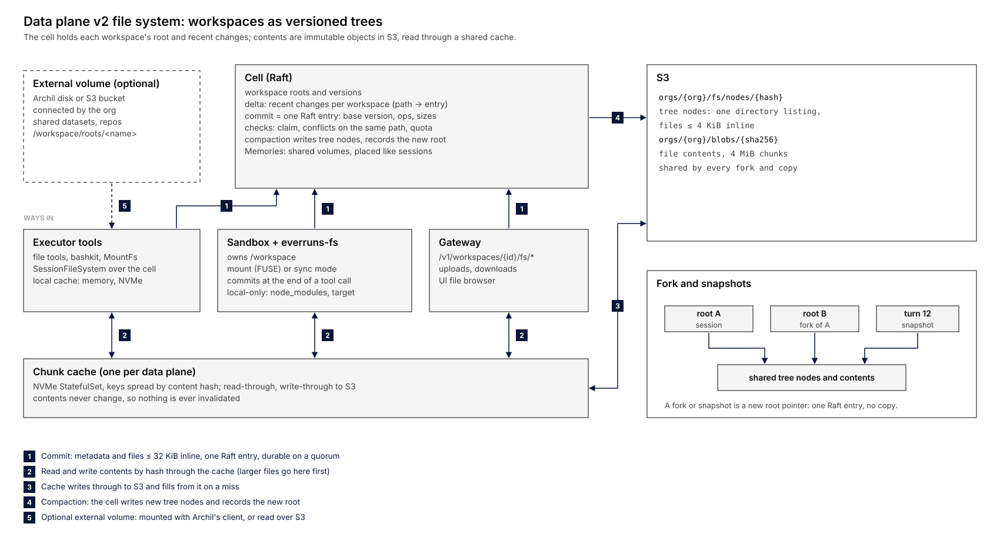

# Everruns data plane v2: file system

Status: approved 2026-11-09, not implemented yet. Part of [design.md](design.md) (data plane v2, cells).

## Summary

The file system is the agent's main working surface, so in v2 it is built into the cell and is not a separate service.

- A **workspace is a versioned tree**, the way git works:
  - The cell holds each workspace's current root and its recent changes.
  - The tree nodes and the file contents are immutable objects in S3, named by their content hash.
- **One commit is one Raft entry.** Writes are strongly consistent and durable on a quorum, like the session log. Small files go inside the entry itself. Large files go to S3 first, and the entry only references them.
- **Fork, copy, per-turn snapshots and undo cost nothing:** each is just a new version pointer.
- **One shared read cache per data plane**, the same idea Archil uses. Because content never changes, the cache never has to be invalidated.
- **Three ways in:**
  - Agent file tools and bashkit run inside the executor, with no mount and no FUSE.
  - Sandboxes run a small file agent that fetches files lazily and commits at the end of each tool call.
  - The API and UI go through the gateway.
- **Archil (or any S3-backed POSIX service) is optional**, used for large external data volumes that an org mounts into a sandbox. It is not where workspaces live.

## What agents need from a file system

| Need | Why |
| --- | --- |
| Fast small-file reads and edits | Most tool calls touch a few text files: read, edit, grep |
| Strong consistency inside a session | The model reads back what it just wrote; the UI shows the same files |
| Durability equal to the session log | A turn whose events committed must not lose its file writes |
| Cheap fork and snapshot | Forking sessions, retries, eval runs, undo of a turn, sandbox restore |
| A real POSIX tree in sandboxes | git, package managers, compilers, tests |
| Shared org data | Memories, knowledge, datasets mounted into many sessions |
| Scale to 75 000 agents | Each with its own workspace, mostly small and idle, each written by one turn at a time |

The typical workload is many small private workspaces with one writer each. That is a different problem from the one Archil solves, which is one large shared bucket with many readers and writers. It is why the core design is cell-native, and why Archil fits as an add-on for shared data.

## Model

- **Workspace:** a tree of directories and files, plus a monotonically increasing version. Every session has one. Org Memories and other shared volumes are workspaces too, each a placeable unit on some cell (movable like a session).
- **Tree node:** one directory listing, holding names, kinds, sizes, modes and content references. Each node is encoded once and stored at `orgs/{org}/fs/nodes/{hash}`.
- **File contents:**
  - Up to 4 KiB: inline in the tree node.
  - Up to 4 MiB: one object at `orgs/{org}/blobs/{sha256}`.
  - Larger: split into 4 MiB chunks with a chunk list. Content-defined chunking is a later option, if deduplicating edits to large files turns out to matter.
- **Root:** the hash of the top tree node, written by compaction.
- **Delta:** changes committed since the last root was written. They live in cell state as a small per-workspace overlay of path → new entry or tombstone, in commit order.
- **Version:** a workspace version is the pair *(root, delta position)*: the last compacted root plus the commits after it up to that point. A snapshot names a version, never a bare root, so committed changes that aren't compacted yet are never left out. Compaction writes a root for every version something still refers to (a turn snapshot, a fork, a restore point), after which that reference becomes a plain root.

## Writes

1. A tool writes a file, or a set of files at the end of a sandbox tool call.
2. Bytes go where their size dictates:
   - 16 KiB and under: inline in the commit (below funout's 32 KB command-split size, so a commit is always one Raft entry).
   - Larger: written by content hash through the chunk cache, which writes through to S3 before acknowledging. This is idempotent; if the object is already there, nothing is uploaded.
3. The client sends **one commit** to the session's cell. A commit holds an operation id chosen by the client, the expected base version, the operations (put, delete, move or mkdir, with path and content reference) and their sizes. The cell keeps the result of each commit by operation id for a day, so a retry after a lost acknowledgement gets the original result back instead of a conflict or a second change.
4. The cell checks three things: the caller holds the session's claim (or is the gateway acting for a user upload), the base version matches for any path that changed in between, and quota is respected. It then appends the commit as a Raft entry. The write is durable once a quorum has it, just like an event.
5. Compaction runs off the turn path. When a delta grows past a threshold, or the workspace goes idle, the cell writes new tree nodes to S3, records the new root as a Raft entry, and drops the delta.

Concurrent writers are rare: sub-agents sharing a workspace, a user uploading during a turn. Writes to different paths both apply. A write based on an older version of the same path is rejected with a conflict, and the tool re-reads the file. That is the same "file changed since you read it" behavior the edit tool already has.

## Reads

Resolving a path means looking up the delta first, then the tree. Tree nodes and contents are immutable, so each layer can cache freely:

- **Executor local cache** (memory, then local NVMe). A warm turn reads from here.
- **Data plane chunk cache:** a StatefulSet of NVMe pods with keys spread by consistent hashing. Executors, sandboxes' file agents, the gateway and the query service all read through it, and S3 is the backing store.
- **S3:** the source of truth for bytes.

Only the root pointer and the delta need consistency, and both live in the cell. That is why the cache tier can be a plain key-value cache, with none of the coherency protocol a shared POSIX cache needs.

## Ways in

### Executor tools (most turns)

`SessionFileSystem` gets a cell implementation that combines the cell client, the delta, the tree and the chunk cache. The file system tools, bashkit's file system adapter and `MountFs` stay as they are; only the backend changes. Grep walks cached content in the executor. For big workspaces, a trigram index built during compaction (and stored in S3) cuts the number of files read; that is stage 2.

### Sandboxes (Daytona, E2B, Modal, boxd)

A small binary, `everruns-fs`, runs inside the sandbox and owns `/workspace`. It works in one of two modes:

- **Mount mode** (FUSE, where the provider allows it):
  - Reads fetch lazily from the chunk cache.
  - Writes land in a local write-back layer.
  - At the end of each tool call, the executor asks `everruns-fs` to commit, and the changes go up as one commit.
- **Sync mode** (no FUSE):
  - At sandbox start, it materializes the tree eagerly. A plain file system can't fetch contents on first read without an interception layer, so there is no lazy loading here; a per-agent size cap (with files over it listed in a manifest and fetched by an explicit command) keeps start time bounded.
  - At the end of each tool call, it scans for changes since the base version and commits them. A file that changes during the scan (a background process still writing) is left for the next commit; renames show up as delete plus put; a crash during commit is safe because the commit is one entry with an operation id.

Concurrent uploads through the API during a sandbox tool call follow the normal rule: different paths both apply, the same path conflicts and the later writer re-reads.

Either way, after every tool call the sandbox and the workspace hold the same files, with the cell as the source of truth. That replaces today's split where the sandbox becomes the source of truth after seeding, and it removes the separate tar checkpoints: a lost sandbox restores from the current root. Paths marked local-only (`node_modules/`, `target/`, `.venv/`, configurable per agent) stay on the sandbox disk and are never committed. That keeps commits small and build output out of S3.

### API and UI

The gateway serves the same `/v1/workspaces/{id}/fs/*` routes. Reads resolve through the cell and the chunk cache. Uploads write contents through the chunk cache and then commit. Downloads stream from the chunk cache.

## Fork, snapshots, undo

- **Fork:** the new workspace starts at the parent's current version: its root plus a copy of the parent's delta (at most 64 KiB of metadata). One Raft entry; no file contents are copied.
- **Turn snapshots:** the version at the end of each turn is recorded on the turn's completion event. "Show files as of turn 12" and "undo this turn" are version lookups.
- **Sandbox restore:** start from the current version.
- **Seed modes** (`fork`, `workspace`, `fresh`) map to: parent version, chosen version, empty root.

## Memories and shared volumes

Org Memories are a shared volume: a workspace placed on some cell like a session. A session mounts it read-only at `/memory/shared` in one of two ways: **pinned** (the root at session start, which is reproducible) or **following** (re-reads the latest root at the start of each turn). Writes to a writable mount are commits sent to the volume's cell, one network hop. They are not copied into the session's workspace, which replaces today's copy-at-creation.

## Where Archil fits

Archil puts a shared, replicated NVMe cache in front of an S3 bucket and exposes it as POSIX through a FUSE client. Writes are durable in its cache and synced to the bucket in the background ([architecture](https://docs.archil.com/details/architecture)). E2B and Mastra already integrate it.

| | Workspaces (cell-native) | Archil |
| --- | --- | --- |
| Shape | Many small private trees, one writer each | Large shared bucket, many clients |
| Consistency | Raft commit, tied to the session log and claims | Read-after-write through its cache; bucket sync is eventual |
| Fork, snapshot, undo | O(1) root pointers | Not covered in its docs |
| Quotas, tenant isolation, soft delete | Cell state, per org | Per disk; ours to layer on top |
| Dependency on the turn path | None outside our data plane | An external service on every file operation |
| Best at | Agent workspaces | Datasets, repos and artifacts shared across many sessions, which bring their own bucket |

The proposal: an **"External volume" capability**. An org connects an Archil disk (or a plain S3 bucket, read-only), and sessions see it at `/workspace/roots/<name>`. In sandboxes it is mounted with Archil's own client. In executors it is read through Archil's S3 API. It is an opt-in connection like other integrations, with credentials stored as org secrets. If we later want POSIX semantics for very large shared data inside the data plane, the chunk cache tier is the piece that would grow toward what Archil does. That is a decision for after the 75k proof, not before.

## Scale estimate

These are estimates to be checked in the stress bench (plan steps 5 and 6) and the EKS proof (step 10).

- **Metadata:** cells hold roots and deltas, not trees. With 75 000 workspaces, each carrying a root plus a delta capped at about 64 KiB, cell memory is at most around 5 GB across 11 to 16 cells, and much less in practice. Trees live in S3 and the cache.
- **Commits:** with about 1 250 turns/s and on average 1 or 2 commits per turn (tool calls batch into one commit), that is roughly 2 000 extra Raft entries/s across the data plane. That is under 200 per cell, under funout's measured per-cell budget, and group commit batches them.
- **S3 writes:** only files over 16 KiB plus compaction nodes, so a few hundred PUTs per second.
- **Reads:** a warm executor serves almost everything locally. The chunk cache absorbs cold starts and sandbox lazy reads.

## Implementation, in the steps of design.md's plan

1. **Step 5 (cell crate):** workspace tree types, commit command, delta, compaction, fork. The simulated executor writes files in chaos tests. Checks: no lost committed write, forks independent, quota never exceeded.
2. **Step 6 (cell executor):** `SessionFileSystem` over the cell, executor cache, grep.
3. **Step 8 (gateway):** `/fs` routes, uploads, downloads.
4. **Stage 2 features**, after the core proof, not part of it: `everruns-fs` for sandboxes (sync mode first, then mount mode), local-only paths, the chunk cache tier, Memories as shared volumes.
5. **Stage 3:** External volume capability (Archil, S3), trigram index.

## Deleting bytes

Blob objects are shared across an org's workspaces, forks and snapshots, but each cell only sees its own references, so no cell can prove a blob unused. v2 therefore never garbage-collects blobs: they are removed only by the explicit org deletion job (which matches the data rule that records are never purged). Tree nodes and compacted-away objects are kept as long as any restore point refers to them. A global mark-and-sweep is a separate design if storage cost ever calls for it.

## Open questions

- The 16 KiB inline threshold keeps every file commit in one Raft entry (funout splits commands over 32 KB); the bench may lower it if the WAL or fsync budget is hit.
- Whether a sandbox commit should run after every tool call or only after mutating ones. Sync mode can detect "nothing changed" cheaply.
- Exposing the turn snapshot browser in the UI is a product question, not a storage one.
