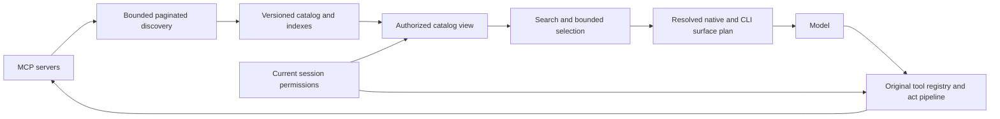

# Large MCP Catalogs in Everruns and Yolop

## Decision and scope

Everruns implements paginated MCP discovery, an authorization-scoped
server-aware search index, opt-in bounded native schema disclosure, and a
resolved [tool surface plan](tool-surfaces.md). Capabilities register
operations once; native functions and CLI commands project that same registry.
Protocol discovery, retrieval, invocation surface, model disclosure and
execution remain separate decisions. Tool disclosure reuses the transcript
`ToolChanges` path. The feature is opt-in: legacy `tool_search` behavior stays
the default unless `bounded: true` is configured. No Yolop code or dependency
pins change in this work.

The implementation accepts up to **10,000 tools per MCP server**, subject to
the byte, page and deadline bounds below. The combined Framework scoped session catalog is
also capped at 10,000 tools and 32 MiB of serialized server-prefixed
definitions; overflow fails closed with an explicit tracing error rather than
returning a partial catalog. These are fixed implementation limits, not
deployment settings. Catalog size is not an accuracy guarantee. Finding the
right operation, supplying its arguments, and completing the task require
separate measurements.

Status: **implemented; the 54-trial synthetic Muse qualification and six
targeted DB-backed hosted case matrices passed**. Hosted coverage used the local
API, worker, PostgreSQL-backed sessions and UI with Muse Spark 1.3 Contributor.
It does not qualify every provider, topology or surface cross-product. The
canonical runner is
the direct Rust/Mira study in
[`evals/mcp-scale`](../../evals/mcp-scale/README.md), which calls this working
tree's Framework and Rust MCP fixture. It compares native, CLI and hybrid
surfaces on synthetic data. The earlier Python gateway and retrieval reports
are archived under
[`evals/mcp-scale/historical/python-prototype`](../../evals/mcp-scale/historical/python-prototype/README.md)
and are historical prototype evidence, not measurements of this implementation.
The hosted case coverage and limits are recorded in the
[hosted qualification report](../../evals/mcp-scale/HOSTED_QUALIFICATION.md).

## Implemented contract

The shared HTTP and stdio MCP clients follow every `tools/list` cursor. One
server discovery is rejected as incomplete when it repeats an empty cursor or
tool name, exceeds a bound, or reaches its 60-second total deadline. The fixed
limits are 10,000 tools, 16 MiB each for cumulative response bodies and
serialized tool definitions, and 256 pages per
server; the HTTP client also enforces its existing timeout on each request.
Partial page sequences are never published as a successful catalog.

Discovery results are scoped to the server/session configuration and current
credential context. The cache keeps at most 1,024 entries, at most 10,000 tools
and 16 MiB per entry, and 128 MiB of serialized tool data across one runtime.
Its TTL is one hour. Stale entries may be served during transient refresh
failures; authentication failures clear the cached tools. The weighted global
budget evicts least-recently-used entries.

The registry's immutable `ToolSearchIndex` uses BM25-style lexical scoring over
operation names and descriptions, bounded schema property names/descriptions,
and MCP server names/descriptions. Server context is scored once per source,
not once per tool. Search receives the current visible-operation set, so
unattached or unauthorized operations do not contribute results or ranking
statistics. The index contains metadata only; every selected identity resolves
against the live registry and current authorization at execution.

`tool_search` remains legacy by default. With `bounded: true`, it returns at
most eight operations, bounded by `max_result_bytes` (32 KiB by default), and
discloses at most 32 optional schemas or 64 KiB of optional active schemas by
default. Eager tools, client-side tools, `DeferrablePolicy::Never` tools, and
explicit `never_defer` tools remain visible in addition to those optional
limits. Config accepts `max_active_tools` 1–128, `max_active_bytes` 1 KiB–1 MiB,
and `max_result_bytes` 1 KiB–64 KiB. Oversized matches are omitted with an
omission count and refinement guidance; the result is never silently treated
as complete. Empty matches offer a bounded list of authorized server sources,
not every tool name.

The implemented `ToolSurfacePlan` resolves `native`, `cli`, or `hybrid` routes
and native disclosure (`eager` or `deferred`) per operation. `tools_in_shell`
uses `mode: "cli"` by default; `mode: "hybrid"` leaves eligible operations on
the CLI and exposes them natively as well. Hybrid mode alone keeps their native
schemas eager; explicitly enabling `tool_search` with `bounded: true` defers
optional schemas under the configured count/byte limits. Owner-required eager
schemas remain visible. `keep_visible` keeps eligible tools on both routes.
The CLI catalog and bounded native discovery use the same index and registry.

The CLI catalog is assembled from the current turn's visible-operation
allowlist; search, help, deferred loading, and invocation stay inside that
scope, and a loaded child retains its visible parent placeholder's scope. One
CLI search loads at most eight matching deferred MCP servers. Untouched
placeholders remain pending for later searches. Each server's tools are added
atomically only when the resulting shell catalog remains within the 10,000-tool
and 32 MiB limits; an over-limit load adds none of that server's tools.

Implementation anchors: [tool search](../../crates/core/src/builtins/tool_search.rs),
[auto selection](../../crates/core/src/builtins/auto_tool_search.rs),
[HTTP discovery](../../crates/core/src/mcp/http.rs),
[stdio discovery](../../crates/core/src/mcp/stdio.rs),
[host discovery](../../crates/core/src/host/mcp.rs),
[cache admission](../../crates/core/src/host/mcp_cache.rs), and
[deferred servers](../../crates/contracts/src/runtime/mcp_deferred.rs).
Yolop's [runtime wiring](https://github.com/everruns/yolop/blob/1d5fa3d0ba79b048538c09fc0f2d9a5b417a291e/src/runtime/mod.rs)
and [tool search contract](https://github.com/everruns/yolop/blob/1d5fa3d0ba79b048538c09fc0f2d9a5b417a291e/knowledge/specs/tool-search.md)
identify the consuming layer.

The bounded native count/byte limits apply only to optional disclosed schemas;
eager native schemas are additional. A fallback driver's removal-only warm
hold may keep removed definitions on the wire, subject to the combined native
tool budget (eager definitions plus the configured optional count and bytes).
If a live budget reduction no longer admits the held list, the runtime releases
those removals. The active view and the conversation's cumulative tool-change
history are separate budgets. Inline removal does not reclaim earlier prompt
tokens, and no feature-specific cumulative history cap is currently
implemented. Provider behavior determines whether a tool-set addition or
schema redefinition is sent incrementally or requires a tool-list rewrite.

## State of the art

| Approach | Evidence | Implication for Everruns |
|---|---|---|
| Codex client discovery | Current [Codex source](https://github.com/openai/codex/blob/8c076942cb70fba8e5c4732c23f1faabc4aed484/codex-rs/core/src/tools/handlers/tool_search.rs) uses client-side BM25 over deferred metadata, including namespace and schema text. Selected definitions return through `tool_search_output`; the default result count is eight. MCP exposure depends on model search support. | Adopt indexed discovery and canonical namespace identity. Do not equate the current Codex client with OpenAI's hosted search API, or describe 2,000 as a universal Codex limit or guarantee. |
| Codex client-owned Code Mode | The pinned [surface planner](https://github.com/openai/codex/blob/8c076942cb70fba8e5c4732c23f1faabc4aed484/codex-rs/core/src/tools/spec_plan.rs) resolves per-tool direct/deferred and code-mode exposure. Its [executor](https://github.com/openai/codex/blob/8c076942cb70fba8e5c4732c23f1faabc4aed484/codex-rs/core/src/tools/code_mode/execute_handler.rs) runs JavaScript over enabled tool definitions and dispatches nested calls through Codex runtimes. Availability depends on mode/features/model. | This is the closer analogue to client-owned orchestration over Cloudflare's individual tools. Everruns now reuses its CLI execution surface for this role; source support is not a task-accuracy benchmark. |
| OpenAI hosted or client-executed search | [Responses API documentation](https://developers.openai.com/api/docs/guides/tools-tool-search) offers both mechanisms, deferred namespaces and incremental tool disclosure. Its separate Agents API has automatic MCP discovery rules. OpenAI reports 47% fewer total tokens at equal accuracy on a 250-task MCP Atlas comparison using 36 servers in the [GPT-5.4 announcement](https://openai.com/index/introducing-gpt-5-4/). | Retain native projection where the actual driver and endpoint pass conformance tests. The vendor result supports the approach, not an expected saving for every model or workload. |
| Anthropic search and programmatic calling | [Advanced tool use](https://www.anthropic.com/engineering/advanced-tool-use) combines deferred schemas with BM25/regex or custom search. [Programmatic calling](https://platform.claude.com/docs/en/agents-and-tools/tool-use/programmatic-tool-calling) composes calls and filters intermediate results in an execution environment. | Discovery reduces schema context; orchestration separately reduces round trips and result volume. Qualify each independently. |
| Code Mode | Cloudflare's [Code Mode MCP](https://blog.cloudflare.com/code-mode-mcp/) exposes search and code execution over an API with thousands of operations. Its token figures are engineering claims rather than a controlled task-accuracy comparison. | Everruns uses its existing Tools in Shell adapter and shared registry. Keep per-operation policy and auditing under programmatic execution. |
| Individual MCP operations with client-owned surfaces | Cloudflare's [documented `codemode=false` option](https://github.com/cloudflare/mcp/blob/d5d326e5d4dd09af4af1f2ea9926df2a991582c2/README.md#disable-code-mode) already exposes roughly 2,500 endpoint tools. OpenAI's [search guide](https://developers.openai.com/api/docs/guides/tools-tool-search) places newly discovered schemas at the end of context to preserve caching. | Consume individual tools without exposing all schemas up front. Everruns owns native/CLI surface policy; remote Code Mode is optional. The exact motivating OpenAI tweet has not been independently located. |
| Hybrid retrieval | [SCOUT](https://arxiv.org/abs/2608.23992), a 2026 preprint, describes BM25 plus dense retrieval combined by reciprocal rank fusion for an enterprise MCP gateway. | A credible next arm when lexical recall is insufficient. Its deployment claims do not establish our task success or justify an embedding service before measurement. |
| Protocol scalability | MCP [tools specification](https://modelcontextprotocol.io/specification/2025-06-18/server/tools) provides cursor pagination and catalog-change notifications. | Pagination makes enumeration complete. It does not select relevant tools or reduce model context by itself. |

Benchmark selection must match the question. [ToolRet](https://aclanthology.org/2025.findings-acl.1258/)
isolates retrieval over a large heterogeneous inventory. [MCP-Bench](https://arxiv.org/abs/2508.20453)
tests multi-step execution across live servers. [Toolathlon](https://arxiv.org/abs/2510.25726)
uses 604 tools across 32 applications with state-based task verification.
Arcade's [4,000 tool experiment](https://www.arcade.dev/blog/anthropic-tool-search-4000-tools-test)
measures discovery, not completed tasks. These are complementary workloads;
their headline scores are not comparable rankings of one retrieval system.

## Architecture

### Complete discovery and bounded caching

HTTP and stdio follow the opaque cursor until absent while preserving the
negotiated protocol, session, auth and egress path on each page. A repeated or
empty cursor, duplicate tool name, count/byte/page overflow, or 60-second total
deadline returns an incomplete-discovery error; it cannot become a successful
partial catalog. Limits are fixed in core, not deployment configuration:
10,000 tools, 16 MiB each for cumulative response bodies and serialized tool
definitions, and 256 pages per server. JSON-RPC and SSE framing count toward
the response budget, so a tool payload below 16 MiB may still exceed it. HTTP also
retains its per-request timeout. The Framework's aggregate scoped session catalog allows at most
10,000 tools and 32 MiB of serialized server-prefixed definitions; overflow
fails closed with an explicit trace error and no truncation.

The runtime cache is bounded to 1,024 entries, with 10,000 tools and 16 MiB per
entry and 128 MiB of serialized tool data across one Framework runtime. It uses a one-hour TTL,
single-flight refresh, and least-recently-used eviction under the weighted
runtime budget. Transient failures may continue using a previous complete
catalog during the established stale/cooldown path; an authentication failure
clears it. The discovery cache is not a persistent catalog service and does
not guarantee a provider prompt-cache hit.

Cache keys bind the attachment/session and server configuration, including
credential context. Credentials remain in existing auth providers; neither
tool text nor search parameters select a principal. Current attachment and
authorization scope are supplied again to search and execution. Catalog
notifications are not required for refresh: the MCP discovery cache currently
revalidates by TTL.

### Canonical catalog and retrieval

A snapshot maps an opaque stable tool identity to its original server identity,
original tool name, authoritative schema, metadata digest and catalog revision.
Provider-safe names are aliases for this tuple. Sanitization collisions and
same-named tools on different servers must never route by a guessed string split.

The cached registry index records tool name, description and searchable schema
property names/descriptions. It also records MCP server names and configured
descriptions, scoring a server once regardless of its tool count. Server
description text can find generic operations such as `search` or `get` without
turning metadata into execution instructions. The native bounded search and
CLI `tools search` use this server-aware index. Legacy native `tool_search`
remains unchanged unless `bounded: true` is opted in.

Search receives the current visible operation set; forbidden documents do not
contribute to ranking. A selected result is resolved against the live registry
and checked again by the normal execution policy. Server namespacing keeps
same-named operations on different servers distinct. The index is metadata, not
authority, and a registry revision invalidates it.

Bounded native search returns at most eight schemas, within a default 32 KiB
response. `max_result_bytes` may be configured from 1 KiB through 64 KiB.
`max_active_tools` defaults to 32 optional revealed schemas and may be set from
1 through 128; `max_active_bytes` defaults to 64 KiB and may be set from 1 KiB
through 1 MiB. These two active limits account for optional disclosed schemas;
eager, client-side and `Never` tools remain in the model list separately.
Results that do not fit are omitted with an explicit count/refinement hint;
no-match responses browse at most 16 authorized server sources instead of
listing every operation. Bounded mode uses the default `reveal: redefine`
behavior so selected schemas become callable typed native tools on the next
step.

### Native and CLI surfaces, disclosure and caching

The resolved `ToolSurfacePlan` is available to capability context and hooks.
Ordinary operations use one registry definition and the host-selected route;
capability owners retain route constraints. `native_disclosure` is independent
of whether an operation also has a CLI route. For Yolop, a future adoption can
keep hot coding tools native and expose eligible MCP operations through both
bounded native discovery and its own CLI bridge.

The bounded capability uses client-side search over individual MCP operations;
existing hosted search modes remain separate and provider-specific. CLI and
bounded native search share the authorized registry index. Servers that expose
only a search/call wrapper remain ordinary MCP tools; Everruns cannot infer
hidden operations from them.

Use [existing cache-stable tool changes](cache-stable-tool-changes.md) for
incremental native schemas and prompt notes. The resolved plan and static Bash
entry description remain stable as the registry changes; inventory is shown by
runtime `tools --help`, not embedded into the Bash schema. Selected schemas and
other tool-set changes are recorded through `ToolChanges`. Drivers that support
inline additions can apply them without replacing the whole list; fallback
drivers may rewrite the list for additions or schema changes. Removals may be
held while a warm fallback prefix is in use. These transitions preserve
execution correctness but do not promise cache hits across providers.

The active optional-schema budget and cumulative transcript history are
different. Inline removal does not reclaim earlier prompt tokens. The bounded
capability does not impose a cumulative schema/help-history limit; normal
conversation compaction and provider context limits still apply. Every call
uses current authorization and current registered schema despite historical
disclosure.

All projections invoke the same original registry entry, validation, auth,
approval policy, cancellation, tracing and idempotency path. Do not silently
retry mutations after ambiguous transport failures. Code-mode loops do not
acquire broader permissions or bypass operation-level accounting.

## Canonical Rust/Mira study

[`evals/mcp-scale`](../../evals/mcp-scale/README.md) is the canonical study. It
is a standalone Mira 0.4 Rust crate whose subject runs the working-tree
Everruns Framework against a Rust MCP fixture through `McpServer::stdio`.
There is no gateway or second search implementation between the subject and
fixture. The fixture exercises real `tools/list` pagination and `tools/call`,
with synthetic ticket and deployment state.

The study varies catalog size (50, 600, 2,000, 10,000), one or ten servers, and
native, CLI, and hybrid surfaces. Its cases cover a normal read, a request
resolved only by server description, a read-only constraint, and a staged
rollback that must be verified while production remains unchanged. Scorers use
Framework tool events and fixture state; a plausible final answer does not pass
without the expected tool evidence and state check. The configured model target
is `openrouter/meta/muse-spark-1.3-contributor`, with three trials per case and
surface. The serial qualification completed on 2026-10-19:

| Catalog | Servers | Tasks | Trials | Passed |
|---|---:|---|---:|---:|
| 600 | 1 | Read-only ticket and state-verified staging rollback | 18 | 18 |
| 2,000 | 1 | Read-only ticket and state-verified staging rollback | 18 | 18 |
| 600 | 10 | Server-description disambiguation | 9 | 9 |
| 2,000 | 10 | Server-description disambiguation | 9 | 9 |

All three surfaces passed every serial trial, with no infrastructure failures
or skipped cases. After rebuilding the final runtime fixes, two additional
2,000-tool CLI smoke trials (read-only and rollback) also passed; they are
reported separately from the 54-trial matrix. An earlier concurrent nine-trial
description run had six
passes and three provider model-unavailable responses; its evidence is retained
separately, and the serial retry is identified in the result lineage. See the
[study report](../../evals/mcp-scale/README.md) for per-case scores, usage,
provenance, and complete compressed transcripts. These synthetic tasks do not
establish a winning default, general task accuracy, or causal cache savings.
Reported zero-valued cost fields are unpriced, not evidence of free requests.

The production index stress report covers 50, 600, 2,000 and 10,000 operations
with one and ten server partitions. At 10,000 operations, local debug builds
took roughly 0.55–0.59 seconds at the median to build the index; query p95
depended on query and partition and ranged from roughly 9 to 52 milliseconds.
These are synthetic development measurements, not production latency or heap
memory bounds. The serialized catalogs occupied roughly 6.6–7.2 MB. Ten thousand
operations are covered by deterministic discovery/cache/search limits tests;
the paid model qualification covers up to 2,000.

Regression verification includes 1,357 core and 1,263 contracts unit tests,
56 Tools in Shell tests, 38 Lua tests, 54 MCP transport tests, five host
lifecycle tests, and the Gemini serialized-wire removal test. The Rust/Mira
runner has six deterministic scorer and infrastructure-classification tests.
Final-source focused hosted-path regressions passed 168 server MCP tests, 64
server search tests (overlapping), two worker metadata tests, and ten deferred
CLI tests. Lifecycle tests exercise plugin contributions, attachment, schema
redefinition and revocation over a warm session, plus 2,000-tool paginated MCP
discovery. Hosted cases additionally verified source-description search and
refresh, plugin replay after worker restart, discovery faults, and deferred
aggregate admission. Provider-prefix assertions qualify wire behavior
separately from provider-reported cache usage; they do not establish guaranteed
cache hits or universal provider behavior.

The older Python matcher, gateway adapter, and runs are retained in
[`historical/python-prototype`](../../evals/mcp-scale/historical/python-prototype/README.md).
Its retrieval percentages and single-run task traces are historical prototype
evidence. They are not measurements of the implemented Rust index, bounded
native search, or `ToolSurfacePlan`. The archive retains the original source,
fixtures, and result files for reproducibility.

## Qualification gates

Use the same tasks, catalogs, credentials, budgets and model versions across
eager schemas, current generic stubs, native search, bounded selection/dispatch,
Tools in Shell and hybrid surfaces. Separate invocation-surface comparisons
with shared retrieval from hosted/client search comparisons. Include 50, 600,
2,000 and 5,000 tools; compare one large
server with 10 and 50 server topologies, with duplicate tool names across
servers. Separate cold discovery, warm discovery and long-session costs, and
test a Cloudflare-shaped individual-tool catalog without a remote code wrapper.

Measure retrieval hit/recall at 1, 5 and 8, MRR, all-required-tool recall, and
no-match behavior separately from schema-valid first calls and **state-verified
task completion**. Agent-written success text is not a verifier. Capture actual
provider input/output/cache tokens, cost, search retries, tool rejections,
discovery bytes, memory and latency percentiles. A provider refusal or missing
credential is infrastructure/compatibility evidence, not a successful trial.

Include paraphrases without operation names, near-identical read/write tools,
opaque enum values, nested objects, multi-step ID lookup, forbidden tools,
permission revocation after discovery, schema changes during a task, repeated
cursors, failed later pages, slow/unavailable servers and resume/compaction.
Include cache stability during no-change turns, additive instructions, native
schema reveals, surface changes and model switches. Check serialized prefixes
and real endpoint cache usage separately; the existing OpenRouter demonstrations
do not qualify first-party inline-tool changes.
Use independent realistic tasks before selecting a default; do not tune aliases
to the fixed synthetic set.

Include identical tool names/descriptions across servers, queries whose domain
appears only in a server description, changed/missing descriptions, server-size
imbalance and unauthorized sources. Compare tool text alone against tool text
plus server descriptions. Report source recall separately from correct-operation
recall: finding the relevant server is not yet finding its correct tool.

These broader gates remain required before recommending defaults or claiming
general task performance. The implementation remains opt-in. The synthetic
study above does not establish realistic retrieval recall, a paired baseline
comparison, production memory use, or causal cache savings.

- All pages discovered at 2,000 tools, or an explicit bounded failure; no silent
  truncation and no unauthorized calls under revocation or stale disclosure.
- At least 95% relevant-tool recall at eight on a separate realistic query set.
- End-to-end success within five percentage points of the best feasible baseline
  on paired tasks, reporting confidence intervals and per-model results.
- At least 80% lower initial model-visible catalog bytes on the large cases,
  with actual total token/cost and added discovery latency reported separately.
- Bounded active schemas, memory and output throughout a 100-search session.

## Rollout into Everruns and Yolop

1. **Done in Everruns:** shared HTTP/stdio pagination, catalog bounds, duplicate
   and cursor checks, the weighted discovery cache, server-aware search index,
   bounded native disclosure, and manual stress cases.
2. **Done in Everruns:** canonical operation registry projections and the
   resolved surface plan. Bounded search and `tools_in_shell` hybrid mode remain
   explicit opt-ins; existing `native` and CLI profiles keep their defaults.
3. **Synthetic qualification complete:** all 54 Muse trials passed across
   native, CLI and hybrid surfaces. Realistic baseline comparisons, paid
   cold/warm and long-session studies, and additional provider qualification
   remain future work. Do not claim a winning default, causal cache benefit,
   or comparative task accuracy. Yolop's recorded opt-out remains unchanged.
4. Release the aligned Everruns crate family. Yolop updates exact pins and wires
   the catalog policy while retaining eager read/edit/navigation/shell tools.
   Reuse its capability-owned attached CLI for generic catalog dispatch,
   preserving the current contained shell and CLI-only administration rules;
   do not require Bashkit in Yolop. See [surface integration](tool-surfaces.md#yolops-existing-cli-integration).
   Show attached, discovered and selected counts distinctly in `/mcp` and `/tools`.
5. Qualify Yolop workspace HTTP, user-owned stdio, OAuth, live reload, model
   switching and resumed sessions. The working gateway needs only existing
   user-owned stdio configuration for a local fixture, or HTTP for a publicly
   reachable endpoint, and provides an immediate opt-in experiment. Loopback
   OAuth handling must not be mistaken for a tool-discovery SSRF exception.

A standalone semantic gateway is a viable interoperability product, but adds a
network hop, auth ownership and a second lifecycle. Use one only when multiple
non-Everruns clients need the same catalog service. Hierarchical server routing
alone does not solve one server with 2,000 tools, and a model swarm per lookup
adds cost without fixing incomplete enumeration or authorization.

## Related contracts

- [Native and CLI Tool Surfaces](tool-surfaces.md)
- [Tool Search](tool-search.md)
- [Cache Stable Tool Changes](cache-stable-tool-changes.md)
- [Tools in Shell](tools-in-shell.md)
- [Runtime MCP](../integrations/runtime-mcp.md)
- [User MCP Servers](../integrations/user-mcp-servers.md)
