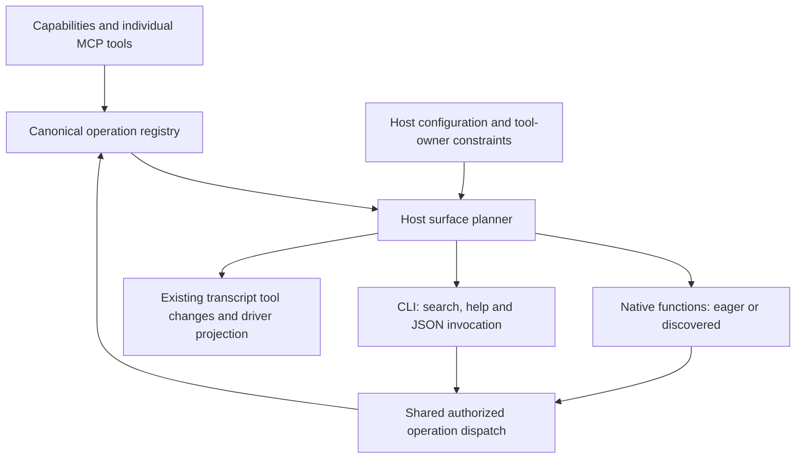

# Native and CLI Tool Surfaces

## Recommendation and status

One capability registers each operation once. The implemented `ToolSurfacePlan`
resolves its exposure as a native function, CLI command, or both, separately
from whether a native schema is eager or deferred. Both routes reach the same
registry operation and execution policy.

Status: **implemented in contracts/core/integrations**. The typed plan lives in
`everruns-contracts`; capability prompt/definition hooks and `ToolContext` read
the effective plan. `tools_in_shell` chooses CLI by default or hybrid with
`mode: "hybrid"`. Bounded native search is an explicit `tool_search` opt-in.
Yolop has not adopted the new core surface plan; its integration remains future
work described below.

The Platform capability also supports an explicit native inventory surface for
the managed Platform Chat. Its static `operations.json` catalog is generated
from the server inventory, and all 333 public, noninternal, nondurable
operations are projected as prefixed native functions. Workers do not link the
server crate. Invocation uses the platform's existing authorized dispatch;
the inventory is not a cached authorization grant. Platform Chat bounds native
disclosure through `tool_search` and retains the Bashkit shell route for
aggregation. See [Platform Chat](../harnesses/platform-chat.md) and the public
[Platform capability reference](../../docs/capabilities/platform.md).

## Why the server should expose operations

Cloudflare already documents a
[per-endpoint MCP mode](https://github.com/cloudflare/mcp/blob/d5d326e5d4dd09af4af1f2ea9926df2a991582c2/README.md#disable-code-mode):
`https://mcp.cloudflare.com/mcp?codemode=false` registers roughly 2,500 endpoint
tools. Its default Code Mode remains documented too. This verifies the server
option, not the exact OpenAI tweet motivating this investigation or a universal
tool-count guarantee.

The current pinned [Codex surface planner](https://github.com/openai/codex/blob/8c076942cb70fba8e5c4732c23f1faabc4aed484/codex-rs/core/src/tools/spec_plan.rs)
already distinguishes direct, deferred, code-mode-only and combined tool
exposure. When enabled, its [client executor](https://github.com/openai/codex/blob/8c076942cb70fba8e5c4732c23f1faabc4aed484/codex-rs/core/src/tools/code_mode/execute_handler.rs)
runs JavaScript with nested tools dispatched through Codex runtimes. This is
separate from Cloudflare's server-side interpreter. The transferable design is
client-owned orchestration and per-tool exposure; Everruns can use its existing
CLI execution surface for that role.

Everruns consumes these individual operations, enumerates every page and owns
their discovery and exposure. The model need not receive every schema. Native
search, the CLI adapter and a mixed surface work over the same catalog, without
nesting a second code interpreter inside a remote tool.
Existing servers exposing only `search`/`execute` remain ordinary MCP inputs;
their hidden internal operations cannot acquire individual typed identities
unless the server also supplies their descriptors.

## Three independent decisions

| Decision | Meaning | Owner |
|---|---|---|
| Operation and authority | Stable identity, schema, executor, permission, approval and result semantics | Capability or MCP registration; current host policy |
| Invocation surface | Native function, CLI, or both; special result/control requirements | Resolved host plan constrained by the tool owner |
| Disclosure and wire format | Eager or deferred schema, search/browse, provider-specific incremental definitions | Catalog/disclosure policy and qualified driver |

Do not encode CLI as a search provider, or use a provider's native-search flag
as the test for CLI eligibility. In particular, `DeferrablePolicy::Never`
means eager schema loading. Whether a tool can safely run inside a script is
a different requirement. The existing `stays_direct` hint expresses a stronger
constraint and must survive the migration.

## Capability contract and assembly

The typed `ToolSurfacePlan` has a mode and per-operation route map. Each route
states `native`, `cli`, or `both`, and independently states whether native
disclosure is `eager` or `deferred`. Capability code reads it through the
read-only `SystemPromptContext` and `ToolContext`. A missing route is not
permission to invoke a tool.

Collection resolves the mode and capability routes before prompt/hook use, then
the host extends the plan with late MCP/host definitions:

1. Resolve dependencies and model-adaptive capabilities, then collect canonical
   operations and owner constraints. Preserve capability attribution and stable
   MCP server/name identity. Existing `tools()` and `tools_with_config()` remain
   the registration path for tool-backed operations; bind capability-owned CLI
   handlers without inventing a second executor. Do not return different
   executors for different views.
2. The host combines requested mode, available adapters and owner constraints
   into effective routes. Capabilities can use that context for surface-specific
   instructions and adapters. The native and CLI projections use the canonical
   registry definition and schema.

The [capability context and hooks](../../crates/contracts/src/runtime/capabilities/mod.rs)
and [collection algorithm](../../crates/contracts/src/runtime/capabilities/collect.rs)
resolve the plan. Execution authority remains independent of model-facing
context. The act path derives eligible routes from the current registry when
needed rather than trusting a missing model-view entry.

A capability can ask whether an operation is native, CLI, or both and whether
its native schema is eager or deferred. It usually needs this only for
behavioral instructions or specialized adapters. Existing tool registration
remains valid; the host derives ordinary routes centrally. A command adapter
must not register a second implementation of the same mutation.

Capability collection previews definitions and builds routes before
assembling the final prompt and hooks. The plan does not duplicate schemas or
executors. Schema disclosure changes only the model-facing definition;
execution resolves the call through the current registry and validates against
its full schema.

Tool owners impose hard restrictions first: turn-control/client tools and
results requiring direct model presentation stay native unless an adapter can
preserve those semantics. Host routing preferences cannot override these
constraints or permissions. Reject an explicitly requested CLI route when its
executor is unavailable; an `auto` policy may choose a documented fallback.
Do not promise arbitrary tool calls through Yolop's process shell: the `tools`
command needs the session-aware bridge, cancellation and approval lifecycle.
Owner constraints can also require CLI-only exposure. Automatic projection
must not create native functions for a deliberately CLI-only capability.

The host rebuilds the plan from persisted capability configuration and the
current registry on each assembly. It keeps the full catalog and search index
in the runtime registry, not transcript metadata. Transcript-derived
`ToolChanges` replay schema disclosure; a worker restart rebuilds routes and
the index from current config. Current authorization always takes precedence.

## Supported profiles

These profiles apply to eligible data operations; shell entry points and
turn-control tools retain the native calls they require.

| Profile | Model receives | Use |
|---|---|---|
| Native | Native operations; generic schemas are bounded only when `tool_search` uses `bounded: true` | Structured calls or hosts without a session shell |
| CLI | `tools_in_shell` default; eligible operations use the shell `tools` command, with `keep_visible` available on both routes | Loops, pipelines and filtering large intermediate data |
| Hybrid | `tools_in_shell` with `mode: "hybrid"`; eligible operations use both routes. Native schemas stay eager unless bounded `tool_search` is explicitly enabled. | Native calls for one operation and CLI composition over the same operations |

Yolop has not adopted this plan. If it adopts it later, it can keep
read/edit/navigation and its shell entry point native, and make large MCP
operations eligible for both native discovery and its CLI bridge. The runtime
chooses available routes; the model chooses a call among them.

Search returns stable operation identity plus the available native alias and
CLI spelling from that same mapping. CLI `tools search` and bounded native
`tool_search` use the same authorization-scoped index; legacy native search
retains its existing matcher. The index uses operation and schema metadata,
MCP server names and descriptions, and declared capability IDs, names and
descriptions, never full system prompts. Server context and owner capability
text contribute once per MCP source; built-in operations share one capability
context contribution per capability, regardless of the number of operations.
A capability- or server-only query returns bounded source browse/refinement,
not an arbitrary batch of operations; an operation query reveals its selected
schema through the existing `tool_search` disclosure path. Replacing or
detaching a source rebuilds the index, and current scope is checked at search
and dispatch. Names remain stable when a different tool is revealed. CLI
supports JSON input so nested objects, arrays and enums retain the original
schema meaning.

Both adapters validate canonical arguments, check current permissions and
approval, and preserve cancellation and operation-level audit. The CLI catalog,
search, help and dispatch use the current turn's visible-operation allowlist;
deferred children retain their visible parent placeholder's scope. A route or
cached schema never widens that scope. Retain each nested call's identity,
status and bounded result evidence or artifact reference even when only a
reduced script result reaches the model. A failed script must not silently
replay successful mutations. Validate owner-required route constraints at
entry points; hiding a definition is not an execution guard.

The CLI adapter records nested operations as `tool.nested_call` beneath the
shell call rather than as separate native `tool.started`/`tool.completed`
events. Its [timeline](../../crates/integrations/src/bashkit/tools_in_shell/timeline.rs)
truncates input, and its [run report](../../crates/integrations/src/bashkit/tools_in_shell/run.rs)
counts read-only calls and retains bounded mutation previews. This is the
observable CLI audit shape; it is not a one-to-one native tool-event replay
contract.

## Prompt caching is part of the contract

Reuse [the existing cache contract](cache-stable-tool-changes.md) and its
[reason-step implementation](../../crates/core/src/engine/execution/reason/tool_changes.rs).
Do not introduce a second disclosure ledger or another cache manager.
OpenAI's [tool-search documentation](https://developers.openai.com/api/docs/guides/tools-tool-search)
explicitly places discovered definitions at the end of context to preserve the
prefix. Retrieval quality and cache behavior must be qualified together.

The surface plan must preserve these invariants:

- **Stable baseline.** Surface mode and general prompt guidance are resolved
  from configuration. Catalog inventory is reported by `tools --help`; it is
  not copied into the Bash tool description. A new search result does not
  change the static instructions or eager tool order.
- **Incremental disclosure.** Selected native schemas use existing `ToolChanges`
  and qualified provider injection. New CLI help appears as a tool result.
  Schema additions or redefinitions alter the active projection; provider
  fallback behavior may require a full tool-list rewrite.
- **Capability instructions.** `tools_in_shell` contributes mode-specific
  guidance. Changes to prompt instructions use the existing prompt/tool-change
  path and may change provider cache behavior; no cache hit is promised.
- **Endpoint qualification.** Drivers use inline changes only when their
  provider profile supports them. A compatible model name served through a
  gateway does not prove that wire support. Fallback drivers may rewrite the
  actual tool list on additions and schema redefinitions.
- **Immediate revocation.** Cached or historically declared tools never grant
  execution authority. A fallback driver may retain removed definitions during
  a warm-prefix hold, but execution still checks current authority. If a
  reduced active-schema ceiling is lower than the held set, the runtime
  releases held removals immediately. Both surfaces reject a currently
  forbidden operation before execution.
- **Replay and boundaries.** Keep routing stable across worker restart and
  transcript replay. Model switches, compaction and incompatible surface
  changes re-baseline as needed. Preserve every inline change's original
  position; do not edit earlier search outputs to simulate eviction.

The implemented limits cover one search response and the current optional
native schema projection; eager tools are additional. A fallback driver may
temporarily hold removals during a warm-prefix transition, subject to the
combined native definition budget (eager schemas plus optional count and byte
limits). If a reduced live budget cannot admit the held list, the runtime
releases those removals. The conversation's cumulative schema/help history is
a separate budget: inline removal does not reclaim old context, and this
feature does not impose a cumulative-history cap. Session compaction and
provider context limits remain responsible for that history. Measure
serialized prefixes and provider cache usage separately; a stable prefix does
not itself prove a cache hit.

## Implementation and remaining verification

The shared plan, mode selection and per-operation route projection are
implemented in contracts/core/integrations. In `cli` mode, Tools in Shell
supersedes generic and hosted tool-search capabilities. In `hybrid` mode, it
does not; eligible operations are available natively and through the CLI.
Hybrid mode alone keeps native schemas eager. When bounded `tool_search` is
explicitly enabled, its policy limits optional native reveals while keeping
eager owner-required tools available. Existing native-only and CLI-only
profiles remain supported.

The canonical [Rust/Mira synthetic qualification](../../evals/mcp-scale/README.md)
is complete. Its matrix and interpretation are recorded in
[Large MCP Catalogs](large-mcp-catalogs.md#canonical-rust-mira-study). The
archived Python/gateway runs are prototype evidence only.

### Yolop's existing CLI integration

Yolop already has a closer integration point than embedding Bashkit. Its
[attached CLI](https://github.com/everruns/yolop/blob/1d5fa3d0ba79b048538c09fc0f2d9a5b417a291e/src/control.rs)
defines capability-owned `CliCapability`/`ControlCapability` facets and a
short-lived authenticated endpoint belonging to a shell execution. The child
sends argv, the host parses it and dispatches to the capability's existing
handler. Its [conversational-control contract](https://github.com/everruns/yolop/blob/1d5fa3d0ba79b048538c09fc0f2d9a5b417a291e/knowledge/specs/conversational-control.md)
requires one implementation across front ends and intentionally keeps
configuration administration on the CLI rather than adding native mutation
tools.

Extract portable catalog, schema/help and operation-dispatch interfaces from
the shell integration, leaving Bashkit as one adapter. Yolop contributes a
capability-owned route, for example `yolop tools search|help|call`, through its
existing attached endpoint. That route binds canonical operation IDs and JSON
arguments to the same session dispatcher used by native calls. Reuse the
current endpoint authentication, shell-call lifetime and containment wiring;
add cancellation, nested-call identity, per-operation approval and bounded
result handling at the generic dispatcher. Do not open an independent MCP
connection from each child CLI invocation.

The current control route's broad read-only/consequential distinction is not a
substitute for the selected operation's policy. A generic `call` must consult
that operation, not treat every request to the dispatcher as read-only. Large
results should use bounded output or existing artifact storage rather than
simply lifting local frame limits.
The present endpoint gates the whole CLI invocation; the new adapter must
preserve host containment checks and enter the canonical per-operation gate.
It does not inherit native execution semantics merely by implementing a
`ControlCapability` handler.

Provide canonical bindings for CLI-only handlers as they migrate; do not wrap
the whole administrative CLI into model-visible functions. The neutral surface
contract belongs in Everruns contracts/core; argv parsing, containment and the
attached endpoint stay Yolop-owned. The standalone example below uses Bashkit
to test current adapters; it does not implement this Yolop bridge.

The [canonical Rust/Mira synthetic qualification](../../evals/mcp-scale/README.md)
is complete; its matrix and interpretation are recorded in
[Large MCP Catalogs](large-mcp-catalogs.md#canonical-rust-mira-study). Historical
Python/gateway results remain archived as prototype evidence only. This study
is for Everruns; Yolop adoption remains future work.

Extend the [large-catalog evaluation](large-mcp-catalogs.md#evaluation-and-acceptance)
with paired native, CLI and hybrid tasks. Hold retrieval policy constant while
comparing invocation surfaces, then vary native hosted/client discovery
separately. Verify argument equivalence, dispatch identity, nested approvals,
partial script failure, output reduction, bounded audit evidence and
current-authority enforcement.

For each qualified endpoint, record cold and warm input/cache tokens, cache
miss reasons where available, actual billed cost and latency. Include no-change
turns, schema additions/redefinitions, permission revocation, routing changes,
worker restart, model switch and compaction over a 100-search session. Assert
stable serialized prefix and account for cumulative history separately from
live cache-hit measurements; this feature imposes no cumulative-history limit.
The existing OpenRouter checks demonstrate working calls; they
do not establish first-party inline-cache behavior or a winning default surface.

## Related contracts

- [Capabilities](capabilities.md)
- [Large MCP Catalogs](large-mcp-catalogs.md)
- [Tools in Shell](tools-in-shell.md)
- [Cache Stable Tool Changes](cache-stable-tool-changes.md)
- [Command Tree](command-tree.md)
