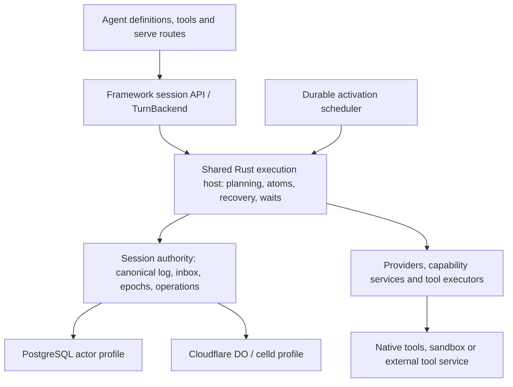

# Portable Durable Agent Execution

The revised [Engine-owned sessions proposal](engine-durable-sessions.md)
supersedes this document's application integration recommendation. DO must run
through the public Framework Engine/Session path, including admission, lifecycle
and observation. The source assessment below is the original investigation;
sharing a core host alone does not satisfy the revised Framework success bar.

Implementation update: the first native executor profile is now implemented; see
[Native Execution with Durable Object Authority](durable-object-native.md) for
current scope and qualification. The broader design below remains a proposal.

**Status: draft proposal, 2026-10-16. No architecture decision or runtime change
is implied.** Source analysis uses OSS revision
`93edb4fd49edf8cb7b0e81dcc39cc38ec36c4f50`. Cloudflare documentation was checked
on the proposal date. No Cloudflare deployment or crash experiment was performed
for this investigation. Existing tests are evidence of intended coverage, not
new test results. Cloud-specific operations and private infrastructure are outside
this document's scope.

## Recommendation

Keep Everruns' session actor and canonical log model. Make its execution host
portable, and make durable ownership, command admission and activation explicit
backend contracts. Support two placements of the **same Rust agent runtime**:

1. **Native execution with a durable session authority.** PostgreSQL or a Durable
   Object owns the log, inbox, operation records and execution epoch. Replaceable
   native workers run Everruns over that authority. Implement the DO version first
   to preserve native tool and provider compatibility.
2. **Execution inside a Durable Object.** The shared portable runtime runs as Rust
   Wasm; DO storage and alarms supply the same authority and activation semantics.
   Offer this for agents whose capabilities fit an isolate, with external tool
   execution when needed.

Treat these as deployment profiles of one runtime. A backend supplies persistence,
ownership and wakeups; it must not implement reason/act planning, conversation
repair, tool safety, approvals or agent lifecycle in JavaScript. Keep the current
container snapshot example as a hosting demonstration, not the durability
foundation. The companion [guarantees proposal](durable-execution-guarantees.md)
defines the failure semantics and qualification tests.

## What the current code already provides

| Existing component | What it gives us | Boundary still missing |
| --- | --- | --- |
| [Execution and TurnExecution](../../crates/core/src/engine/machine.rs) | Portable, sans-I/O planning over engine outcomes | A portable orchestration driver using all the same policies |
| [Shared turn loop](../../crates/core/src/host/turn_loop.rs) and [host adapter](../../crates/core/src/host/host.rs) | Shared input/reason/act wiring, lifecycle effects and inbox boundaries | These live behind native `host`, which brings OS dependencies |
| [TurnBackend](../../crates/core/src/host/turn_backend.rs) | Public, unsealed experimental turn entry point | Durable admission/observation semantics and facade backend injection |
| [TurnLogFold and resume](../../crates/core/src/host/turn_resume.rs) | Recover open turns, skip completed calls, classify unfinished calls | Portable placement and versioned reconstruction requirements |
| [HostBackends](../../crates/core/src/host/backends.rs) and [EventLog](../../crates/core/src/host/events.rs) | Custom stores, canonical identity/sequences, bounded reads, conditional append, declared crash durability | Atomic log/control updates and execution-epoch fencing across ports |
| [Platform actor runtime](../../crates/worker/src/actor_runtime/mod.rs) | Runnable-session leasing, inbox progress, cancellation, restart pickup | Host-neutral extraction of semantics currently in worker code |
| [Tool result store](../../crates/core/src/durability.rs) and [durable start barrier](../../crates/core/src/engine/execution/act_start_record.rs) | Claim/settle, known-result reuse, conservative handling of unsafe interrupted calls | Consistent operation durability and recovery across all host profiles |
| [serve hosting seam](../../crates/serve/src/hosting.rs) | Host wrappers around the existing application and `/v1` API | Injecting distributed session services instead of assuming local Engine/SQLite |

The [actor backend design](execution-backends.md) is the right starting point.
The platform already resumes whole turns from the log. Its old per-step turn
queue was removed; `everruns-durable` still serves non-turn tasks. A DO adapter
does not require restoring that retired engine or creating another replay planner.

The platform already atomically stores input and makes its actor runnable. Actor
event appends carry a holder and fence, checked inside the insert transaction.
Lease expiry plus polling restores progress after a worker dies. Preserve those
properties when extracting contracts; a lease trait by itself is insufficient.
See [the owning operational contract](../operations/durable-execution-engine.md#session-actors-turn-execution).

The facade has custom storage through `AgentBuilder::backends`, but
[Session::ensure_runtime](../../crates/everruns/src/session.rs) currently constructs
`ActorRunner` directly. An external `TurnBackend` implementation is therefore not
yet an application-facing backend selection feature. The facade's default is
process-local execution; persistent state allows recovery when a host restarts
and resumes it, but does not supply an independent distributed activation service.

## The two celld examples demonstrate different guarantees

### Container snapshot and request journal

[serve/celld](../../examples/serve/celld/README.md) runs the ordinary native serve
app. The supervising [cell](../../examples/serve/celld/worker/src/cell.js) journals
mutating requests and periodically snapshots the data directory. Recovery restores
the snapshot and replays later requests. This preserves application code and gives
a useful hosting experiment, but recovery may repeat model calls and tool effects
from after the last snapshot. A container-local tool ledger rolls back with that
snapshot, so it cannot prevent these repeats.

There are also explicit weak paths in the source: creation while busy can return
success with `x-celld-durable: pending` after the snapshot deadline; an already
booted replacement container can be adopted without restoration. These paths are
weaker than the README's unconditional acknowledged-creation guarantee. Tighten
them or document their scope before promoting the example. Retrying recorded HTTP
requests is not a substitute for durable operation identities.

### Execution kernel inside the cell

[celld-engine](../../examples/celld-engine/README.md) runs shared `ReasonAtom` and
`ActAtom` inside Wasm. Its [Cell](../../examples/celld-engine/src/cell.rs) stages
events and commits a reason or tool batch with the next position. Its
[DO adapter](../../examples/celld-engine/src/durable.rs) uses SQLite and alarms.
An already committed step is retained; an interrupted step repeats.

This proves kernel portability, not full Framework parity. The example owns a
separate reason/act driver instead of using `TurnExecution` and `drive_turn`;
messages queue rather than steer; a blocked act or client-tool wait ends as an
error; the model transport is a small non-streaming Chat Completions driver;
history reads load all committed events. Its pure demo tool makes batch retry
reasonable. General side-effecting tools need starts and results that survive
discarding an uncommitted batch. Simply moving this code to a published crate
would preserve a second, incomplete runtime.

## Architecture and ownership

Execution placement is independent of the agent definition, but not every binary
or capability is portable. A plain Rust tool using processes cannot become an
isolate tool through a storage adapter. It can run in the native profile or behind
a durable external operation interface. Both placements still use Everruns for
all agent decisions.

### Shared semantic layer

Extract the portable part of `host` into a feature-selected module **within core**.
Keep the current low-level host boundary and existing application facade; do not
create a competing public runtime API. Dependency direction remains contracts →
core → facade/host adapters. DO-specific SDKs never enter the portable core.

The shared layer owns turn entry, planning, reason and act execution, log folding,
recovery classification, steering versus next-turn decisions, policy/approval
checks, durable waits, lifecycle effects, context assembly and conversation
projection. Move these incrementally from existing implementations. Keep native
filesystem, process execution, transport clients and fleet scheduling outside it.

Provide a bounded drive operation as well as the existing run-until-park/complete
wrapper. A bounded drive yields at a safe boundary and reports runnable, waiting
or terminal. Yield is a scheduling outcome, not a user-visible turn completion.
Native workers can continue without queue handoffs; DO alarms can execute a small
batch within their budget. This is one driver, not one scheduler per engine step.

### Session authority

Use one consistency domain per session for canonical events, accepted commands,
inbox progress, owner epoch, pending waits and operation receipts. Keep blob
payloads elsewhere when necessary. The log remains the conversation source of
truth; actor metadata and indexes explain scheduling and control, not a second
serialized conversation. Any checkpoint is a versioned acceleration that can be
validated against the log.

Extend the existing event and actor ports with semantic, atomic operations where
needed. Do not pretend independent store calls form a transaction. In particular:
accept input with a recoverable activation obligation; claim execution; commit
progress without losing later input; record an operation start before dispatch;
settle an operation and its canonical result; park or resolve a wait. The detailed
requirements are in [the companion contract](durable-execution-guarantees.md).

`append_conditional` is useful optimistic concurrency, but a matching log head
does not prove a remote executor still owns the session. Remote execution also
needs an authority-checked execution epoch. Avoid treating DO ownership, native
leases and event sequence checks as interchangeable guarantees.

### Activation scheduler

Persist the obligation to run before acknowledging accepted work. PostgreSQL can
retain its runnable row, polling and notifications; DO uses persistent alarms.
Scheduling is a separate concern from `SessionLeases`: a lease prevents some
overlap, while a scheduler makes abandoned work run again. Backend profiles bundle
compatible authority and scheduler implementations; arbitrary independent choices
of log, lease store and wakeup service must not silently weaken guarantees.

### Application and backend extension

Use the following small set of semantic ports. These are proposed responsibilities,
not a replacement umbrella trait containing every platform storage operation:

| Port | Proposed responsibility | Existing seam to extend or reuse |
| --- | --- | --- |
| Turn entry | Admit/attach to a requested turn, observe it, request cancel | `TurnBackend`; keep native and remote observation semantics explicit |
| Session authority | Admit command; load recovery state; claim epoch; append fenced events; commit progress; park/resolve wait; start/settle operation | `EventLog`, actor storage and `DurableToolResultStore`, backed by one consistency domain |
| Activation | Ensure future pickup/reconciliation, publish earlier deadlines, acknowledge no more work | Platform runnable index/notifications or DO alarms |
| Runtime services | Resolve context, models, tools, secrets and resources without owning turn planning | `RuntimeHostAdapter`, `HostBackends`, provider and capability contracts |
| Agent factory | Rebuild a specific agent revision against supplied services; validate capability requirements | Framework agent/package values and serve registrations/build identity |

Keep fleet discovery separate from per-session authority: `lease_actors(limit)`
is meaningful for a native worker pool, while DO receives an activation for a
known session. Do not require an object adapter to implement a global actor scan
or a fake SQL task queue. Conversely, do not require PostgreSQL to pretend it has
one object alarm API per session. Both must satisfy the same admission, progress
and recovery behavior, using their own efficient scheduler.

Keep `TurnBackend` as the turn entry seam. Add a backend factory/profile at the
Engine or session-host boundary, with a per-agent override where useful, and a
matching injection point in serve. The default remains ergonomic. A profile
constructs a coherent runtime host and backend; users should not assemble dozens
of low-level stores to select DO.

Distinguish accepted execution from a caller's observation of it. In a durable
profile, dropping a ticket or disconnecting SSE must not cancel accepted work;
cancellation is an explicit, persisted command. Retain the existing caller-owned
execution behavior for the in-process profile and expose the difference clearly.
Waiting for a parked turn must not be mistaken for terminal completion.

Declare backend capabilities and validate the agent at registration: persistence
scope, independent activation, durable human/client waits, tool placements,
streaming and required resources. Unsupported capabilities fail early or use an
explicit external executor. Do not silently replace a process tool, remove a
guardrail, or substitute a provider protocol.

Agent extensibility is a separate axis. Register behavior through a reconstructible
factory/package identified by agent and build. Persist the owning build and
effective turn configuration; resolve closures, tools and drivers from that build
after restart. Native hosts may use link-time registrations. Wasm hosts need an
explicit/generated registry unless `inventory` and the macro path are verified
on that target. Runtime dynamic library loading is not required for pluggability.

## Deployment proposals

| Proposal | State authority | Execution | Main advantage | Main cost | Recommendation |
| --- | --- | --- | --- | --- | --- |
| A. Native runtime with DO authority | Session DO | Existing Rust worker/container | Broad provider/tool reuse and small semantic change | Remote state calls, dispatch and fencing protocol | First external backend |
| B. Runtime inside DO | Session DO | Shared Rust Wasm | State locality, natural per-session activation | Portable host extraction, provider transport and capability work | Second profile; best for isolate-compatible agents |
| C. Snapshot native serve | DO snapshot + request journal | Ordinary serve container | Minimal app adaptation | Request replay, duplicate effects, snapshot size and weak acknowledgement paths | Demo/compatibility bridge |

### A. DO authority, native runtime

One DO represents a session, addressed by a tenant-qualified session key. It owns
canonical state and execution authorization. A replaceable executor runs the
existing shared host loop with a DO-backed host adapter; its local files and
SQLite are caches or separately declared workspace resources, never a second
authoritative session log.

On input, the DO commits admission and an activation obligation. An alarm dispatches
the session to an executor with a durable activation identity. The executor must
claim an epoch at the DO before running, renew its authorization, and send fenced
event/progress batches. Duplicate dispatches attach to or fail the existing claim.
Arm recovery before dispatch; a lost response or dead executor is resolved through
stored progress and claim expiry. No acknowledgement depends on an in-memory task.

The DO does not need to keep an HTTP request open for a whole turn. A dispatch can
be acknowledged after the executor starts its owned work; alarms reconcile stored
progress until it parks or finishes. Execution infrastructure still needs capacity
management. A separate native executor pool can serve many sessions; a container
per session is optional and must be justified by isolation/cost needs. Cloudflare
[Containers](https://developers.cloudflare.com/containers/) can host native code;
an ordinary reachable native service is another placement.

This is event/operation durability, not snapshot replay. Batch noncritical events
and phase setup reads to control RPC cost, preserving barriers before unsafe tool
dispatch. Measure the actual provider-to-state latency; an extra authority round
trip on every streamed token would be a poor design. Keep deltas observational.

### B. Shared runtime in DO

Compile the extracted runtime with the existing portable kernel. The DO wrapper
provides SQL, clock, alarm, model transport, secrets and live event delivery.
It invokes bounded drive; it never decides whether to reason, act, park or retry
an unsafe call. Use native and Wasm builds of the same semantic modules.

Vendor request/response logic now uses the shared host HTTP port, so fetch and
native clients reuse provider semantics. The object example uses the ordinary
Chat Completions driver over a bounded, cancelable byte transport rather than
implementing provider JSON or SSE itself. Qualify reasoning data, hosted tools,
compaction and workload/resource budgets per supported driver and deployment.

Keep state mutations short and serialized, allowing input/cancel requests during
model I/O. One DO instance is single-threaded, but requests can interleave across
external `await`s. A turn-wide `blockConcurrencyWhile` would delay steering and
cancel; it also has a 30-second callback timeout. Use transactional local changes,
an explicit drive guard and generation checks instead.
[Cloudflare concurrency guidance](https://developers.cloudflare.com/durable-objects/best-practices/rules-of-durable-objects/)
and [State API](https://developers.cloudflare.com/durable-objects/api/state/).

Start with one session per DO, not one DO per agent definition or tenant. A busy
session then serializes only itself. Subagents get separate sessions and durable
parent/child command identities. Shared workspaces need a separate resource owner;
session ownership does not serialize two sessions modifying the same filesystem.

### One lifecycle across both placements

Consider a turn that calls a mutating tool and then waits for approval:

1. The backend deduplicates and commits the input with its activation obligation.
2. A valid owner loads the retained agent revision and folds the canonical tail.
3. The shared runtime reasons; the authority commits its completed tool-call
   decision before tool dispatch. Live deltas remain observational.
4. For each dispatched tool, the authority commits its start/claim, then records
   the result and canonical completion. The runtime advances its existing planner.
5. A human wait is recorded durably and compute is released. The same wait appears
   after restart; no future or container must remain alive to preserve it.
6. A deduplicated approval command resolves the wait and restores runnable state.
   The shared runtime checks policy and resumes the same turn.
7. Completion commits its terminal event and input progress while retaining any
   newer input's activation obligation. A reconnecting observer reads by cursor.

If the owner dies after the mutation but before its result is durable, the shared
operation policy decides retry versus unknown outcome. Placement changes how
ownership and activation work, not that decision. Steps above are durability
boundaries, not seven mandatory queue tasks or seven separate scheduler wakeups.

### serve integration

Preserve agent/tool declarations and `/v1` protocol. Replace hard-coded session
construction and local boot recovery with injected session services that can
create, attach, send, resolve, cancel and observe through the chosen backend.
Keep routing, auth and protocol adaptation in serve. Persist its build/session
catalog and required channel-delivery state through compatible host services;
moving the event log alone leaves other restart paths incomplete.

Initially, A lets the existing native serve routing run beside a remote-authority
runtime. For B, extract transport-neutral request handling and registration from
the native Axum/CLI host, then add a Workers adapter. Do not claim `serve::start`
will compile to Wasm unchanged. Delivery schedules and channel replies must use
durable occurrences/outboxes, not process-local tasks. Per-caller authorization
must precede session-key routing; object names are not access control.

## Constraints, cost and alternatives

Cloudflare currently documents 30 seconds default CPU per DO invocation,
configurable to five minutes, 15 minutes wall time per alarm, 10 GB SQLite storage
per object on Paid, and a 2 MB SQL row limit. Use bounded drives and paginated
history; externalize large artifacts. Network waiting differs from CPU consumption.
These are dated platform limits, not constants to bake into the core.
[DO limits](https://developers.cloudflare.com/durable-objects/platform/limits/).
The 128 MB isolate memory budget includes Wasm allocations; measure context
assembly and concurrent workloads, not just the module size.
[Workers limits](https://developers.cloudflare.com/workers/platform/limits/).

Compare cost per active session-hour and per completed turn, including model wait
duration, alarm frequency, SQL reads/writes, live connections, native cold starts
and external tools. No billing estimate is justified without measurements. Parked
human waits should release compute; avoid heartbeat alarms on idle sessions.
The native profile avoids isolate restrictions but pays for executors and RPCs;
the Wasm profile saves state RPCs but has portability and resource constraints.

celld and Cloudflare can share the Workers/DO adapter shape, but need separate
qualification for storage confirmation, alarms, failover and supported bindings.
API compatibility does not establish equal operational guarantees. The upstream
[celld project](https://github.com/denoland/celld) documents the intended platform
and compatibility scope; multi-node failure guarantees require direct testing.

Cloudflare Workflows or another workflow service could supply durable activation
or external long-running activities later. Keep the Everruns planner as the sole
agent planner; do not restate its loop in workflow JavaScript. A second replay
history alongside the canonical log adds migration and consistency costs without
being necessary for the initial DO backend.

## Implemented placements

The [shared authority profile](durable-object-native.md) implements both A and B:
a native HTTP executor and a Wasm object host reconstruct the ordinary runtime
through injected services. The Wasm host is a separate example from the original
custom `celld-engine` step machine; the latter remains a useful minimal example.
Single-session ownership is its own port; platform fleet discovery extends it.
Neither backend reimplements agent planning or tool recovery in JavaScript.

The following sequence remains the roadmap for broader product adoption, rather
than a claim that every capability or deployment has been qualified.

## Implementation sequence and decision gates

| Phase | Concrete work | Exit gate |
| --- | --- | --- |
| 1. Specify and expose | Define authority/activation semantics; backend factory in Framework and serve; extend reusable conformance harness | Current native behavior preserved, custom backend selected through application API |
| 2. Qualify native durability | Enforce required barriers, atomic progress/intake, durable wait identities and tool policy matrix in the shared contracts | PostgreSQL passes the crash/cancel/steering matrix; local profiles declare their narrower scope |
| 3. Implement A | Session DO authority, native adapter, epoch/dispatch/recovery protocol; separate celld and Cloudflare configurations | Real restart and network-partition tests preserve acknowledged input and reject stale writes |
| 4. Extract portable host | Move shared driver, resume, effects and waits into portable core; add bounded drive and transport-independent provider path | Native/wasm feature guards pass; no second planner or copied recovery policy |
| 5. Implement B | Convert celld-engine to the shared driver; durable waits, operation records, bounded reads and live delivery | Same semantic matrix on native, celld and actual Cloudflare DO |
| 6. Productize | serve profile selection, build routing/migrations, workspace and capability checks, metrics and packaging | Same app-level tests; latency/memory/cost budgets accepted before a default changes |

Keep changes PR-sized and the default platform actor path working throughout.
First deliver a native DO-backed vertical slice with one real model and one safe
tool; deterministic models belong in tests. Do not port all native capabilities
before proving the authority protocol. Stop after A if it meets the workload's
cost and deployment needs; B remains a placement option with independent value.

Measure acceptance-to-start, crash-to-resume, first token, completed turn latency,
authority RPC count/bytes, writes per tool call, Wasm memory peak, pending wait
duration and stale-write rejection. Compare identical workloads and histories.
Correctness is a qualification gate; throughput is a profile selection criterion.

## Decisions still needed

The recommended defaults are A first, session-per-object, one authority per
session, log-derived recovery, explicit at-most-once/unknown tool outcomes, and
native capability support before isolate feature expansion. Remaining product
choices are the first supported providers, required tool/resource set, initial
Cloudflare deployment packaging and service budgets. Backend switching for an
existing session should be a controlled migration at a quiescent boundary, with
the old owner fenced before export and the new binding published after import.
Do not offer live cross-backend migration or transparent code replacement in v1.

## Related contracts

- [Proposed durability guarantees and qualification](durable-execution-guarantees.md)
- [Execution Backends](execution-backends.md)
- [Execution kernel in an isolate](wasm-kernel.md)
- [Application API Boundaries](application-api.md)
- [serve hosting contract](serve.md)
- [Canonical event semantics](../execution/events.md)
