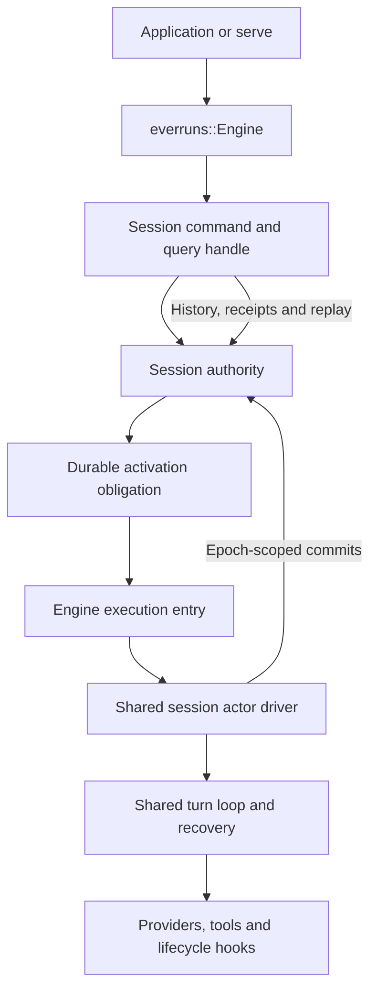

# Engine-Owned Durable Sessions

**Status: accepted for implementation; migration in progress.** This revision makes `everruns::Engine`
mandatory for the DO application and execution paths. It supersedes the earlier
proposal's recommendation to expose an external host factory as the Framework
integration. The [implemented DO adapter](durable-object-native.md) remains a
working lower-level authority and recovery proof; it does not yet satisfy this
Framework contract. No existing API or durability guarantee changes through this
proposal alone.

## Implementation status

The in-progress [Framework hosting implementation](../../crates/everruns/src/hosting/mod.rs)
now owns transactional admission, retained behavior/Harness/Environment references,
authority epochs and reconstructible outcomes. Memory and single-domain SQLite
profiles share the actor driver with `ObjectHosting`. Framework lifecycle receipts
conservatively record uncertain hook effects. Approval batches and client results
target a retained logical turn; repeated provider call ids cannot authorize a later
turn. Timer obligations are separate from runnable input; Rust interprets expired
waits after an independently delivered activation.

The public facade and shared Agent compile for Wasm. The DO application enters
Engine for creation, commands and execution. Workers event polling/SSE uses bounded
canonical pages and exact opaque event identities. Native serve reads authoritative
status and can rebuild a lost catalog from binding metadata. Explicit Environment
factories reopen workspace services; a durable journal does not supply those services.
The celld bootstrap and native adapter now use these same paths. The native
container placement has passed executor-container loss and replicated authority
owner loss without client recovery traffic; final revision qualification remains
the completion gate.

These changes are not the completion gate: explicit legacy facade retirement,
complete API/protocol parity, required host-service coverage and final platform crash proofs
still require validation. The publication hold remains in force. Qualification
results must identify the tested revision and placement; prior low-level proofs
do not qualify the Engine migration.

## Decision to make

Keep one concrete Engine and one public Agent/Session API. Make a coherent
**session hosting profile** pluggable beneath Engine, above input admission and
runtime construction. Engine owns Framework semantics; the profile supplies
session authority, activation and host services. The application defines ordinary
Framework Agents. A hosting plugin owns all low-level backend wiring.

The primary DO target is an Engine compiled to Wasm inside the object. A native
executor over DO authority is another placement of that same Engine, not an
alternative application API. serve continues to call Engine. Yolop's current
custom core host is a separate consumer and need not be migrated to establish
this contract.

## Why the previous extension was insufficient

The previous extension shared execution, but its integration boundary was
a turn boundary rather than a session authority boundary:

| Previous coupling | Consequence for DO |
| --- | --- |
| [Engine](../../crates/everruns/src/engine.rs) holds executable Agent snapshots in a process-local map and initializes memory/local stores from Agent configuration | Replacing turn execution does not replace session creation, attachment, identity or storage selection |
| [Session admission](../../crates/everruns/src/session.rs) acknowledges a local mailbox before preparation and execution, and steering also uses a local queue | A successful Framework send is not a durable DO admission |
| Session owns start/completion hooks, cancellation finalization, runtime construction and completion watchers | A remote turn factory cannot move these semantics or survive loss of the frontend |
| History and live observation reach local execution bindings and the facade event bus | A remote turn result does not provide a coherent remote session API |
| The former DO activation factory accepts a factory returning `InProcessRuntime` | It bypasses Engine and its session lifecycle, even when the factory started from an Agent |
| [The Wasm application](../../examples/durable-object-agent/src/lib.rs) imports core/contracts directly | It proves portable shared execution, not portable Framework application composition |

`TurnBackendFactory` is therefore too narrow as the public hosting extension.
Wrapping `Agent::execution_host` or renaming the example would preserve the gap.

## Ownership and dependency direction



These are logical roles, not separate Engine implementations or services that
must be deployed individually. In a DO, authority and execution communicate
through an object-local port. In native embedded execution, they may be in the
same process. A remote native executor has a second instance of the same Engine
library, with the retained application registry and execution role enabled.

| Owner | Responsibility |
| --- | --- |
| Application | Trusted Agent definitions, tools, hook declarations and provider/model selection |
| Framework Engine | Session API, behavior reconstruction, lifecycle orchestration, outcome projection and shared actor execution |
| Session authority | Authoritative identity/binding, admitted commands, canonical journal, receipts, execution epochs, waits and runnable state |
| Activation implementation | Deliver wakeups, retry or discover runnable work, observe lease expiry and preserve the recovery obligation |
| Host services | Supported provider transport, workspace, secrets, clocks and other declared effects |
| serve | HTTP auth and protocol mapping, app discovery, channels and deployment integration |

The neutral session contracts and shared actor mechanics belong below the
facade in core/contracts. The coherent profile extension and Agent registry are
Framework APIs. `everruns-durable-object` implements that extension and depends
on Framework; Framework must not depend on the DO plugin. The plugin may use core
internals. Application agent modules import `everruns` only; hosting entrypoints
may additionally import the hosting plugin. Engine's private `HostBackends`
construction does not become application configuration. Authority selection moves
from Agent-local backend configuration to the Engine profile; an Agent must not
silently select another authority through its legacy local/custom-backend settings.
Workspace selection remains an Environment concern, separate from journal and
activation ownership.

## One profile, several implementations

A profile is a validated composition, not an independently swappable event store,
lease store and queue. Its command and commit operations establish the atomicity
boundary across those concerns. A third-party profile implements the contract
and runs the same conformance suite; it does not implement agent planning.

The minimum responsibilities are session creation/reopening and immutable
binding; idempotent command admission; bounded snapshot/query and receipt reads;
a durable wakeup obligation for durable profiles; and epoch-scoped execution
access to the journal and session state. Environment/Harness requirements are
persisted with the session binding. These are semantic operations, not a proposed
Rust method inventory or a generic transaction callback sent over HTTP.

Keep command/query access separate from execution write access. Claiming a
session returns an epoch-scoped execution capability, from which Engine privately
assembles coherent runtime stores. Each write checks that capability at the
authority; frontend readers and Agent configuration cannot acquire unfenced
canonical write access. Activation delivery does not itself confer ownership.

| Profile | Authority and activation | Engine execution |
| --- | --- | --- |
| Memory | In-memory authority and process-owned scheduler; explicitly volatile | Native or Wasm, while the process/isolate exists |
| Native durable | PostgreSQL authority with durable runnable discovery, or a qualified single-domain SQLite authority with startup supervision | Native Engine on embedded or fleet workers |
| DO isolate | Object SQLite plus stored alarms and retry state | Wasm Engine in that object |
| DO with native tools | Same DO authority and alarms, authenticated dispatch to a retained build | Native Engine in replaceable executor processes |

The current native local profile combines JSONL and SQLite. It must not acquire
an atomic-admission or autonomous-recovery claim by changing its label. Either
keep its documented weaker failure scope, or implement and qualify a coherent
local authority. An optional JSONL export from a transactional authority is a
projection, not a second writer.

Exactly one mechanism owns execution epochs. Do not put the facade's
`ActorRunner` lease around a driver already leased by the DO authority. Move the
facade's mailbox execution semantics into the shared actor path for all profiles;
the public Session becomes a handle, not another session executor. The existing
`TurnBackend` may remain an internal turn-driving helper during migration, but
its factory is not the profile boundary. Retire the overlapping facade runner
once parity tests pass.

## Agent registration and creation

Agent closures and provider clients are not serializable. Engine needs a trusted
registry mapping an immutable agent/build reference to an Agent factory. Native
and Wasm builds use the same application definition; factories receive curated
host configuration such as a Model/provider value, not storage interfaces.
Native filesystem or process capabilities remain explicit host requirements.

A durable session binds tenant/session identity, agent/build reference, and its
Harness/Environment definition or immutable reference. An activation reconstructs
that binding, rather than accepting a fresh Agent from an arbitrary request.
Unsupported host requirements fail before creation/admission is acknowledged.
Unavailable retained code produces a durable, visible suspension; it never
selects the latest build silently. The reference pins behavior configuration as
well as executable code; credential rotation stays host-owned and secret-free.
Retain old builds or explicitly migrate the
binding while no execution epoch is active, with a recorded migration decision.

Creation and attachment require asynchronous authority I/O. Prefer explicit
async durable creation over pretending that a process-local allocation created
an authoritative session. Preserve simple local convenience only if it clearly
returns an uncommitted handle. A caller-supplied typed session identity makes a
lost creation response retryable at the same DO address; retrying the same
creation/binding succeeds and conflicting reuse fails. Generated identities must
be allocated once in a retained creation request before transport retries.
No global cross-object transaction or strongly consistent tenant session listing
is implied; tenant directory/listing is a separately declared projection.

After restart, `Engine::resume` looks up the authoritative binding and resolves
its retained Agent/Harness through the registry. A process-local session map is
only a cache, not the existence or ownership check. Explicit application
attachment can remain for reconstructed local behavior, but must verify the
same binding; it cannot replace a missing durable registration with arbitrary
new closures or wider Environment permissions.

Conceptual application flow, **not existing or finalized Rust API**:

```text
agent = ordinary Framework Agent definition
engine = Engine(registry with immutable agent/build, selected hosting profile)
session = await engine.create(agent reference, stable creation identity)
admission = await session.send(input, stable command identity)
outcome = await admission.wait()
```

The agent module and Session operations are identical across profiles. Hosting
configuration and platform entrypoints differ. Agent definitions do not construct
`InProcessRuntime`, `HostBackends`, actor stores or authority clients.

## Admission, steering, results and cancellation

A successful send means the selected authority accepted the message under its
declared durability scope. For a durable profile it commits input, a stable
receipt and a discoverable activation obligation before acknowledging. Retrying
the same identity/content returns the same receipt; conflicting reuse fails.
Transport retries reuse the request identity. Applications that retry after losing
an entire client process must supply or persist their command identity.

The current `SentMessage` promises an immediate turn id and Started/Steered
classification. A durable inbox cannot generally know either at admission.
Replace that assumption with an admission handle keyed by command/message
identity. The shared driver durably records which turn consumed the input;
only then is its turn assignment and steering disposition known. The handle
exposes pending assignment and later resolution. It must never invent a new turn
just to fill a receipt field. All profiles expose the same distinction.
An admission cancelled before consumption can have a final outcome without any
turn assignment. Build suspension and durable waits must also be visible through
the handle, rather than waiting forever for a nonexistent terminal turn event.

Admission is ordered by the authority, while consumption and turn assignment
follow the shared driver's reason/finish boundaries. Closing a turn and checking
for late input must preserve runnable work atomically. Rejected in-memory steering
is not an accepted durable command. Input cursors advance only after durable
evidence of inclusion exists, preserving the existing log-fold recovery rules.

Tool results, approvals, Ask User answers, cancellations and session overrides
are commands with stable identity and authoritative targets. Cancellation names
a recorded turn or an admitted input generation, cannot cancel a later turn,
and has one authoritative terminal writer. A lost cancellation reply is retried
with the same identity. A successful cancel acknowledges the request; reaching
a cancelled terminal state is separately observable. No cancellation retracts an
external effect already dispatched.

Approval and client-tool waits survive restarts without keeping a callback,
oneshot or Engine instance alive. Restore pending requests from the authority;
resolve them through the same Session API. A profile that cannot support a
requested capability refuses it explicitly before its work is admitted.

## Activation and the Engine execution entry

A DO alarm, native poller or authenticated executor endpoint enters Engine with
a session activation. Engine validates the authoritative binding, acquires one
execution epoch through the profile, reconstructs the registered Agent/Harness,
then runs the shared `SessionActorDriver` and turn loop. Frontend handles do not
construct a runtime as a prerequisite for sending or reading a session.

All profiles use the same admission/consumption/recovery path, including the
memory profile. Native fleet discovery remains an activation concern, not a
method every single-object adapter must fake. Ordinary facade execution no
longer runs a second loop around a remote ticket.

Renewal and every canonical/session-state commit use the same authority epoch
and authority clock. Lost or expired ownership stops future dispatch and rejects
stale writes atomically. The authoritative wakeup is retained before starting
work and while a lease can expire. Bounded activation budgets yield only at
recoverable boundaries; a platform lifetime limit is not treated as an unlimited
background task. A transient activation error persists retry state and another
wakeup. Storage/platform outages outside the declared wakeup guarantee require
an explicit operational recovery path; a stored runnable bit alone is not one.

The object may admit commands while execution awaits a provider or tool. It must
not hold a global object concurrency block across the turn. Transactions protect
short authority mutations; Engine serializes semantic execution per session.
Duplicate alarms cannot create a second owner. JavaScript transports storage,
fetch and activation only; Rust retains planning, recovery and tool policy.

## Lifecycle hooks and outcomes

Move awaited Framework start/completion hooks into the Engine execution path,
under the same logical session/turn identity as native execution. The frontend
never runs them in addition to the worker. Per-tool hooks remain on the shared
runtime path. Record hook invocation identity, recovery policy and outcome;
reconstruct durable progress rather than relying on `HookRunState` in a lost
Session object.

A first-session lifecycle hook differs from per-activation host initialization.
Persist the logical first-start transition, and keep ordinary transport/store
setup outside it. Pure or idempotent hooks can recover under a stable invocation
identity. An effectful hook with an uncertain result is not retried blindly;
default to conservative at-most-once handling. An unresolved pre-effect gate
blocks/suspends the effect instead of granting permission. Post-effect failures
are isolated and recorded. This does not promise exactly-once hook effects.

The durable Framework outcome includes hook failures. `turn.completed` alone
cannot resolve a wait if awaited Framework completion hooks are still pending.
Persist a lifecycle-finalized outcome or equivalent receipt after they settle.
Model/tool termination, durable waits and Framework finalization are distinct
states, not a second planner. Existing client-tool waiting results remain
observable without requiring a terminal event that has not happened.
The authority retains runnable work until Framework finalization is committed,
even if the core turn is already terminal. Activation must recover that pending
finalization without starting another model/tool turn. Turn hooks are keyed by
the logical turn, so multiple steered admissions share its outcome and do not
each invoke completion hooks.

## Reads and observation

History, event pages, context inspection, pending waits and outcome queries all
use the profile, never a second local event log. Reconstruction of context uses
the same trusted Agent/Harness and a consistent authority snapshot, possibly by
an Engine query on the execution host. It must not start a model call or create
an extra owner simply to read history. Attachments and other session mutations
also cross the authority boundary; they cannot fall back to a frontend workspace.

Wait handles reconstruct from durable identity, not a process-local watch
receiver. Dropping a handle, SSE connection or request does not cancel accepted
durable work. Engine shutdown leaves the durable activation obligation intact;
a volatile profile documents its process-lifetime limit. Local watches are an
optimization, not proof of completion.

Live deltas remain lossy observation. A durable observer subscribes first, reads
to an authoritative watermark, deduplicates by sequence and can catch up after a
reconnect. The live path needs either a replay-capable subscription handshake
or poll-from-cursor catchup; a process-local broadcast alone is insufficient.
Persisted semantic events are replayable; ephemeral token deltas are not.
Engine listeners remain best-effort and may see duplicates across restarts;
effectful consumers need their own durable outbox/consumer receipts.

## serve integration and trust

serve registers its discovered agent factories with Engine and uses its normal
session creation, sending, resolution, history and cancellation methods. A
DO hosting package wires the Engine profile and platform entrypoints. There is
no separate authority-client send path in an example and no independent
`Server::execution_host` execution flow. Both native serve and the DO target
reach the same Engine session contract; sharing a router is not sufficient.

serve's current SQLite catalog, build checks, approval waiters and channel state
must be audited individually. Session identity/build binding and durable waits
move behind Engine authority. UI/catalog indexes may be projections. Channel
inbox deduplication and reply delivery still require a durable channel store and
outbox; changing the session profile does not make that store durable. Initially
port a thin Workers `/v1`/SSE adapter over the shared Framework execution API
contracts; native Axum/CLI and process-specific serve tooling need not compile
to Wasm. This adapter performs no agent planning or independent event authoring.

The current HTTP message response already identifies a message without requiring
an immediate turn id. Preserve that compatibility where possible; replace
serve's internal Started/Steered-based tracking with authoritative assignment and
outcomes. Audit cancellation responses separately: accepting a cancel command
must not claim terminal cancellation already happened. Any required wire changes
belong in the shared execution API contracts and SDK compatibility tests, not a
DO-specific protocol.

Tenant identity comes from authenticated host context. Authority operations,
creation identity, receipts and event cursors remain tenant/session scoped.
Activation validates the retained build and epoch, not a caller-supplied callback
or Agent payload. A native executor authenticates independently from the user
API; object-local ports are bound to that object. Provider keys and executable
closures never enter canonical records. Hosting plugins are trusted executable
code, not a sandbox for untrusted tenant modules.

The current [threat model](../security/threat-model.md), especially
TM-DURABLE-012, remains the baseline. This proposal requires review of the new
profile/registry boundary and durable callbacks before claiming its mitigations
are implemented.

## Celld examples and integration are part of the change

Celld and Cloudflare use the same Engine hosting contract and shared agent
definition. Platform configuration, container provisioning and actual storage/
alarm guarantees remain platform-specific and are qualified independently.
Neither platform maintains its own agent execution or recovery implementation.

The celld migration is required for this proposal's completion:

| Existing surface | Required target |
| --- | --- |
| [celld-engine](../../examples/celld-engine/README.md) | A thin celld bootstrap of the shared Framework Agent/Engine application, replacing its custom cell step driver and direct Reason/Act orchestration |
| [Shared DO application](../../examples/durable-object-agent/README.md) | The common Framework application module used by celld and Cloudflare, with platform-specific hosting configuration |
| [serve-celld integration](../../crates/serve-celld/README.md) | A thin serve hosting adapter selecting the Engine DO profile and optional native executor/container services |
| [serve/celld application and Worker](../../examples/serve/celld/README.md) | Ordinary serve declarations and the same `/v1` Engine path; replace snapshot plus HTTP-request replay as the session durability mechanism |
| [Wasm guard](../../scripts/lib/check-wasm-portability.sh) and [recovery CI](../../.github/workflows/durable-object.yml) | Check the public Framework facade and qualify recovery through Engine/Session and serve, rather than accepting a kernel-only build or low-level authority-client proof |

Remove the example-specific step machine once its replacement is qualified.
Useful kernel assertions can move to focused internal tests; the maintained
application example must not teach another runtime. Share the Agent module
between platforms instead of copying agent/tool/provider composition into
another celld-specific application.

Use one DO authority per Framework session. The existing serve cell name scopes
an application/container that can contain multiple sessions; it must not remain
a second session authority around the new Engine profile. Session creation and
gateway routing need stable tenant/session identities. App-level directories and
session listings can be separate projections. Test multiple sessions and tenants,
not just one named demo cell.

Keep native containers when tools need processes or a real filesystem. They run
the native Engine execution placement against the same DO authority. Container
restart reconstructs the registered build and resumes claimed work; it does not
restore an old canonical session log and replay `/v1` requests. Snapshot/restore
may remain a separately specified workspace persistence or cache mechanism, but
must not roll back authoritative commands, receipts or execution epochs. Tool
results referring to files require an explicit durable workspace contract; a
durable session journal alone does not preserve container files.

The old cell can return a successful session-creation response with
`x-celld-durable: pending` when it cannot snapshot while busy. The new target
acknowledges creation only after authoritative binding commits. A busy executor
must not weaken that acknowledgement or require a later snapshot for correctness.

Replace the current celld E2E scenarios with shared Engine/serve conformance plus
platform-specific faults: lose the owner node in the replicated fleet, kill the
native executor independently, retry a lost creation or admission response,
recover approval/tool waits and completion hooks, and reject late writes from
the previous epoch. Observe through Engine or `/v1`; make no extra client request
to trigger recovery. Count committed effects and canonical outcomes, rather than
assuming an interrupted whole turn or tool batch must replay. Retain the
qualification limits for the test bucket, alarm scan and deployment topology.

Update the [public celld guide](../../docs/framework/serve-celld.md), example and
crate READMEs, hosting documentation, manifests and CI together with executable
migration. Until then they describe their existing weaker semantics; a design
document does not upgrade those implementations. Do not leave the three current
paths advertised as interchangeable Framework durability architectures.

## Alternatives and migration

| Alternative | Assessment |
| --- | --- |
| Keep the turn factory and wrap a remote ticket | Reject: admission, hooks, reads and local leases still have the wrong owner |
| Supply DO stores to the current facade runtime | Useful implementation material, insufficient as architecture: creation, command receipts, activation and lifecycle remain local |
| Build a separate DO agent facade | Reject: creates another application API and another lifecycle to keep aligned |
| Session hosting profile beneath one Engine | Recommend: moves the complete semantic boundary while retaining the shared runtime |

Implement in reviewable stages, with a runnable proof at every step:

1. Establish the memory profile and thin Session handle through Engine. Move
   current behavior into the shared session driver and pin compatibility tests
   for hooks, steering, cancellation, waits and observation before adding DO.
2. Introduce trusted agent/build registration, durable creation/admission and
   reconstructible outcome handles. The selected embedded native profile is a
   single-domain transactional SQLite authority with independent startup supervision.
   The platform's PostgreSQL actor host remains a separate consumer of the same
   core driver; its control-plane records stay outside the Framework dependency graph.
3. Port the complete minimal Framework facade to Wasm: Engine, Agent, Session,
   tools, hooks, Harness, events and observers. Gate native I/O and use the
   existing portable task/time and host-HTTP facilities. A core-only Wasm build
   does not satisfy this step.
4. Adapt the existing DO authority/activation to the Engine profile. Replace
   `HostFactory` examples with the same ordinary Agent module on native and Wasm.
   Existing fencing, alarm and crash qualification remain mandatory.
5. Wire serve's normal session API, durable waits and required catalog/channel
   storage to the profile. Run the same tests over native HTTP and the DO `/v1`
   target. Migrate the celld examples and integration described above, including
   both isolate and native-container placements. Remove bypass paths, the custom
   example step driver and superseded factories once their replacements qualify.

These are implementation stages, not deferred follow-up issues. Do not declare
Framework/DO parity complete after only the kernel, factory or Wasm build lands.

## Acceptance gates

- One shared agent module imports only `everruns`, uses normal Agent/tool/hook
  authoring, and executes through Engine on native and Wasm. Platform bootstraps
  may import the hosting plugin, but never hand-assemble core runtimes.
- A nontrivial conformance suite uses only Engine/Session for creation, send,
  tool continuation, cancellation, history, events and outcome observation. Run
  it on memory, native durable and both DO placements, not on AuthorityClient.
- Kill the frontend after accepted send, lose the executor, send no additional
  client traffic, and require persisted completion or an explicit durable wait.
  Reopen in a new Engine and resolve the original admission handle.
- Lost creation/admission/resolution/cancel responses followed by retries retain
  one binding, one accepted command and one effect under the declared policy.
- Race two Engines, duplicate alarms, lease expiry, delayed stale replies,
  cancellation followed by new input and input at a finishing reason. No stale
  canonical writes, dual execution owners or stranded acknowledged commands.
- Start/completion hooks and approvals behave through Engine after restart.
  Test loss after hook effect but before its receipt; default uncertain effects
  are not repeated and pre-effect gates never fail open.
  Also lose the process after `turn.completed` but before Framework finalization;
  the admission handle must still resolve, with no new model/tool execution.
- Pending client tools, partial resolutions, attachment references and Harness/
  Environment bindings reopen correctly. Unsupported host requirements are
  rejected before admission rather than silently using local substitutes.
- Native serve and the Workers target expose compatible `/v1` session behavior,
  including durable accepted receipts, SSE replay, authorization and cancellation.
  Cross-object channel delivery has its own outbox proof when enabled.
- The maintained celld examples use Engine and the same agent module as the
  Cloudflare target. Native-container recovery has no canonical snapshot/request
  replay path; creation while another session is busy is still durably admitted.
- Crash proofs run in workerd, the actual Cloudflare service and the replicated
  celld fleet, with failure-domain limits recorded. Provider/tool policies remain
  the shared Rust implementation; no exactly-once external-effects claim.

## Related concepts

- [Application API boundaries](application-api.md)
- [Framework Harnesses](harnesses.md)
- [Current execution backends](execution-backends.md)
- [Durability semantics and qualification](durable-execution-guarantees.md)
- [Implemented lower-level DO authority](durable-object-native.md)
- [Kernel portability](wasm-kernel.md)
