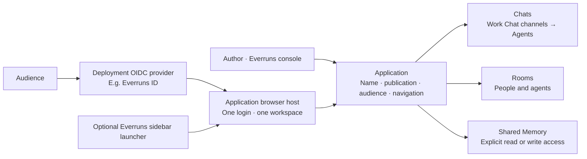

# Applications

An Application is the public workspace an author assembles for an audience. It owns
publication, navigation and audience policy. Agents still own execution; Work Chat
channels still own chat sessions; Rooms and Memory retain their existing behavior.
This is a new aggregate, independent of the retired single-agent App.

## Experience

Organization owners and administrators manage Applications in Build, using the
same organization settings permission as organization Memory. They create or attach Work Chats, Rooms and
organization Memories, name and order their navigation entries, select an audience,
and publish. A separate browser host serves the Application at its stable name under
the deployment's configured publication domain. Existing standalone Work Chat hosts
continue to use their assigned random labels.

The optional launcher is available in both the compact navigation rail and the
expanded sidebar. Navigation loads only the admitted launcher projection, without
prefetching Application configuration or resource content.

The consumer overview groups the configured resources into Chats, Rooms and Memory.
Each Chat retains the existing Work Chat conversation, thread, file, account and
plugin interfaces. Rooms let participants read, post, reply and mention agent members.
Memory has a directory browser and text editor; the publisher explicitly grants write
access. Automations have a reserved configuration boundary, rejected when enabled until
an automation runtime ships. Themes are outside this implementation.

## Ownership and publication

Stable names are globally unique, immutable, and retained after archival. Broker and
infrastructure labels, and the existing random Work Chat namespace, are reserved.
Publication requires resources and a configured domain. Unpublishing stops runtime
access. Archiving retains resource bindings, history and the name. Owners can restore an
archived Application as a draft before changing or republishing it. Configuration edits
use optimistic versions; stale saves cannot overwrite someone else's edits.

Configuration changes participate in the platform's revision history. Restoring a
revision uses the current version guard and validates resource bindings again.
Selected-field undo preserves the current audience and resources unless those
fields were explicitly selected. The stable name, version token and publication
state cannot be restored from history; publication and archive restoration remain
explicit lifecycle actions.

A Chat or Room belongs to at most one Application. Attaching an existing resource is
an explicit audience-sharing action. Every binding must resolve inside the owning
organization. Memory can be shared deliberately across Applications, with separate
read/write grants; private user, Agent and Room memories cannot be attached through
this mechanism. The editor links back to existing resource management surfaces. Detached Chats resume
their own Work Chat audience policy; Chats created through an Application start with
an organization-only standalone policy so detaching them cannot make them open.

Application memory also appears to the Application's chat and Room agents under
`/application/memory/<resource-name>`. This is a live memory mount, not a copied initial
file. Changes in bindings and permissions are resolved again for existing sessions and
child sessions. On data plane v2 a reserved routing mount reaches the control plane,
including when a resource binding is created after the session; every operation still
requires a current grant. Existing private user memory remains governed by the runtime identity.

## Authentication and isolation

The browser host reuses Work Chat's OIDC broker, state, nonce, PKCE, encrypted provider
sessions, host-only cookies, origin checks and narrow proxy allowlists. OIDC issuer and
client settings belong to the deployment, supporting Everruns ID or a self-hosted
provider. A fresh provider-token exchange runs before authenticated browser requests.

The published browser calls same-origin APIs on its Application hostname. The browser
host forwards only allowed consumer operations to the shared Everruns backend using
Application-scoped credentials kept server-side. It exposes no organization management
proxy. This is an Application API boundary over the shared runtime, not a separately
deployed backend per Application.

The audience modes are open (any accepted identity), invited verified emails, and
current organization users. New Applications default to organization users on both
the API and the authoring interface. External audience identities are isolated per Application,
but shared across its Chats and Rooms. Organization mode deliberately reuses the
member's default runtime identity and connected services. Verified subject/email and
current membership rules match Work Chat's existing admission semantics.

Application credentials have a distinct JWT type and audience. They identify one
Application, one virtual user, the current configuration version and a live identity
binding. Runtime calls recheck publication, version, account and binding status, and
current audience admission. They confer no management permissions. Application-owned
Chats reject standalone channel tokens, raw OIDC tokens, PATs and agent keys as alternate
paths around the audience. Shared transcript links also require Application admission.
Consumer connection setup is limited to the union of the Application chats' user MCP
attachments.

The public bootstrap exposes only presentation. Authenticated manifests expose only
bound resources, never invite addresses. Room consumers receive server-selected guest
members; a browser cannot provide `as_member`. Leaving/removing that guest revokes its
Room access. Consumer Room projections omit private member instructions and agent
session IDs. Memory calls resolve the bound resource, organization, scope and access
mode before using the existing path-validated file service.

## Deployment

The [Helm chart](../../charts/everruns/values.yaml) optionally runs the existing
[chat browser image](../../apps/chat-ui/Dockerfile) for both Applications and Work Chat.
The [Kubernetes CLI](../../crates/cli/src/commands/k8s/mod.rs) accepts publication domain,
OIDC client, existing credential Secret and wildcard TLS Secret settings. DNS and OIDC
registration remain explicit operator inputs. The browser and server receive identical
issuer/client/domain settings; browser credentials and encryption keys never reach the
console or a client bundle. A separately provisioned restricted PostgreSQL login owns only browser credential
access; the chart never passes the platform database administrator credential to the
browser. PostgreSQL stores encrypted provider sessions across replicas
and restarts. Keep the session encryption key stable across upgrades.

## Implementation and evidence

* [Application commands and types](../../crates/server/src/domains/applications/)
* [Consumer adapters](../../crates/server/src/api/applications/)
* [Database migration](../../crates/server/migrations/20261125160523_applications.sql)
* [Authoring interface](../../apps/ui/src/components/applications/application-editor.tsx)
* [Published interface](../../apps/chat-ui/src/components/application.tsx)
* [Boundary tests](../../crates/server/tests/domain/applications_test.rs)
* [Work Chat](work-chat.md), the underlying chat and browser-auth contract
* [Rooms](../runtime-resources/rooms.md) and [Memory model](../runtime-resources/memory-model.md)
