# Email inbox channels

One agent may publish Slack and email channels. Provider accounts and inboxes are
organization resources, while one inbox binds to one agent channel. Provider
credentials are encrypted organization connections, separate from AgentID.
Channelkit owns AgentMail wire operations; Markkit owns deterministic body views;
Everruns owns identities, durable waiting, quotas, gates and delivery authority.
See [channels](channels.md), [injected capabilities](../execution/injected-capabilities.md),
and the [implementation](../../crates/server/src/channels/email/).

```mermaid
flowchart LR
    AM[AgentMail webhook or reconciliation] --> Verify[Verify and persist]
    Verify --> Queue[Durable inbox backlog]
    Queue --> Batch[Bounded subject and preview batch]
    Batch --> Judge[Jev triage]
    Judge -->|inspect selected| Read[Fetch and normalize body]
    Judge -->|noise or uncertainty| Hold[Ignore or hold for review]
    Read --> Gate[Authentication and relevance gate]
    Gate -->|admitted| Thread[Sender-specific email session]
    Thread --> Intent[One immutable text and HTML reply]
    Intent --> Review[Output gate or operator approval]
    Review --> Send[Outbox transport]
```

## Authority and audiences

A verified webhook proves the provider delivered the event, not who authored the
mail. Provider authentication must align with From for autonomous processing;
security holds, automatic replies and mailing lists fail closed. From remains an
external actor, never an Everruns login. Plus tags preserve the original recipient
and share the base inbox's quotas; they neither authenticate a sender nor select
another person's session. Thread bindings include the exact sender mailbox.
Email bypasses the channel host's verified-participant enrollment. The external
actor is display and routing metadata, not a new runtime account or login.

Execution currently requires data plane v2 and the served email capability. The
controller attaches that capability from the persisted email session source after
normal capability validation; public requests cannot assign an injected email
capability or choose its server URL. See [session setup](../../crates/server/src/domains/data_plane/sessions.rs).
The host installs an email tool policy from the persisted session or resolved agent
attachment, independent of injected-hook discovery. Only the scoped email read
and list tools, send_message without files, and no_reply may execute. It is a
policy gate on final arguments, including nested/client calls. Inbound email
cannot authorize Slack, shell, file access, delegation or arbitrary MCP calls.
Injected beforeTool declarations also express the restriction; the current
runtime does not automatically install those hooks, so they are not the
security boundary. See [runtime policy](../../crates/core/src/host/host/email_policy.rs).

Jev evaluates bounded summaries once per batch and reads only selected bodies.
Uncertain or unavailable decisions hold work. The full normalized selected body,
not just its cleaned excerpt, is used by the content gate. The business agent
receives an isolated thread, not the entire inbox. Clean/full tools are scoped to
admitted messages in that session. There is no busy-polling agent: ending the turn
leaves durable intake waiting for another message. This first version uses host
batch triage rather than a free-form, inbox-wide triage-agent session.

Model judgments cannot guarantee injection resistance or detect every secret.
Use an agent whose instructions and preloaded context are appropriate for external
correspondents. The same agent definition is reusable across Slack and email;
conversation history and sender identity are not automatically shared. The inbox
admin page exposes page identity to Platform Chat without projecting mail or
provider-account caches; its approval actions remain explicit manual actions.
Read-only personal tokens can inspect the admin read surfaces but cannot claim
work, approve execution or send replies. Inbox credential binding requires full
token scope; provider webhook authentication remains independent of PAT scope.

## Backpressure and recovery

Receipt acknowledgement follows committed intake; duplicates share provider
message identity. Poll reconciliation has a persisted page/window cursor and
uses the same admission path. A 1,000-message burst becomes database rows, not
1,000 active turns or LLM summarization calls. Batch byte/count limits, renewable
leases, per-org fixed-window budgets and per-inbox execution serialization bound
work. Limits are owned by [queue](../../crates/server/src/channels/email/queue.rs)
and [worker](../../crates/server/src/channels/email/worker.rs), not process-local
counters. Begin and commit use the shared cancellation-safe database boundary,
so a cancelled waiter cannot return a connection with an untracked transaction.
Capacity exhaustion returns retryable refusal before acknowledgement.

Completed/ignored/failed bodies expire after 30 days when there is no unsent or
uncertain reply. Receipt identities remain another 90 days, preserving deduplication
without body retention. Held work is retained within the hard storage and receipt
quotas. Expiry is swept in bounded chunks. Provider storage has its own policy.
Session transcripts retain admitted content under the session retention policy;
inbox expiry does not erase those copies.

Email buffers output until a successful turn boundary. Failed, cancelled, empty,
over-budget and no_reply turns do not send completion notices as email. Rendered
text/HTML and the sole sender recipient are persisted once. Template edits cannot
change an existing intent. Replies retain the provider thread subject; template
subject previews apply to composition, not a promise to rename a reply thread.

Operator approval and output-gate approval survive restart. Definite rate limits
can defer an unchanged intent; timeouts, server errors and interrupted sends
become unknown and are never automatically repeated. There is currently no
operator reconciliation UI for unknown sends. This is an explicit operational
hold, not evidence of failed delivery.

## Qualification and dependency rollout

Tests cover the queue burst and fences, signed HTTP intake, real database delivery
staging, template escaping, scoped reads, terminal aggregation and restart recovery,
and the UI flow. The opt-in [local round-trip test](../../scripts/e2e-email-agentmail.py)
uses a real v2 stack, real model, the designated testing inbox, polling and explicit
execution/send review. It is separate from the deterministic contract tests.
The live test also requires a successful scoped email read. It covers boundaries
that component tests missed during implementation: attaching a hosted capability
after write validation, avoiding verified-identity enrollment for email From,
using the versioned injected endpoint and parsing canonical MCP tool names.
Live AgentMail checks exercise only a designated inbox's plus variant, text/HTML
and threaded replies, including idempotent retries. Synthetic signatures are not provider-origin webhook
proof. End-to-end qualification must distinguish these layers from a deployed
provider-webhook-to-real-model-to-reply run.

On 2026-11-26, a real provider-received plus-address message resumed from the
durable backlog on local v2, passed explicit execution review, was read through
the authenticated session-scoped MCP tool by a real model, and produced an
immutable text/HTML reply. Separate send approval delivered a threaded reply
confirmed as sent and received by AgentMail. Provider readback preserves quoted
history, so the test checks the new first line separately; the outbox's original
text is checked exactly. A subsequent fresh-message run passed the complete
plus-address delivery → durable polling intake → execution review → real scoped
read → immutable outbox → separate send approval → provider threaded text/HTML
readback flow. One earlier fresh delivery exceeded the test's four-minute wait;
provider transport timing is not a processing latency guarantee. These runs use
explicit approvals, not autonomous Jev admission/output decisions, and do not
qualify a provider-origin webhook deployment.

Markkit resolves from published `0.3.3` with `email-body`, avoiding the unused MIME
parser and preserving Rust 1.96 compatibility. Channelkit core and AgentMail resolve
from published `0.1.0-alpha.7`. Exact registry versions replace the temporary source
snapshots; the checkout no longer depends on sibling repositories. Cloud rollout
remains separate from this core integration.
