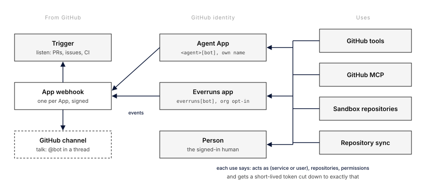

# GitHub Connection Model

> Status: **Design, awaiting approval.** Nothing here is built. It reorganizes
> what [Per-agent GitHub Apps](github-apps.md), [User Connections](user-connections.md),
> [User MCP servers](user-mcp-servers.md) and
> [Agent Triggers](../runtime-resources/agent-triggers.md) already ship.
> Public per-agent Apps (one App installable on many GitHub accounts) are
> designed separately and are out of scope here.

## Abstract

GitHub reaches Everruns through six separate paths today, each with its own
idea of whose credential it uses. A person's "GitHub" connection actually holds
an installation of the shared Everruns App, so it acts as `everruns[bot]`, not
as the person. An agent's own App is set up from the Triggers section although
it is the agent's GitHub identity for everything. The GitHub MCP server has a
third login of its own when it acts as a person. Sandboxes get a token only
through one Daytona tool or Modal's egress injection. Repository sync for
memories and knowledge indexes borrows the index owner's personal connection.

This design replaces those paths with one model of four parts:

1. **GitHub identity**: who shows up on GitHub. An agent bot with its own
   name and avatar, the shared Everruns App, or a person.
2. **Access**: where that identity is installed and with which permissions.
3. **Uses**: every feature that calls GitHub (tools, MCP, sandbox git,
   repository sync) names the identity it acts as and the permissions it
   needs, and gets a token cut down to exactly that.
4. **Inbound**: GitHub talks back through the identity's App webhook, either
   as events to a trigger (listening) or as messages to a GitHub channel
   (a conversation, like Slack).

## What exists today

Verified against `origin/main` at `c79edc4` and saas `main`.

| Path | Credential | Acts on GitHub as | Where it is set up | Where it lives |
|---|---|---|---|---|
| Shared Everruns App, person connection | Installation of the deployment App (`GITHUB_APP_*`), stored on the person's virtual user | `everruns[bot]` (installation token), not the person | Settings > My agent experience | `api/user_connections/github_setup.rs`, `GitHubAppTokenMinter` in `storage/connection_resolver/mod.rs` |
| Per-agent App | App created from a manifest, stored as the service virtual user's `github` connection | `<agent-app>[bot]` | Agent > Integrations, under Triggers | `github_apps.rs`, `api/github_apps.rs` |
| `github` capability tools | `get_connection_token(session, "github")`: the invoking person's connection when the turn has a person, otherwise the agent's | Whichever of the two above was picked, implicitly | Capability on the agent | `crates/integrations/src/github/` |
| GitHub MCP preset | `acts as service`: the agent's `github` connection (connection-backed preset). `acts as user`: a separate OAuth grant `mcp_oauth_<server>` through the preset's OAuth client | Agent bot, or the person | Agent MCP sheet | `setup/seed/mcp_servers.rs`, `domains/mcp_servers/connection_backed.rs` |
| GitHub triggers | Per-agent App webhook only; the shared App has no webhook route | Inbound only | Agent > Integrations > Triggers | `api/github_webhooks.rs`, `domains/agent_triggers/github.rs` |
| Sandbox git | `daytona_git_clone` writes a full installation token into `/tmp/.git-credentials` in the sandbox; Modal injects the `github` connection at its egress proxy; plain sandbox `bash` gets nothing | Same as tools | Daytona capability, Modal sandbox template | `integrations/src/daytona/tools.rs`, `integrations/src/modal/egress.rs` |
| Memory and knowledge index sync | `get_connection_token_for_user(resolved_owner_user_id, "github")` | The owner's shared-App installation | Memory / knowledge index source form | `domains/memory/source_sync.rs`, `domains/knowledge_indexes/source_sync/mod.rs` |

What this costs people:

- **"My GitHub connection" is not me.** A person who connects GitHub in
  Settings gives the agent `everruns[bot]` installation tokens. An agent run
  started by that person posts as `everruns[bot]` even when the agent has its
  own App (inferred from the resolver order: a turn with a person picks the
  person's connection).
- **Two rules for picking a credential.** MCP has explicit `acts as`
  (`none`, `service`, `user`, `user_or_service`); tools, sandbox git and sync
  pick implicitly. The same agent can act as its bot through MCP and as the
  person through tools in one turn.
- **Every token carries every permission the App has.** A review tool that
  only reads a diff holds `pull_requests: write` and `issues: write`, and so
  does the sandbox credential file.
- **The App is filed under Triggers** (gap 10 in the Yolop PR Reviewer build
  log), and the shared App's installations hang off individual people, though
  a GitHub org admin installed them for the whole team.
- **Talking to the bot is not supported.** The App subscribes to
  `issue_comment`, so a trigger can wake on any comment, but nothing treats
  `@bot` as a message, keeps a conversation per pull request, or replies in the
  thread the way the Slack channel does.

## The model

### 1. GitHub identity: who shows up

There are exactly three identities. Each is a `github` connection on a
[virtual user](../runtime-resources/virtual-users.md), and its `kind` says
which one it is:

| Kind | Held by | Shows up as | Token | Name and avatar |
|---|---|---|---|---|
| `agent_app` | An agent's service virtual user | `<agent-app>[bot]` | Installation token of the agent's own App | The agent's own (D2) |
| `everruns_app` | An agent's service virtual user, or the org's own service virtual user | `everruns[bot]` | Installation token of the shared App | Everruns' |
| `person` | A person's (end-user) virtual user | The person | User-to-server token of the shared App (`ghu_`), refreshed | The person's |

The `person` kind changes meaning: today it stores an installation and acts as
the bot. Under this design a person's GitHub connection is the person, signed
in through the shared App's user authorization, which the setup callback
already performs to prove installation ownership
([user-connections.md](user-connections.md#get-v1userconnectionsgithubcallback)).
Its reach is what GitHub allows a user token: repositories where the shared App
is installed and the person has access, with no more than the person's own
rights.

### 2. Access: where the identity is installed

An App identity holds one or more **installations**, each on one GitHub
account (user or organization) with a repository selection and a permission
set. The connection records them; GitHub stays the source of truth and the
`installation`, `installation_repositories` and `new_permissions_accepted`
webhooks keep the record current (the last already does for agent Apps).

- A private agent App can only be installed on the account that owns it, so
  an `agent_app` connection has one installation until public Apps land. The
  "GitHub organization" field on Connect GitHub (#4548) and the org picker
  being built in the Yolop PR Reviewer thread choose that account.
- The shared App is installed by GitHub org admins for their org. Those
  installations belong to the **Everruns organization**, not to whoever clicked
  Install, and an org admin opts the org in to using it (D3).

### 3. Uses: who draws on the identity, and with what

Every feature that calls GitHub is a **use** with three declared facts:

- **Acts as**: `service` (the responding agent's identity), `user` (the
  person driving this turn), or `user_or_service`. This is the MCP vocabulary,
  applied to every use; nothing picks implicitly any more.
- **Repositories**: the repositories this use may touch, when it knows them
  (a sandbox's declared repositories, a sync source, a trigger's scope).
- **Permissions**: the smallest set it needs, for example the reviewer's
  `contents: read, pull_requests: write`.

The resolver mints an installation token with exactly those repositories and
permissions (GitHub's `POST /app/installations/{id}/access_tokens` accepts
`repositories` and `permissions` subsets) and caches it per
(installation, repositories, permissions) until shortly before expiry. A
`person` token cannot be cut down by GitHub, so a `user` use is limited by the
person's rights and by which tools the agent has.

| Use | Acts as (default) | Permissions it asks for |
|---|---|---|
| `github` capability tools | Configured per agent: `service` for bots, `user` for personal agents | Derived from the enabled tools: read tools ask read, `submit_github_pull_request_review` asks `pull_requests: write`, `create_github_pull_request` asks `contents: write` |
| GitHub MCP server | The attachment's `acts as`, unchanged | Read-only toolsets ask read permissions; others the App's full set |
| Sandbox repositories | `service` for triggered runs, `user` for chats started by a person | `contents: read` for listed repositories, `contents: write` only when the template allows pushing |
| Repository sync (memory, knowledge, agents) | `service`, on the org's service virtual user | `contents: read`; writes go through a pull request with `contents: write, pull_requests: write` |
| Triggers and channel replies | `service` | Inbound needs no token; replies use the channel's write permissions |

### 4. Inbound: listening and talking

Every App identity has one webhook; the shared App gets a deployment route that
finds the Everruns org by installation id, the way agent Apps already find
their agent by App row id. A verified delivery goes to two consumers:

- **Triggers** (listening, use case 2). Unchanged: events filtered by type,
  repository and payload, one session per pull request or issue with
  `per_thread`. This is the right home for "tell me when CI fails" or "review
  every new pull request".
- **GitHub channel** (talking, use case 1). A new messaging channel on the
  [channel host](channels.md), the GitHub counterpart of Slack. A comment that
  mentions the bot (`@<slug>` or `@<slug>[bot]`) in an issue, pull request,
  review comment or discussion is an inbound message from the commenter; the
  thread (issue, pull request or discussion) is the conversation and maps to a
  session; replies are posted as comments by the bot, and the
  [response policy](slack-response-policy.md) decides whether it answers
  without a mention once it is in a thread. The bot reads the surrounding
  thread through its tools, not through the message, so untrusted text stays
  framed as data.

MCP Events are not a source for GitHub: GitHub's MCP server does not offer
them. If it starts to, an `mcp_event` trigger on the GitHub server works
without changes, but the App webhook stays the primary path because it needs
no subscription upkeep.

## Use cases

| # | Use case | How the model covers it |
|---|---|---|
| 1 | PR review bot that talks, takes pings, reads comments and discussions, has a name | `agent_app` identity with its own name and avatar; GitHub channel for mentions; triggers for automatic reviews; tools act as `service` |
| 2 | Listener of GitHub activity | Trigger on the identity's App webhook; no token needed. MCP Events only if GitHub adds them |
| 3 | Sync knowledge and agents with a repository | Accounted for, not built here: a repository sync use on the org's service identity (`agent_app` or `everruns_app`); reads on push events, writes as pull requests |
| 4 | Repositories in sandboxes | Sandbox template lists repositories and read or write; the token is injected at the egress proxy where the provider supports it, else a cut-down token in a credential helper |
| 5 | GitHub MCP | Existing preset; `service` uses the agent identity, `user` uses the person's `person` connection instead of a separate MCP login (D5) |
| 6 | Personal agents act as the person | `person` identity; the agent's uses act as `user` |
| 7 | Bots act as themselves on the server | `agent_app` (or `everruns_app` with consent) on the agent's service virtual user; uses act as `service` |
| 8 | Least privilege | Per-use tokens with only the needed permissions and repositories, plus a granted-versus-used report (D6) |
| 9 | Apps we create have names and avatars | Manifest sets the name from the agent; avatar is a guided step (D2) |
| 10 | Global Everruns App when the user agrees | `everruns_app` kind, opt-in per org by an admin, chosen per agent explicitly (D3) |

Cases the list did not name, which the model also has to carry:

- **CI results wake an agent** ([proactive agents](../runtime-resources/proactive-agents.md)):
  a trigger on `workflow_run` and `check_suite`, unchanged.
- **Security scanner files issues** ([templates](github-agent-templates.md)):
  `service` use asking `issues: write`.
- **Fix pull requests from a sandbox**: sandbox repository with write access
  plus `create_github_pull_request`; the one place `contents: write` is needed.
- **Public repositories**: no identity at all; uses that only read public
  repositories skip resolution, as `git_fetch` already does.
- **Plugin marketplaces and git sources fetched from GitHub**
  (`domains/plugins/fetcher.rs`, `domains/git_fetch.rs`): public today; a
  private marketplace is a repository sync use on the org identity.
- **A bot answers a person who has connected GitHub**: the bot still acts as
  itself (`service`); the person's connection is used only by uses that say
  `user`. This fixes the case where a person's turn makes a bot post as
  `everruns[bot]`.

## Decisions

### D1. One `github` connection per virtual user, with a kind

The three identities share the `github` provider and the existing
virtual-user connection store; `kind` (`agent_app`, `everruns_app`, `person`)
tells the resolver how to mint. An agent's service virtual user holds at most
one, so "who is this bot on GitHub" has one answer. A person holds at most one
`person` connection. No second GitHub provider id, and no `github_mcp`
connection.

### D2. Agent Apps carry the agent's name and avatar

The manifest name comes from the agent name, shortened to GitHub's 34
characters and made unique with a suffix when GitHub reports a clash; the bot
login follows the App slug. GitHub's manifest has no logo field and there is no
API to set an App logo, so after creation the GitHub card shows a "Set the
avatar" step: download the agent's avatar, open the App's settings page. The
card shows whether a logo is still missing by comparing the App's public avatar
to GitHub's default.

### D3. The shared Everruns App is an org-level, explicit choice

An org admin connects the shared App for the Everruns org (installs it on their
GitHub org and agrees that agents may act as `everruns[bot]`). Agents then pick,
on their GitHub card, "Create this agent's own GitHub App" (recommended, own
name) or "Use the Everruns app". Nothing falls back to the shared App silently.
Existing person-held installations move to the org on migration; the people who
created them keep a `person` connection only after they sign in again, since a
user token was never stored.

### D4. Every use declares how it acts; the resolver never guesses

`acts as`, repositories and permissions are part of each use's configuration
or code. `get_connection_token(session, "github")` is replaced by one call
taking those three facts. Missing access fails closed with `connection_required`
guidance naming the identity to connect. This retires the implicit
"person if the turn has one" rule for GitHub.

### D5. A person's GitHub login is one connection, shared by MCP

The GitHub MCP preset acting as `user` uses the person's `person` connection
(its `ghu_` token) instead of its own OAuth grant, so a person signs in to
GitHub once. To verify in step 4: that `api.githubcopilot.com/mcp/` accepts
GitHub App user tokens. If it does not, the preset keeps its own OAuth client
and the card says so; nothing else in this design depends on it.

### D6. Least privilege is enforced per token and reported per agent

Tokens are cut down per use (section 3). Every GitHub call made by our own
code records the agent, use, `acts as`, repository and the permission GitHub
says the endpoint needed (`X-Accepted-GitHub-Permissions` response header).
Sandbox git through the egress proxy records `contents` read or write per
repository. The agent's GitHub card shows granted versus used over 30 days
and suggests what to drop. Calls made inside GitHub's MCP server are invisible
to us and are reported as "MCP (not measured)".

### D7. The GitHub card leaves Triggers

The agent page gets one **GitHub** section: identity (bot name, avatar step,
which kind), installations (account, repositories, permissions, missing
permissions), usage report, and links to the agent's GitHub triggers and
GitHub channel. Triggers and the channel need the identity and link to it
instead of hosting its setup. Settings > My agent experience shows the
person's `person` connection; Settings > Organization shows the shared App.

### D8. Talking is a channel, listening is a trigger

A mention is a conversation with a sender, a thread and replies, which is what
channels own (bindings, sender attribution, reply delivery, retries). Building
it as a trigger filter would rebuild that per trigger. Both read from the same
verified webhook delivery. The App manifest adds `pull_request_review_comment`,
`pull_request_review`, `discussion` and `discussion_comment`, and
`discussions: write` for answering in discussions; existing Apps catch up
through the missing-permissions prompt that already exists.

## Plan

Each step is one PR unless noted, and leaves everything working.

1. **One resolver call.** `acts as` plus repositories plus permissions in,
   cut-down token out; `kind` on the connection (migration via
   `just new-migration`). Move the `github` capability, connection-backed MCP,
   Daytona clone, Modal injection and memory and knowledge sync onto it.
   Started: `get_github_token` with `GitHubAccess` mints narrowed installation
   tokens (`storage/connection_resolver/github.rs`), and the `github`
   capability uses it with an `acts_as` setting (default `agent`).
2. **GitHub section on the agent page** (D7), name rules and avatar step (D2).
   Coordinate with the Yolop PR Reviewer thread's org picker, which lands first.
3. **Shared App at org level** (D3): org opt-in, deployment webhook route by
   installation id, agent choice between own App and shared App, migration of
   person-held installations.
4. **Person connection** (D1, D5): store and refresh the user token; GitHub
   MCP `user` uses it after the endpoint check.
5. **GitHub channel** (D8) on the channel host, with the manifest additions.
6. **Sandbox repositories**: repositories and access level on the sandbox
   template, injected at the egress proxy (Modal, saas egress proxy) or
   through a credential helper with a cut-down token.
7. **Usage report** (D6).

## Open questions

1. ~~Who may link a shared App installation?~~ Decided (user, 2026-10-12):
   installations belong to the Everruns org, not to the person who clicked
   Install, so every agent in the org can use them. Linking one needs org
   admin rights (the recommended default; members can ask an admin).
2. ~~Should a personal agent ever post as its bot?~~ Decided (user,
   2026-10-12): yes, it may. A personal agent can hold both the person's
   connection and a bot identity; each use still says which one it acts as,
   so posting as the bot is an explicit setting, never a fallback.

## Out of scope

- Public per-agent Apps installable on many GitHub accounts (separate thread).
- Building repository sync for knowledge and agents (user, 2026-10-12). The
  model only accounts for it: a sync is a `service` use on the org identity,
  so it needs nothing new from this design when it is built.
- GitHub Enterprise Server hosts.
- Organization-wide policy on which repositories agents may touch beyond what
  the installation grants.

## Where it lives (today)

- Agent Apps: `crates/server/src/github_apps.rs`, `crates/server/src/api/github_apps.rs`
- Webhook: `crates/server/src/api/github_webhooks.rs`, triggers in
  `crates/server/src/domains/agent_triggers/github.rs`
- Resolver: `crates/server/src/storage/connection_resolver/mod.rs`
- Shared App config: `GitHubConnectionConfig` in `crates/server/src/auth/config.rs`
- Tools: `crates/integrations/src/github/`
- Threats: TM-GHAPP and TM-GITHUB in [threat-model.md](../security/threat-model.md)
