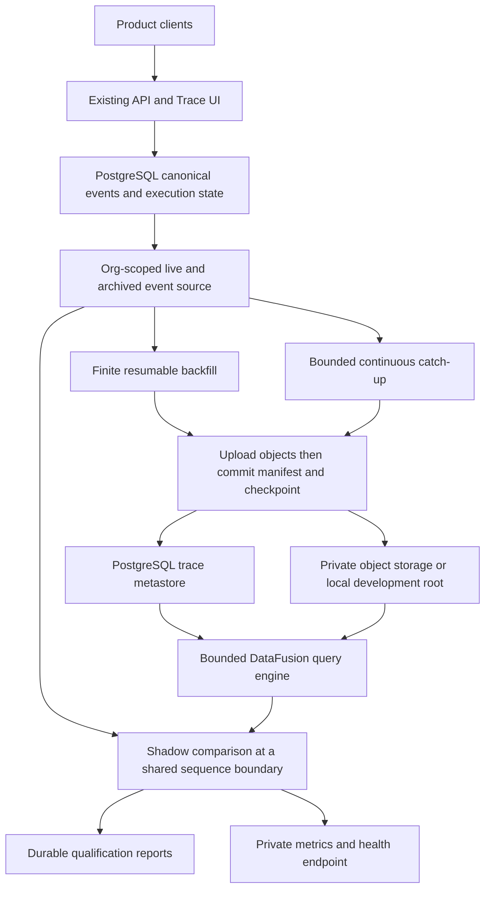

# Optional DataFusion Trace Storage and Parallel Qualification

Status: optional backfill and shadow implementation, qualified locally against
PostgreSQL and an S3-compatible service; no cloud deployment yet. PostgreSQL
continues serving every product read throughout this phase.

## Goal and decision

Separate trace storage cost and analytical queries from the operational database
without changing execution correctness. The optional engine uses Apache DataFusion,
immutable Parquet indexes, separate payload objects, and a PostgreSQL metastore.
ClickHouse is excluded by product direction.

Ship this as a companion executable. The server and Framework neither link
DataFusion nor require S3. Existing file/image blob configuration and the trace
store's object placement are independent: enabling one never enables the other.
The trace process is off by default and must not open a database connection,
create a directory, resolve object credentials, or bind a port while disabled.
An enabled process requires an explicit organization allowlist and a dedicated
object prefix. Missing configuration fails that optional process visibly; the
primary service remains independent.

This phase copies history and qualifies reads. It does not remove canonical
rows, route user requests to DataFusion, alter actor fencing, export customer
telemetry, or move billing authority. See [Events](../execution/events.md),
[Session Trace](../ui/session-trace.md), and [Reporting](../evaluation/reporting.md).

## Tradeoffs and scope of the experiment

| Choice | Benefit | Cost accepted here |
| --- | --- | --- |
| PostgreSQL only | Transactional replay and fast indexed session reads | Large retained envelopes compete with the operational workload |
| Document/key-value service | Managed point reads and ingestion | Additional service/index cost; analytical scans need a separate engine |
| Immutable objects plus DataFusion | Open formats, cheap durable bytes and embedded Rust queries | Object request/cold-read latency, compaction and a metastore remain our responsibility |

This qualification temporarily increases storage and source reads. It does not
save PostgreSQL capacity until a later, separately qualified retention/read-path
change removes canonical historical bytes. Measure that prospective benefit
against object requests, compute, metadata growth and operating cost. Session
reads may remain faster in PostgreSQL; a faster analytical engine is a hypothesis
to test, not a reason to move recovery or interactive reads prematurely.

## Component boundaries

| Component | Owns | Does not own |
| --- | --- | --- |
| Canonical database | Session identity, execution transactions, ordering, leases, billing | Analytical storage placement |
| Source adapter | One org's retained live and archived envelopes | User authorization or public payload disclosure |
| Backfill coordinator | Fixed session/head targets, progress and resumption | A moving definition of completion |
| Exporter | Bounded batches, immutable objects, atomic publication/checkpoints | Canonical event deletion |
| DataFusion engine | Typed predicates over explicitly selected manifests | Arbitrary SQL, bucket enumeration or execution replay |
| Shadow coordinator | Shared comparison boundaries, parity and timing evidence | Product response selection |
| Maintenance | Bounded compaction and physical collection | Retention policy approval |

The same storage contract supports S3-compatible and local-filesystem placement.
Cloud uses a private bucket/prefix. Local placement exists for testing and small
self-hosted qualification; it does not imply a shared filesystem architecture.
Deployment addresses, credentials, and cloud infrastructure belong in the private
SaaS repository, never in this public document.

## Data model and object layout

A segment contains a narrow Parquet index and an independently fetched payload
object. List/filter queries never fetch full prompts or tool results. A detail
read resolves an event through an org-scoped live manifest, reads a bounded byte
range, and verifies event identity and a checksum. Unknown event types, JSON
fields, tags and original identities survive the privileged copy format.

The metastore holds object placement, session checkpoints/tombstones, published
and retired segments, finite backfill targets, and the latest shadow evidence.
Exact schemas and indexes belong in migrations; exact configuration and commands
belong in the [operator guide](../../crates/trace-store/README.md).

Keys include a dedicated deployment prefix, tenant, session and unique segment
identity. Registration rejects overlapping prefixes. A placement name remains
bound to one physical bucket/root for its lifetime; relocating bytes requires a
new placement, not changing a running name's endpoint. No cross-tenant payload
hash sharing is introduced. GC removes current object versions; versioned buckets
and backups require separate lifecycle/deletion policies before claiming
all-version erasure. Object storage is private, encrypted, TLS-protected,
and co-located with compute where feasible.

## Write and recovery protocol

1. Acquire the store's shared maintenance lock, validate the live source session
   under org scope, and lock its export checkpoint.
2. Capture a committed sequence boundary and read one bounded source batch.
   Source ordering is the canonical sequence, never timestamp or UUID order.
3. Read both retained `events` and `archived_events`; deduplicate the same
   canonical identity during archival overlap. Conflicting identities at one
   sequence are corruption, not rows to silently discard.
4. Upload immutable payload and index objects using create-only keys.
5. Commit manifest publication and checkpoint advancement in one transaction,
   using the existing cancellation-safe transaction helpers.

No accepted event can reference an unfinished upload. A crash before publication
advances no checkpoint; retry can leave additional unreferenced objects but no
visible duplicate. A lost commit response is resolved by the persisted checkpoint.
Gaps in canonical sequences are valid. Progress records scanned boundaries rather
than assuming that every integer corresponds to an event. Source history missing
from both retained tables cannot be reconstructed; record missing coverage rather
than claiming a verified archive.

Compaction atomically replaces a bounded adjacent group of manifests, preserving
identities and sequence order. Retired files remain until collection. Tombstones
hide trace sessions and prevent re-export before physical deletion. Every read
also joins the live org-scoped source session, so deleting the source hides its
analytical copy immediately. Raw copied envelopes remain privileged: future
public API integration must preserve existing disclosure and unsupported-event
rules.

## Finite backfill and catch-up

Starting a backfill snapshots the current eligible sessions and each committed
head in a durable run. Run completion means those fixed targets have been
scanned; newly appended events and newly created sessions belong to catch-up.
Repeating a run resumes its targets and uses the existing per-session checkpoint.
A fresh run reuses copied history rather than rewriting it.

Each invocation processes a bounded number of sessions and batches. Persist
progress after each committed batch; an interrupted process resumes from those
commits. One bad session records a bounded failure and does not starve unrelated
sessions. Deleted sessions become explicit skipped targets. Status distinguishes
pending, copied, skipped and failed work; a run with failed targets cannot be
reported as successfully complete. Byte limits are enforced before transferring
large JSON from PostgreSQL into the process.

After the fixed backfill, a low-concurrency polling loop copies new events. It
prioritizes stale checkpoints and honors the same org allowlist. No synchronous
dual write is added to event emission: object-store failures cannot fail or slow
an agent append through an added application call. Catch-up errors are visible
through health, metrics and durable status, with bounded retries between cycles.

## Shadow comparison semantics

A shadow result is meaningful only when both stores answer the same question.
Capture the exported checkpoint and canonical head and choose their shared upper
boundary. Pin both source and object queries to that boundary. A source event
above it is ingestion lag, not a mismatch. Source deletion/tombstones produce an
explicit skip rather than a false success. Export failure, budget overflow and
object errors are comparison failures, never zero-row matches.

For each sampled session, execute equivalent bounded sequence-range queries:
compare event identities/order/type/timestamp and indexed correlations; separately
sample a complete envelope and compare its decoded JSON, metadata and tags.
Index parity alone cannot establish payload correctness. Use a round-robin
sequence cursor so long histories are covered over repeated cycles, not always
the first page. Record the comparison range, covered row count, source/export
heads, outcomes and independent source/DataFusion elapsed times.

The initial observer generates queries from actual session history in the allowed
orgs. It is a synthetic shadow workload, not a mirror of live HTTP requests.
Report that distinction with latency evidence. Future request mirroring can reuse
the comparison contract; it must be asynchronous, sampled, bounded and independent
of response latency. No product fallback/cutover is part of this phase.

## Measurement and privacy

Expose a separate private endpoint for companion health and Prometheus metrics.
Metrics use fixed low-cardinality outcome/operation labels, never session ids,
organization ids, prompts, tool arguments, object paths or credentials. Durable
operator status may identify the scoped session and comparison boundary but must
not store copied payloads, diff bodies or raw driver errors.

Measure copied events and errors; pending sessions and event lag; cycle age;
backfill targets/progress/errors; match, mismatch, lagging, skipped and failed
comparisons; summary/payload query latency for both stores; candidate segments;
compaction/GC activity. Histograms must retain bucket counts, not just averages.
A process being alive is separate from a recent successful cycle: readiness
requires a healthy recent cycle, while liveness only establishes the process is
running. Mismatch remains visible until a later successful comparison replaces it.

Keep the PostgreSQL pool small and worker concurrency low. Enforce
SQL/lock/object/query deadlines, row/byte/file budgets, no unbounded result sets,
and no DataFusion spill files. Its operator memory pool is not an OS RSS limit;
container/process resource limits remain necessary. The current store-wide GC
lock and listing ceiling are qualification constraints: collection is bounded
and scheduled conservatively, not advertised as a scalable production collector.

## Rollout, acceptance and rollback

| Phase | Action | Evidence before advancing |
| --- | --- | --- |
| Off | Ship optional code/configuration without enabling it | No S3 dependency, no new app connections or writes |
| Canary | Enable a limited org scope and bounded backfill | Source reads healthy, publication/retry/deletion tests pass |
| Backfill | Drain fixed targets and inspect status | Every target copied or explicitly skipped; zero unresolved failures |
| Parallel | Continuous catch-up and rotating shadow comparisons | Lag, parity, latency and error metrics available over a burn-in window |
| Evaluate | Compare cost and performance under representative load | Complete window/payload coverage, zero unexplained mismatches, acceptable DB impact |
| Future cutover | Separate proposal for a product read path | Authorization, retention, replay and public API contracts qualified |

Roll back by disabling/stopping the companion. PostgreSQL product reads and writes
continue unchanged; no rehydration is required because this phase deletes no
canonical data. Preserve catalog/object evidence while investigating. Stopping
the process is independent of erasing data or destroying infrastructure.

The deployment target and organization allowlist are explicit operator choices.
Qualification may run alongside a live deployment without changing product
traffic. Infrastructure recreation is separate from enabling this optional
backend. The companion applies its additive catalog DDL under its own checksum
ledger; it never adds versions to the running platform's `_sqlx_migrations`.
This preserves restart compatibility until a later platform version adopts the
same idempotent migrations through its normal migration path.

## Validation and remaining boundaries

Qualify disabled mode with missing credentials; live plus archived backfill,
resumption and a fixed target during concurrent appends; sequence gaps; conflicting
source identities; org isolation; object failure; source deletion; comparison
lag versus mismatch; payload corruption; comparison-window rotation; metrics
privacy and health degradation; unchanged default server dependency graph; and a
real object-store parallel run in addition to local PostgreSQL integration tests.

This design does not approve canonical retention, automatic TTL, a distributed
query service, full-text/JSON indexing, analytical aggregate APIs, or replacing
the canonical `EventReader`. Multi-page canonical snapshot replay needs separate
qualification. Exact implementation evidence and deployment blockers must remain
explicit rather than being inferred from this architecture.

## Sources of truth

- [Implementation and operator commands](../../crates/trace-store/README.md)
- [Initial catalog migration](../../crates/server/migrations/20261102213413_trace_store_segments.sql)
- [Lifecycle tests](../../crates/trace-store/tests/store.rs)
- [Object storage](../runtime-resources/object-storage.md)
