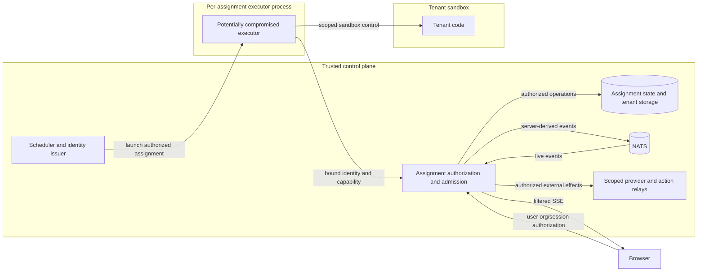

# Assignment-bound Worker Isolation

Status: **Proposed. Not implemented, deployed, or qualified.** This is the target
contract for replacing the trusted shared-worker assumption in
[TM-AUTHZ-002](threat-model.md). It is not a new mitigation claim. Implementation
and deployment require the gates in [qualification and rollout](worker-isolation-qualification.md).

## Required boundary

A compromised tenant executor must be unable to read, publish, mutate, spend, or
obtain credentials outside its server-authorized assignment. Org/session IDs,
actor-holder strings, broker subjects, and worker-supplied principal IDs are
selectors, never proof of authority. A capability for an assignment does not make
the executor an org owner or an internal server caller.

The trusted scheduler selects work across tenants; it and its credentials must
live outside tenant executors. Each executor process is confined to one tenant
or assignment and must not receive another tenant's capabilities, including
capabilities for later work in the same long-lived process. Reusing an executor
requires a qualified destruction/reinitialization boundary. Merely changing
keys between async tasks in a shared process does not provide that boundary.
The scheduler handles typed assignment lifecycle only; it does not execute
tenant model turns, tools, arbitrary cleanup scripts or sandbox workloads.

Tenant code inside a sandbox is a separate, weaker attacker position. Keep
worker/control-plane credentials outside the sandbox even when the executor is
trusted. The stronger executor model assumes the attacker can inspect all of
its process memory, files and environment, and send arbitrary protocol requests.
It therefore cannot rely on a client library choosing the right tenant.

Server, scheduler, capability store, broker, provider relay and deployment
identity issuer remain trusted. Container separation does not protect against
their compromise or a compromised shared kernel/host. A VM can contain a guest
kernel compromise, but an ordinary VM does not protect its memory from a
compromised hypervisor/host. A host-compromise claim needs separate host trust
domains or an explicitly qualified hardware boundary and its privilege
assumptions; neither is established here. Cache/timing side channels and
availability under total shared-infrastructure exhaustion are not covered by a
logical tenant-data isolation claim.

These are logical trust boundaries. Deployment evidence must establish the
actual process/credential boundaries and any separately claimed host isolation.

## Threats and assets

Protected assets include messages and journals, workspace and image bytes,
checkpoints, sandbox bindings, user/agent identities, connection and MCP grants,
provider secrets, invocation authority, accounting and payment state, and
assignment/control metadata. Even read-only discovery and notification streams
can reveal another tenant's work.

The attacker may hold a valid capability for tenant A, know tenant B's IDs, forge
all request bodies, replay traffic, use several connections, lose responses,
race cancellation/reassignment/grant revocation, or reconnect after any component
restarts. It may call an obsolete RPC or a nested operation inside a generic RPC.
Network access to a listener is insufficient to authorize any such call.

The current [worker protocol](../../crates/internal-protocol/proto/worker.proto),
[RPC delegation](../../crates/server/src/worker_link/grpc_service/worker_service_impl.rs),
[HTTP byte routes](../../crates/server/src/api/internal_blobs.rs), and
[direct adapters](../../crates/server/src/worker_link/direct_worker_adapters/mod.rs)
are the inventory sources. The present protocol has 65 methods in 19 handler
groups. That count is a review baseline, not a maintained copy of the API.
Implementation must mechanically enumerate descriptors and nested command
registries so an unclassified new operation fails validation rather than
inheriting access.

## Identity, assignment and capability

Use a distinct authenticated executor identity, established by the deployment's
workload identity mechanism. It may prove possession only for itself; it cannot
choose a scheduler role, register arbitrary trusted labels, or mint assignments.
The scheduler must authenticate as a separate service principal. Delivering the
existing shared bearer token to both principals defeats this separation.
Require mutually authenticated workload identity over protected transport, or a
qualified local identity broker that binds the same proof to an isolated IPC
peer. A caller-controlled identity header is not proof. Both client and server
must enforce the transport contract; current
[worker connection setup](../../crates/worker/src/grpc_adapters/connect.rs)
does not establish this new boundary. No plaintext or unbound-identity fallback
is allowed for a scoped executor.

The server owns the assignment record and its immutable tenant, permitted session
and resource scope, invocation provenance, executor identity, and current lease
generation. Actor fences remain concurrency checks within that authorization;
they do not authenticate the executor.

Prefer an opaque, unguessable capability with at least 256 bits of randomness,
stored server-side as a digest and bound to that identity and assignment. This
avoids making an offline signed token appear immediately revocable. Its validity
must end no later than the authoritative assignment lease; renewal re-evaluates
current authority and cannot extend a canceled or reassigned lease. Identity
issuance, capability creation and credential delivery are proposed operations,
not actions authorized by this design document.

Capabilities are not passed to tenant tools, inherited into sandboxes, logged,
placed in URLs, or made available through process-wide environment shared with
other tenants. Public API tokens and legacy worker tokens are not substitutes.
Server authentication and protected transport are required; a bearer capability
alone does not prevent a stolen token being used by another executor.

## One authorization edge

Before database access, byte reads, broker publication or an external side
effect, every executor operation resolves a server-owned assignment and checks:

- The authenticated executor, active capability and current assignment agree.
- Tenant/session/parent/invocation/resource selectors are within that scope;
  contradictory supplied values are rejected, not used to select a new scope.
- The lease, capability and relevant grants are live, not expired, canceled,
  reassigned, or revoked. Time is evaluated by the server.
- The operation is explicitly permitted for this assignment purpose and obeys
  current user/agent resource grants, spend limits and rate limits.
- Its replay identity and bounded resource admission are valid.

The resulting runtime caller must carry constrained assignment authority. It
must not be constructed as `Caller::internal` or silently upgraded to Owner.
An existing same-org ownership check remains necessary but is insufficient when
the client chooses the org. Existing scoped-resource policy still applies; this
design does not replace [resource ownership and grants](resource-access.md).

Authentication is not just a connection interceptor: streams are re-authorized
at each accepted batch/frame, and long byte streams use bounded admitted chunks.
Generic RPCs must authorize their decoded operation and target, not just their
outer method. Unknown methods, nested verbs or policy versions fail closed.

Carry the immutable server authorization context through listeners, deferred
effects and publication. Do not reconstruct authority from event metadata.
Runtime observations cannot forge user-origin input, management authorization,
grants or accounting receipts. Protected initiator/agent/assignment provenance is
server-derived, not a caller value kept by an `or_insert` convenience. Billing
and shared-provider health use trusted relay observations rather than trusting
arbitrary generation/circuit reports from a compromised executor.

### Authority families

The following families cover the handler groups without duplicating their wire
definitions. Exact methods remain in the protocol and delegated handlers above.

| Family | Executor authority | Authority retained by trusted services |
|---|---|---|
| Messages, journals, compaction and partial streams | Assignment session and approved invocation; reads require scope too | Cross-session/history discovery and reassignment |
| Events and exec receipts | Allowed event types for the assignment, ordered/replay checked; server derives subject and identity metadata | Broker credentials, durable append coordination, receipt arbitration |
| Session, agent, harness and model resolution | Assigned session plus explicitly referenced definitions/resources; constrained status/title transitions | Arbitrary org resource management and deployment defaults containing secrets |
| Durable task lifecycle and worker registry | Complete/fail/heartbeat only the assigned task attempt; bounded self-telemetry | Claim-all dispatch, trusted registration labels, draining or deleting other workers |
| Actor and detached-call lifecycle | Renew/release only the authorized lease; detached child receives a narrower, independently revocable assignment | Cross-org actor leasing, expiry/reaper scans and cleanup dispatch |
| Resource cleanup and orphan task scans | A dedicated cleanup assignment can name one authorized resource | Cross-org claim/prune/scan loops and credentials for unrelated resources |
| Images, files, sandbox state and SQL databases | Authorized object/mount/database handles, including upload and persistence operations | Object-store credentials, encryption root keys and cross-tenant sandbox/provider control |
| Credentials, MCP and user-store operations | Use only invocation-authorized resource grants through scoped handles/relays | Raw deployment provider keys and secret/signing authority |
| Generic commands and platform operations | Decoded, permitted runtime operations; intentionally authorized management runs execute server-side with current management policy | Generic internal/Owner caller construction and unrestricted platform surfaces |
| Scheduled channels, agent triggers and notifications | Only assignment control/cancel messages and explicitly delegated child work | Global triggers, shared task-notification subscriptions and queue discovery |
| Budgets, limits, Slack actions and machine payments | Server-derived tenant and initiator, permitted target/action, bounded spend and idempotent side effect | Arbitrary account/installation selection, budget mutation and payment authority |
| Circuit breaker state | Decision for an authorized provider route | Global success/failure observations recorded by the trusted provider relay, not forged executor reports |

Management tools need a separate server-validated invocation purpose, current
principal permissions and explicit targets. They must not regain generic Owner
authority through a different JSON dispatcher. Features without a scoped
replacement block migration for that workload; compatibility is not permission
to downgrade authentication.

The internal blob signer currently shares worker authority. A strict executor
must receive neither that signer nor object-store credentials. Replace it with
server-issued object handles bound to assignment, operation and validity, checked
on every new byte admission. A legacy signed URL must not bypass revocation or
let an executor choose an upload org. Direct/in-process adapters are trusted
server paths only; an executor with a database handle is not isolated by RPC
authorization.

Deployment-level provider keys must stay in a trusted relay; returning one through
an otherwise scoped credential RPC exposes authority shared by other tenants.
Tenant-owned resources still require current grants and constrained egress.
Moving a secret into a sidecar sharing the compromised executor's readable
memory/files/IPC does not establish a new trust boundary.
The same concern applies to personal OAuth tokens or reused keys whose upstream
privileges exceed the assignment. A local grant does not narrow a copied raw
credential. Direct delivery is acceptable only when the upstream independently
enforces at most the permitted scope and validity; otherwise use the trusted
relay or keep that feature outside the qualified executor mode.

## Revocation, replay and effects

Choose one linearization point: a server admission transaction checks the current
assignment/grant generations and records the accepted operation identity before
performing the permitted effect. Revocation and reassignment serialize against
that admission state. A stale cache may accelerate data retrieval, but cannot
authorize an admission past a committed revocation. Loss of the authoritative
store fails closed; a TTL cache or asynchronous invalidation alone cannot meet
immediate revocation semantics.
Cache keys include server-resolved scope and generation; a warm history or
definition cache must not bypass the same authorization required for a cold
read. Message/cursor selectors cannot be resolved through a foreign session.

Revocation prevents **new admission** after its server commit. Work admitted
before it may still complete or arrive over an already-buffered network path;
the server cannot retract delivered bytes. The protocol and audit receipts must
make this distinction visible. Effects requiring a stronger cancellation rule
need their own transactional/relay boundary and must be qualified separately.

Durable mutations record idempotency and the journal/effect receipt atomically.
A repeated identical operation may return its prior receipt but must not execute
again; the same ordinal with different content, an old generation, a gap or an
unrecognized replay is rejected. Payments and external actions need their
existing server-side idempotency and authority checks as well.

Ephemeral delta bodies remain out of PostgreSQL. Persist only bounded admission
metadata/high-water and replay receipts as required by the chosen protocol;
qualify the database cost per batch. Do not claim exactly-once token delivery:
a crash between acceptance and broker confirmation can lose an ephemeral update.
Return separate accepted, broker-confirmed and durably-committed outcomes where
applicable. Final durable messages and reconnect replay restore the transcript.
An uncertain broker acknowledgement must not cause blind republishing.

Server failover advances/fences the admission generation before accepting work
and refuses old capabilities. Receipt retention and ordinal resumption must be
bounded and explicit. A restarted server cannot reset replay state while
continuing to accept the same old capability.

## Bounded server-mediated streaming

Keep NATS credentials and subject construction in the server. Negotiate actual
server delivery capabilities and limits over the authenticated protocol; the
worker's `NATS_URL` is not capability discovery. A strict client cannot fall back
to the legacy trusted-worker protocol when negotiation is missing or fails.

Use ordered per-assignment queues with fixed event-count, byte and in-flight
windows, plus executor, tenant and global budgets. Validate aggregate stream
limits incrementally before collection. Derive a maximum resident-memory bound
from those limits and maximum admitted executors; configure and test actual
values before rollout. Do not replace a mutex with unbounded background tasks.

Backpressure must pause the producer or refuse a bounded admission. Coalescing
is allowed only for unadmitted accumulated deltas of the same assignment,
message and generation; it cannot cross tenant/session boundaries or remove
durable/terminal events. Assign ordinals after any such coalescing. A terminal
event waits for prior accepted work and reports its actual durable result.
Reconnect resumes from acknowledged receipts within bounded retry/deadline
limits, without letting completion overtake a late background delta.

Qualify first-delta, inter-delta and terminal latency, throughput, fairness,
memory, database operations and reconnect behavior with the authorization checks
enabled. A faster path obtained by dropping more updates or bypassing live
assignment checks is not an acceptable performance result.
